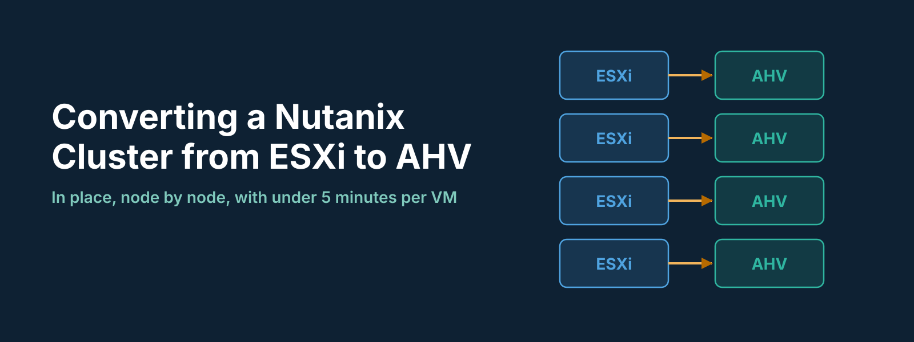
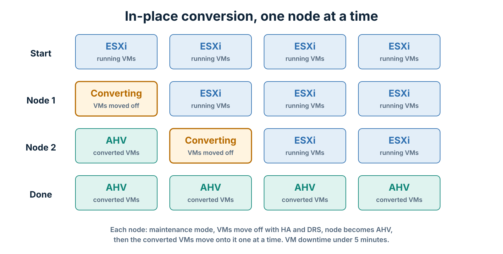
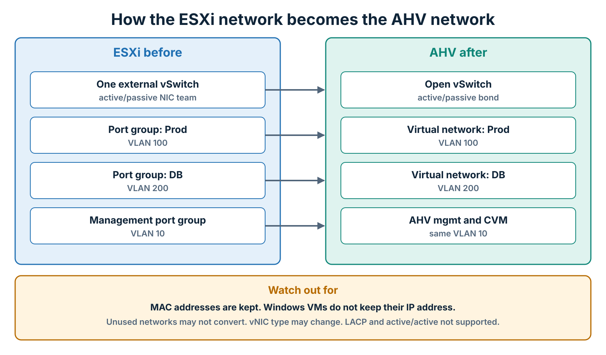
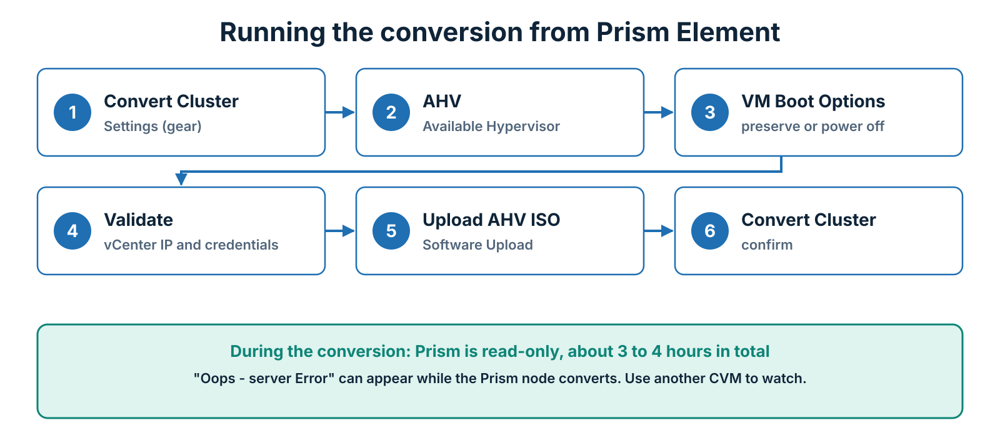
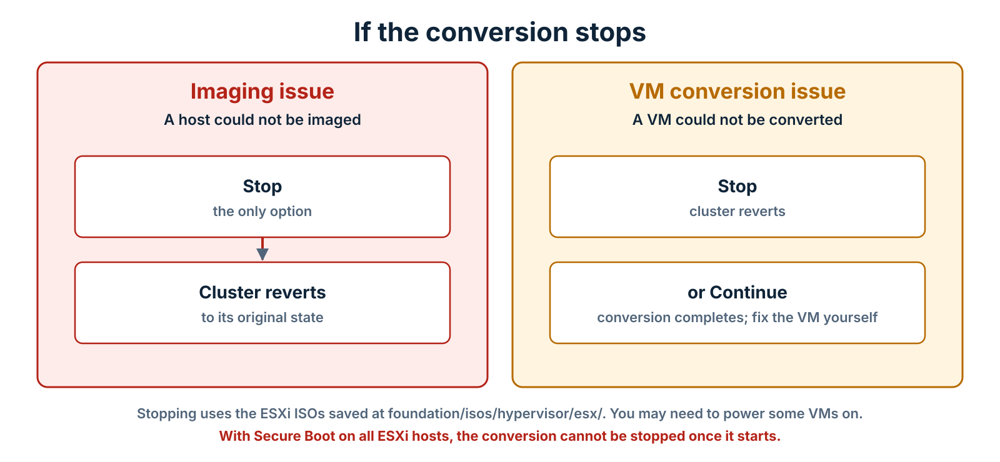

There are two ways to move a Nutanix cluster from VMware ESXi to AHV. The first is to build a new AHV cluster and move the VMs across with Nutanix Move. That's what we did on the large VMware migration I led this year, because the workloads were going to a new site anyway. The second is to keep the hardware, keep the data where it is, and convert the cluster itself. Nutanix calls this **In-Place Hypervisor Conversion**, and it's built into Prism Element.

In-place conversion works well, but only when the cluster meets a long list of conditions. Most of the work is checking those conditions before you click anything. This post covers what the conversion does, what blocks it, how to prepare the network and the VMs, the procedure itself, what to do if it stops, and how to go back to ESXi if you need to.

| Written against | Version |
|---|---|
| AOS | 7.6 (Prism Element Web Console Guide) |
| Source hypervisor | ESXi 8.0 |
| Direction | ESXi to AHV, with notes on going back |

## What the Conversion Does

The conversion takes an existing ESXi cluster and turns it into an AHV cluster. All the VMs running on the cluster are converted so they can run on AHV, and the storage stays where it is. Nutanix designed it to keep VM downtime short:

- **It's rolling.** One node is converted at a time. Each VM is down only for its own shutdown and conversion time, which Nutanix puts at **less than 5 minutes**. Earlier versions of the feature had VM downtime of 3 to 4 hours.
- **VM power state is kept.** A VM that was running before the conversion is powered on again afterwards, unless you choose to power everything off.
- **MAC addresses are kept.** Whether the IP address survives depends on the guest OS. Nutanix's note is that some Linux distributions typically keep the IP when the MAC is preserved, but **Windows doesn't**.
- **It can be reversed.** You can convert the cluster back to ESXi. The reverse conversion is a file system restore of the host, so the cluster ends up close to what it was before.
- **Prism stays up but read-only.** You can watch the progress, but you can't make changes until it finishes.

The whole conversion can take **3 to 4 hours**, depending on the number of nodes.

## Is Your Cluster a Candidate?

Check the blockers first. If any of these apply, either remove the blocker or use Nutanix Move to a new cluster instead.

| Blocker | Why it matters |
|---|---|
| Fewer than three ESXi hosts | The minimum is three ESXi hosts. Single-node and two-node clusters aren't supported, and AHV storage-only nodes don't count towards the three. |
| Prism Central VM running on the cluster | Not supported. Move Prism Central first with Prism Central Backup and Restore. Not every Prism Central feature moves this way, so check its limitations. |
| Nutanix Files deployed | Not supported. |
| Nutanix Objects | Not supported. If you convert the cluster that hosts Objects, the Objects cluster becomes unmanageable. |
| Microservices Platform (MSP) VMs on the cluster | Not supported. Converting disrupts the MSP VMs. |
| Metro Availability protection domains | Must not be enabled. |
| Container-level encryption | Clusters with it can't be converted. |
| Network segmentation activated | Conversion isn't possible while segmentation is on. |
| Containers not at RF2 | Nutanix asks for containers at replication factor 2, which gives fault tolerance 1, to keep data available during the conversion. |

Nutanix also warns that the conversion can lead to the loss or failure of Prism Central features such as Self-Service, Objects and Files, and that affinity policies aren't honored after conversion to AHV. Plan to recreate any affinity rules afterwards.

Mixed clusters are supported. A cluster with ESXi nodes and one or more AHV nodes can be converted, as long as it has at least three ESXi hosts.

## How It Works, Node by Node

When you start the conversion, Nutanix works through the cluster like this:

1. The first ESXi node goes into maintenance mode. vSphere HA and DRS migrate its VMs to the other ESXi nodes.
2. The empty node is converted to AHV.
3. The VMs that moved off it are converted and migrated to the new AHV node, one at a time.
4. The same happens to the next node, and the next. On the last ESXi node, the VMs are converted and migrated to the AHV hosts, and then that host is converted too.

*Figure 1: The conversion empties one ESXi node at a time, converts it to AHV, and moves the converted VMs onto it.*
{: style="text-align: center;"}

When a VM is converted, its source vDisk isn't modified. If a fatal error happens while imaging a host or storing or restoring its configuration, the conversion stops and asks you to stop it, and the cluster can be brought back to where it started.

### What happens to the network

Before converting, Nutanix records every ESXi port group, its VLAN ID, and which VMs belong to it. On AHV, it creates a matching **virtual network** for every unique port group, with the same VLAN ID, and connects the VMs to it. If the management port group uses a VLAN, the AHV management interface and the CVM's public interface are placed in that same VLAN.

*Figure 2: Port groups become AHV virtual networks with the same VLAN IDs. The vSwitch becomes an Open vSwitch with an active/passive bond.*
{: style="text-align: center;"}

A few details are lost or changed on the way:

- The vSwitch becomes an **Open vSwitch** on AHV. Active/active teaming isn't supported and is converted to **active/passive**.
- **Networks that no VM uses** before the conversion may not be converted.
- The VM's **virtual NIC type** may change, for example from VMXNET3 to E1000.
- **Serial ports** and **vGPU** configurations may be lost.
- On Linux, **interface names** may change to a generic name. Nutanix's example is RHEL 7, where `enoXXXX` becomes `eth0`. You may have to reconfigure the network settings in the guest.

## Preparing the Cluster and vCenter

Prepare these at least a few days before the change:

- **Health:** resolve every NCC alert, including warnings, failures and errors, and upgrade the firmware to the latest version with LCM. Nutanix lists both as prerequisites.
- **vSphere HA and DRS** must be enabled. The conversion relies on them to evacuate each node.
- **One vCenter:** all hosts must be managed by the same vCenter Server.
- **vCenter off the cluster:** the vCenter Server VM that manages the cluster must not run on the cluster you're converting.
- **The AHV ISO:** download the AHV ISO that's compatible with your AOS version from the Nutanix Support Portal.
- **The ESXi ISOs:** save the ESXi ISO for every ESXi version running in the cluster at `foundation/isos/hypervisor/esx/` on the cluster. If you stop the conversion, Nutanix uses these images to bring the cluster back to its state before the conversion.
- **ESXi version:** ESXi 8.0 versions are supported if they're in the ISO whitelist bundled with your AOS (`~/foundation/config/iso_whitelist.json`). If you've upgraded Foundation with standalone Foundation, that whitelist is invalidated, and the guide points you to `nutanix-packages.json` to check the original.
- **Keep the hosts in vCenter** after the conversion. If you remove them, you lose the option to convert back to ESXi.

### Secure Boot

If **Secure Boot** is enabled on all ESXi hosts, two things change. You can't convert back from AHV to ESXi, and once the ESXi to AHV conversion starts, you can't stop it. Be sure about the decision before you start.

## Preparing the Network

The conversion validates the ESXi network and fails if it doesn't match these rules:

| Item | Requirement |
|---|---|
| Physical NICs | Two or more homogeneous NICs of 1, 10 or 40 Gb |
| Standard vSwitch | **Only one external vSwitch per host.** More than one fails validation |
| Distributed vSwitch | Only one external distributed vSwitch per host |
| Internal vSwitches | None, apart from the Nutanix internal vSwitch |
| NIC teaming | One active NIC and the others passive. Active/active is converted to active/passive |
| LACP | Not supported |
| Unused adapters | Remove them under **Teaming and Failover** in vCenter. Keep only active and standby adapters of the same speed |
| Port groups | Present on all hosts. The conversion may move VMs to a different host |
| Backplane and management port groups | On the same vSwitch, and not renamed |
| CVM and guest VM networks | The CVM NICs and the guest VM NICs on separate networks |

If the cluster uses LACP today, change the teaming before the conversion window. That change happens on a live ESXi cluster, so plan it as a separate change and check the physical switch side as well.

## Preparing the VMs

This is where most of the work is on a real cluster. Go through every VM:

- **VirtIO drivers.** For ESXi to AHV, VirtIO drivers are enough for VMs to boot, installed either through Nutanix Guest Tools (NGT) or on their own. Nutanix's prerequisite list goes further and says to install NGT on all VMs, because a VM without the drivers doesn't boot after conversion. If you plan to keep the option of going back to ESXi, NGT is required for the VMs to boot on ESXi again. So install NGT everywhere.
- **No snapshots.** Only VMs with flat disks are supported. Delta disks aren't, so delete any VMware snapshots before you start.
- **Disk controllers.** Only IDE and SCSI controllers are converted automatically. SATA and PCI disks are not supported.
- **Windows data disks.** Set the Windows SAN policy to `OnlineAll` for non-boot SCSI disks, so they come online automatically after the conversion.
- **Shared disks and volume groups.** VMs with attached volume groups or shared virtual disks aren't supported.
- **vSphere tags.** VMs that have NFS datastore folders with vSphere tagging can't be converted.
- **vTPM.** Prism Element doesn't support VMs with a virtual TPM. Features that can only be configured from Prism Central aren't kept for these VMs, and memory overcommit isn't enabled for them.
- **Windows IP addresses.** Windows doesn't keep its IP address after the conversion. Record the IP settings of every Windows VM, or have a script ready to set them again.

### Backups

Pause **all backup schedules** before the conversion, whether manual or from a backup application. A VMware snapshot taken during the conversion can make it fail. Before the window, also confirm how your backup product will protect the VMs once they're on AHV.

## Running the Conversion

1. Log in to the **Prism Element** web console.
2. Click the **gear icon** and select **Convert Cluster** on the Settings page.
3. From **Available Hypervisor**, select **AHV**.
4. Choose the **VM Boot Options**:
   - **Preserve power state of the user VMs:** VMs keep their current state. Running VMs come back up after the conversion.
   - **Power Off User VMs:** all VMs are powered off before the conversion starts and stay off afterwards.
5. Click **Validate**, enter the **vCenter Server IP address** and the vCenter administrator username and password, and click **Yes**. Prism checks every requirement. If something fails, the message tells you what to fix.
6. In the **Software Upload** dialog, upload the AHV ISO you downloaded.
7. Click **Convert Cluster** and confirm.

*Figure 3: The conversion is started from Prism Element. Validation runs against vCenter before anything changes.*
{: style="text-align: center;"}

### During the conversion

- The cluster goes into **read-only mode**.
- When the node serving Prism is being converted, you may see **Oops - server Error**. That's expected. Wait, or log in to Prism on another CVM for read-only access.
- Track the progress by logging in to Prism Element again.
- Expect **3 to 4 hours** for the whole cluster, depending on the number of nodes, with less than 5 minutes of downtime for each VM.

## If the Conversion Stops

Prism shows a message if something goes wrong, and what you can do depends on the kind of issue:

| Issue | Your options | What happens |
|---|---|---|
| **Imaging issue** | Stop only | Stopping reverts the cluster to its original state |
| **VM conversion issue** | Stop, or continue | If you continue, the conversion completes and keeps the VM in its current state. You then fix those VMs yourself |

*Figure 4: An imaging issue can only be stopped. A VM conversion issue can be stopped or continued.*
{: style="text-align: center;"}

To stop, click **Stop** when the message appears. The cluster goes back to its original state, which is where the ESXi ISOs you saved earlier are used. Depending on their state, you may need to power some VMs on manually afterwards.

Remember the Secure Boot rule: with Secure Boot on all ESXi hosts, there's no stopping once the conversion has started.

## After the Conversion

1. **Check every VM.** Make sure it booted and its applications work. Start with the Windows VMs, because they won't have kept their IP addresses.
2. **Check Linux networking.** Look for interfaces renamed to a generic name and fix the network configuration if needed.
3. **Check the AHV networks.** Confirm a virtual network exists for every VLAN you need. Networks that no VM used before the conversion may be missing; create them now.
4. **Recreate what didn't carry over:** affinity rules, vGPU and serial port configurations.
5. **Restart backups** with a solution that supports AHV.
6. **Run NCC** and resolve anything it reports.
7. **Keep the hosts in vCenter** until you're sure the conversion is successful. Removing them too early affects the reverse conversion.

## Going Back to ESXi

The reverse conversion uses the same **Convert Cluster** page with **ESXi** selected. It's only possible on a cluster that was converted from ESXi in the first place. You can't start a conversion on a cluster that was built as AHV.

- You need the ESXi ISO for **the same major ESXi version** you converted from. If it isn't stored on the cluster, you upload it during the process, one for each ESXi version that was in the cluster.
- **NGT must be installed** on the VMs for them to boot on ESXi.
- **Remove any nodes added after the conversion** to AHV before you start.
- **VMs created on AHV after the conversion are kept** when you convert back.
- Converted VMs move to the **highest hardware version** that the ESXi version supports.
- All VMs **may end up on a single host**, and the network configuration you defined for them may not be kept. Changes you made to the AHV network may not carry back either.
- On Linux VMs, the **guest OS type** may change to a generic one, for example RHEL 7 becoming Other Linux 64-bit.
- All cluster operations stop while it runs. Nutanix's example is **2 to 3 hours** for a three- or four-node cluster, with less than 5 minutes of downtime for each VM.
- When it finishes, the hosts are **registered to vCenter automatically**.

## A Checklist You Can Copy

| Area | Check |
|---|---|
| Blockers | At least three ESXi hosts |
| | No Prism Central VM, Files, Objects, MSP VMs or Metro protection domains on the cluster |
| | No container-level encryption; network segmentation not activated |
| | Containers at RF2 |
| Cluster | NCC clean, firmware updated with LCM |
| | AHV ISO compatible with the AOS version downloaded |
| | ESXi ISOs for every ESXi version saved at `foundation/isos/hypervisor/esx/` |
| | ESXi version in the AOS ISO whitelist |
| vCenter | HA and DRS enabled, all hosts in one vCenter, vCenter VM not on this cluster |
| | Secure Boot status known, and its effect on stopping and going back accepted |
| Network | One external vSwitch or DVS per host, no internal vSwitches except Nutanix's |
| | Two or more homogeneous NICs, active/passive, no LACP, unused adapters removed |
| | Port groups on all hosts; backplane and management port groups on the same vSwitch, not renamed |
| | CVM and guest VM networks separate |
| VMs | NGT (VirtIO) installed on every VM |
| | No snapshots, no SATA or PCI disks, no shared disks or volume groups, no tagged NFS datastore folders |
| | Windows SAN policy `OnlineAll`; Windows IP settings recorded |
| | vTPM, vGPU and serial port VMs identified |
| | Backup schedules paused |
| After | VMs checked, Windows IPs set, Linux interfaces fixed |
| | Missing networks, affinity rules, vGPU and serial ports recreated |
| | Backups restarted on an AHV-capable product, NCC clean |
| | Hosts kept in vCenter until the result is confirmed |

## Closing Thoughts

In-place conversion is the shortest way from ESXi to AHV when the hardware is staying. Five minutes of downtime per VM and a built-in way back make it easy to approve as a change. The catch is the list of blockers and requirements. Clusters that have been running for years usually carry something that breaks the rules: a second vSwitch, an LACP team, old snapshots, a Prism Central VM. Find those first, and the conversion becomes a long wait on a Prism progress bar.

If the cluster doesn't qualify, or you're moving to new hardware anyway, Nutanix Move to a fresh AHV cluster is the better route.

*Requirements and steps in this post follow the Prism Element Web Console Guide for AOS 7.6. Check the guide for your own AOS version before planning a conversion.*
