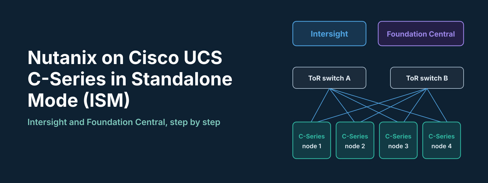
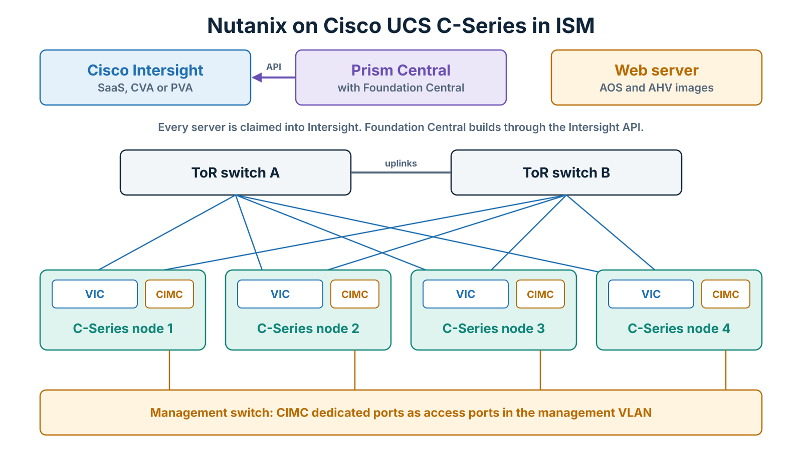
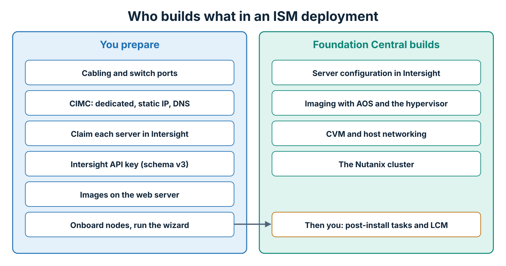

Of the three ways to run Nutanix on Cisco UCS, **Intersight Standalone Mode (ISM)** has the fewest moving parts. The servers are Cisco UCS C-Series rack servers, connected straight to a pair of top-of-rack switches. There are no Fabric Interconnects and no UCS Manager. Each server is claimed into Cisco Intersight on its own, and **Foundation Central** builds the Nutanix cluster through Intersight: it creates the server configuration, images the nodes and forms the cluster.

This post walks through an ISM build from cabling to the first LCM firmware update, with the decisions that matter at each step. If your design has Fabric Interconnects, or you're using X-Series modular servers, read [the IMM and UMM article](/hybrid-infrastructure/nutanix/cisco-ucs/2026/11/09/nutanix-cisco-ucs-imm-umm-deployment.html) instead. The steps there are different.

| Based on | Version |
|---|---|
| Cisco design guide: Cisco Compute Hyperconverged with Nutanix in ISM | Updated December 2025 |
| Cisco field guide for ISM | The guide Cisco maintains on its community site |
| Nutanix Life Cycle Manager guide (Cisco UCS specifications) | LCM 3.4 |
| Hypervisor in this post | AHV, with ESXi notes where the steps differ |

## How an ISM Cluster Fits Together

*Figure 1: An ISM cluster. Each node connects its VIC to both top-of-rack switches, and its CIMC to the management network. Intersight and Foundation Central do the build.*
{: style="text-align: center;"}

There are four pieces to bring together:

- **The servers.** Cisco UCS C-Series rack servers in a Nutanix-qualified configuration. Cisco's design guide validated the HCIAF240C M7 All-NVMe server. Each server has a Cisco VIC (mLOM or PCIe) or a supported third-party NIC for data, and a dedicated CIMC port for management.
- **The switches.** A pair of top-of-rack switches. Cisco validated the design on Nexus 93180YC-FX switches with 25G ports, but ISM doesn't depend on a particular switch.
- **Cisco Intersight.** The SaaS service, or the Connected or Private Virtual Appliance if the site can't reach the cloud. Every server is claimed into it.
- **Foundation Central.** The Nutanix service that talks to Intersight through an API key and does the build.

The split of work is what makes ISM simple: you prepare the switches, the CIMCs and the Intersight claim, and Foundation Central does everything from the server configuration up.

*Figure 2: The split of work in ISM. You build up to the Intersight claim; Foundation Central does the rest.*
{: style="text-align: center;"}

## What You Need Before You Start

| Item | Requirement |
|---|---|
| Servers | Cisco UCS C-Series servers qualified for Nutanix. Check the Nutanix hardware compatibility list for your AOS version |
| Cisco Intersight | SaaS, Connected Virtual Appliance or Private Virtual Appliance, with enough licenses. Cisco's design guide names the **Advantage** tier as the one that enables server profile configuration and the Foundation Central integration |
| Cisco account | Your Cisco ID needs software download access, so Intersight can fetch server firmware. If it doesn't have it, use the **Activate** link Cisco provides |
| Prism Central | With Foundation Central enabled. Cisco's guides require Foundation Central 1.6 or later |
| Web server | An HTTP server that the **CIMC network** can reach, hosting the AOS package and the hypervisor installer. From AOS 6.8, the AOS installer no longer includes AHV, so you need the AHV ISO as a separate file |
| DNS and NTP | Working for Intersight, Prism Central and the CIMCs. DNS is essential: Foundation Central and the CIMCs must resolve the Intersight domain name |

### Where Foundation Central runs

Foundation Central is a service inside Prism Central. On a greenfield site there is no Nutanix cluster yet to host Prism Central. The Cisco guides describe two ways around this:

- **Prism Central on an existing Nutanix cluster** elsewhere in the environment. This is the clean option when it's available. Cisco's design guide uses pc.2023.4 or later for this case.
- **A temporary Prism Central on a non-Nutanix ESXi host**, deployed from the pc.2022.6 OVA. You build the first cluster from it, then deploy your permanent Prism Central on the new cluster. Treat the temporary one as disposable.

**What about the Foundation Central Appliance?** When I first wrote this post, a standalone Foundation Central appliance was on the Nutanix roadmap. It now exists: the Foundation Central Appliance is a VM that doesn't need Prism Central. But check its scope before you plan around it. Version 2.3.0.1 deploys hyperconverged clusters only on **Cisco Unified Edge** platforms through Intersight. Its other workflows are compute-only clusters on Dell, HPE and Lenovo servers, and NKP Metal imaging. For a hyperconverged cluster on C-Series rack servers in ISM, Foundation Central in Prism Central is still the documented path. Check the appliance release notes for the version you have, because its support list is growing.

## Step 1: Cable the Servers and Configure the Switch Ports

### Cabling

Cisco's field guide supports these layouts:

- **One VIC, two cables:** one cable to each switch.
- **One VIC, four cables:** ports 1 and 2 to switch A, ports 3 and 4 to switch B.
- **Two cards:** port 1 of each card to switch A, port 2 of each card to switch B.

Two rules from the same guide:

- **Don't mix** Cisco VICs and third-party NICs in the same server.
- With two cards, **connect only the first card during installation**. Connect the second one after the cluster is built.

The CIMC dedicated management port goes to your management switch, as an access port in the management VLAN.

### Switch ports

Decide early whether the host ports will be **trunk** or **access** ports, because the cluster wizard asks for it later:

| Mode | When to use it | What you set in the cluster wizard |
|---|---|---|
| **Trunk** | Several VLANs reach the servers. The normal choice for production | Enter the VLAN ID for the hosts and CVMs. The VIC ports are set to trunk mode |
| **Access** | All traffic uses one VLAN | Leave the VLAN ID blank. The VLAN is set on the switch port |

Cisco's field guide adds some switch settings:

- **Native VLAN:** some third-party switches need a trunk with a native VLAN instead of an access port. The guide explains why: VIC ports in access mode send a VLAN header with no ID.
- **Spanning tree:** set the host ports as edge trunk ports.
- **MTU:** 9216 is recommended, but not required.
- **No port channels before installation.** The cluster is built with the default **active-backup** bond. LACP is supported only with AHV, when you choose it while the nodes are re-imaged. Nutanix KB 16742 covers it.

### FEC on 25G links

The VIC's default forward error correction is **CL91 (RS-FEC)**, which acts as auto, and that suits 10, 40, 50 and 100G. Some **25G optics and cables need CL74 (FC-FEC)** instead. If 25G links stay down, check this first. The cluster wizard lets you set the FEC mode.

## Step 2: Configure the CIMC on Each Server

1. Connect a keyboard and monitor (or a KVM dongle) and press **F8** during boot to open the CIMC configuration utility.
2. Set **NIC mode** to **Dedicated** and **NIC redundancy** to **None**.
3. **Disable DHCP** and assign a **static IP address**, subnet mask and gateway.
4. Set a valid **DNS server**. The CIMC uses it to find Intersight.
5. Change the default **admin** password, then save with **F10**.

Repeat on every server. Then check from a browser that each CIMC answers on its new address.

## Step 3: Claim Every Server into Intersight

1. Log in to the CIMC web interface and go to **Admin > Device Connector**. Check the connector is **connected**, and copy the **Device ID** and **Claim Code**.
2. In Intersight, go to **System > Targets > Claim a New Target**.
3. Select **Cisco UCS Server (Standalone)**, paste the Device ID and Claim Code, and claim it.
4. Repeat for every server in the cluster.

With the Intersight Virtual Appliance, you claim the servers by **CIMC IP address and credentials** instead of a claim code.

If several teams share the Intersight account, put the Nutanix servers in their own **resource group** and **organization**. Foundation Central asks for the organization when it creates the cluster.

## Step 4: Prepare Prism Central and Foundation Central

1. Make sure **DNS and NTP** are set in Prism Central. Cisco's field guide notes that if Foundation Central was installed before DNS or NTP was changed, you should reboot the Prism Central VM before you build a cluster.
2. Enable **Foundation Central** in Prism Central.
3. Upgrade Foundation Central to the latest version with **LCM**. On an older Prism Central, such as the pc.2022.6 OVA, Cisco's guide upgrades it from the command line instead.
4. In Foundation Central, generate a **Foundation Central API key**. You select it at the end of the cluster wizard.

## Step 5: Connect Foundation Central to Intersight

1. In Intersight, go to **System > Settings > API Keys** and generate a new API key.
2. Select **API key for OpenAPI schema version 3**. That's the schema Nutanix supports for both Foundation Central and LCM.
3. Copy the **API Key ID** and save the **Secret Key** right away. Intersight shows the secret only once. If you lose it, generate a new key.
4. In Foundation Central, go to **Settings > Connect Hardware Provider** and select **Cisco Intersight**.
5. Choose the deployment type (SaaS, or the Connected or Private Virtual Appliance), enter the API Key ID and the Secret Key, and connect.

Foundation Central supports **one Intersight connection at a time**.

## Step 6: Stage the Installers

The nodes download the images over HTTP through the CIMC network, not through Foundation Central. Put these on your web server and test the URLs from a machine on the CIMC network:

- The **AOS** package and its metadata file.
- The **AHV ISO**. You need it as a separate file from AOS 6.8.
- For ESXi instead, the **Cisco custom ESXi ISO**.

Any web server that allows anonymous HTTP downloads works. A small Linux VM is enough.

## Step 7: Onboard the Nodes

In Foundation Central, go to **Nodes** and choose **Onboard Nodes**. Foundation Central lists the servers it can see through Intersight. Select **only the nodes that will be part of the Nutanix cluster** and onboard them.

If a server doesn't appear, check that it's claimed, that it's in a resource group your API key can see, and that it doesn't already have a server profile assigned.

## Step 8: Create the Cluster

Select the onboarded nodes and click **Create Cluster**. The wizard asks for:

| Section | What to enter |
|---|---|
| Cluster | Cluster name, replication factor, and the Intersight organization for the server configuration |
| Imaging | Use the AOS and AHV already installed at the factory, or **re-image** the nodes |
| AOS | The AOS download URL from your web server (when re-imaging) |
| Hypervisor | The AHV ISO URL, or for ESXi the Cisco custom ESXi ISO URL |
| Network | The host and CVM addresses, the gateway and subnet mask, and the **VLAN ID**: enter it for trunk mode or leave it blank for access mode |
| Uplinks | Keep the default active-backup bond. Select **LACP** only for AHV when re-imaging, and only if the switches are configured for it. Set the **FEC** mode if your 25G links need CL74 |
| Security | The Foundation Central API key from Step 4 |

Submit it and follow the progress in Foundation Central. It creates the server configuration for each node in Intersight, images the nodes and forms the cluster.

## Step 9: After the Cluster Is Up

Cisco's field guide lists these post-installation tasks:

1. Browse to Prism Element at `https://<cluster-IP>:9440`, log in as **admin** and change the default password. Accept the EULA and set up **Pulse**.
2. Create the **storage containers** you need.
3. Set the **rebuild capacity reservation**, so the cluster refuses new writes it couldn't protect after a failure.
4. Set the **iSCSI Data Services IP**. You need it to deploy Prism Central on the cluster, and for Volumes.
5. Change the default passwords on the hosts and CVMs, then run NCC's default password check again. On AHV 11.2, Nutanix asks you to set the AHV `admin` and `root` passwords from the **System Accounts** page in Prism Central, not over SSH, and to leave the internal `nutanix` account alone.
6. Run a full **NCC** and fix every warning and failure.
7. On AHV, enable the **VM high availability reservation** and create the VM networks (subnets) for your guest VLANs.
8. On ESXi, set NTP and DNS on each host, add the hosts to vCenter, create the guest port groups on every host, and select the HA datastores.
9. **Register the cluster with your permanent Prism Central.** If you built it from a temporary Prism Central, deploy the permanent one on the new cluster now and retire the temporary one.

### Two-node clusters

For a two-node cluster, Cisco's guide strongly recommends a **Witness VM**. Put it in a separate failure domain with its own power and network path, keep the round-trip latency to it under 200 ms, and make sure TCP 9440 to it bypasses any proxy. One Witness VM can serve up to 50 clusters.

## Day 2: Firmware Updates with LCM

Once the cluster is running, **LCM** handles both the Nutanix software and the Cisco server firmware. For M6 and M7 C-Series servers in ISM, LCM 3.4 supports software inventory and upgrade, **and firmware inventory and upgrade through Intersight**. M8 servers in Intersight mode are supported from LCM 3.2.0.1.

The first time you run an LCM firmware update, LCM asks for the **management mode**:

| Mode | What you provide | What LCM can do |
|---|---|---|
| Standalone CIMC | Nothing | Software only. No firmware inventory or upgrade |
| **Intersight** | A connection name, the deployment type (SaaS with region and URL, or the appliance URL), and an Intersight API Key ID and Secret Key (OpenAPI schema version 3) | Software and firmware |

Choose **Intersight** for an ISM cluster. Some details from the LCM guide:

- If the Intersight credentials **expire or become invalid**, LCM resets its auto-inventory settings. Enter new credentials and enable auto-inventory again.
- Credentials you entered in Prism Element **don't carry over** to the same cluster's view in Prism Central. Enter them again there.
- The LCM inventory **fails if any node is running the Foundation service** (KB-17108).
- On an **AOS 6.8** cluster, the Intersight mode may not appear at first, because AOS 6.8 ships with LCM 3.0. Run one inventory in Standalone CIMC mode to update LCM to 3.0.1 or later, and then Intersight mode becomes available.
- The pre-check `test_cisco_validate_credentials_and_setup` checks the Cisco credentials and setup before every inventory and update.

For the general upgrade order, pre-checks and what LCM does to your VMs, see [my upgrade article](/hybrid-infrastructure/nutanix/lifecycle/2026/11/20/nutanix-upgrade-aos-ahv-prism-central-lcm.html).

### Adding nodes later

Cisco added **cluster expansion with Foundation Central** to its ISM field guide in revision 2.0. Follow the steps in the current revision, and prepare the new servers with the same CIMC settings, Intersight organization, switch port configuration and VLANs as the existing nodes.

## A Checklist You Can Copy

| Stage | Check |
|---|---|
| Design | Servers on the Nutanix compatibility list for your AOS version |
| | Intersight account and license tier confirmed; Cisco ID has software download access |
| | Foundation Central location decided: existing Prism Central or temporary Prism Central on ESXi |
| | Trunk or access mode decided; VLAN IDs for hosts, CVMs and guests |
| Switches | One VIC cable to each switch, no mixed VIC and third-party NICs |
| | Edge trunk ports, MTU 9216 if possible, no port channels before install |
| | FEC checked for 25G optics and cables |
| | CIMC ports as access ports in the management VLAN |
| CIMC | Dedicated mode, no redundancy, static IP, DNS, admin password changed |
| Intersight | Every server claimed as Cisco UCS Server (Standalone); resource group and organization ready |
| | API key generated with OpenAPI schema version 3, secret saved |
| Foundation Central | DNS and NTP set in Prism Central, Foundation Central on the latest version |
| | Intersight connected as the hardware provider; Foundation Central API key created |
| | AOS and AHV (or Cisco ESXi) images on a web server the CIMC network can reach |
| After | Admin password, Pulse, containers, rebuild capacity reservation, iSCSI Data Services IP |
| | Host and CVM passwords changed, NCC clean, VM HA reservation enabled |
| | Cluster registered to the permanent Prism Central |
| | LCM set to Intersight management mode for firmware |

## Closing Thoughts

ISM is the most direct way to put Nutanix on Cisco hardware: two switches, claimed servers, and Foundation Central doing the build. Most of the problems I'd expect on an ISM install come before Foundation Central starts. A CIMC without DNS can't reach Intersight. A web server the CIMC network can't reach stops the imaging. An access port on a switch that needs a native VLAN means the links never pass traffic. Get those three right and the wizard does the rest.

When the design calls for Fabric Interconnects or X-Series, move on to [IMM or UMM](/hybrid-infrastructure/nutanix/cisco-ucs/2026/11/09/nutanix-cisco-ucs-imm-umm-deployment.html).

*Steps and settings in this post follow the Cisco design and field guides for ISM and the Nutanix LCM 3.4 guide. Check the current versions of both before you deploy, because menu names change between Intersight and Foundation Central releases.*
