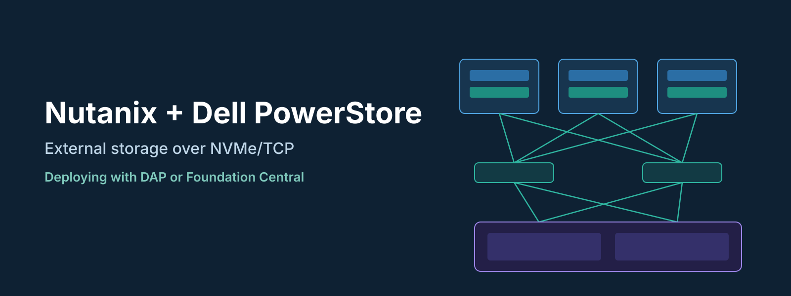
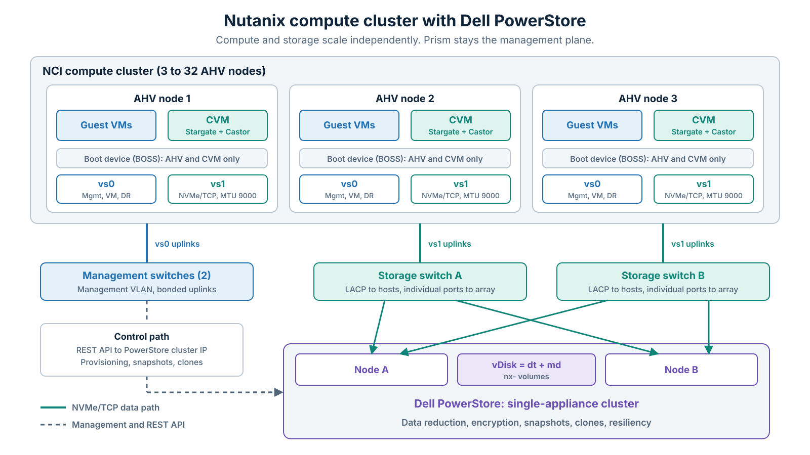
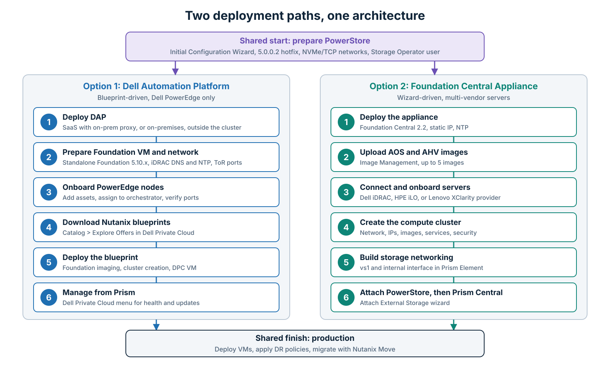

With **Nutanix Cloud Infrastructure (NCI) 7.6**, **Dell PowerStore** became a supported external storage platform for the Nutanix Cloud Platform. AHV runs on compute-only nodes, PowerStore serves the data over **NVMe/TCP**, and Prism stays the place where VMs, snapshots, and disaster recovery are managed.

There are two ways to build this solution: **Dell Automation Platform (DAP)** through Dell Private Cloud, or the **Nutanix Foundation Central Appliance**. They differ in more than the installer, because the choice also decides your hardware options, your licensing, and how you patch server firmware for the life of the cluster.

This guide covers the architecture, the shared prerequisites, both deployment workflows, and the constraints to check before you commit to a design.

* * *

## The Two Options at a Glance

| | **DAP (Dell Private Cloud)** | **Foundation Central Appliance** |
|---|---|---|
| **Servers** | Dell PowerEdge from the DPC support matrix | Dell iDRAC, HPE iLO, or Lenovo XClarity through a hardware provider; other HCL servers through manual AHV install |
| **Imaging engine** | Standalone Foundation VM, driven by a blueprint | Foundation Central Appliance 2.2 |
| **Initial cluster size** | 3 to 8 identical nodes | 3 to 16 nodes |
| **Maximum after expansion** | 32 nodes | 32 nodes |
| **PowerStore attach** | Part of the Dell automated workflow | Manual, from Prism |
| **Server firmware and BIOS** | Automated through DPC and DAP | Manual, node by node, with vendor tools |
| **Extra licensing** | DPC subscription per node, iDRAC Enterprise or Datacenter | None beyond NCI or NCI-C |
| **Extra infrastructure** | DAP outside the cluster, Foundation VM, DPC VM | Foundation Central VM |
| **Support model** | Dell system-level support, plus your Nutanix contract | Dell for hardware and PowerStore, Nutanix for AOS and AHV |

> **DAP does not use Foundation Central in this release.** Some Dell material says Dell Private Cloud automates AHV deployment through Foundation Central, but the DPC v1.2 Pre-Deployment Guide says otherwise: "Foundation Central is not supported with this release." For DPC v1.2, plan for a **standalone Foundation VM**.

* * *

## How the Architecture Works


*Figure 1: Compute cluster, redundant storage fabrics, and the PowerStore appliance.*

The **CVM stays**. Each node still runs one, but it boots from the local boot device (a BOSS card on PowerEdge) and manages no data disks. The nodes do not need internal capacity drives.

Three things change compared with HCI:

- **Data path:** Stargate uses a user-space NVMe initiator (SPDK) in the CVM to reach PowerStore over NVMe/TCP. Multipathing and queue depth are set by the software, not by you.
- **Control path:** A new CVM service called **Castor** manages the external storage entity. AOS calls the PowerStore REST API to create, map, snapshot, and clone volumes, so there is no manual LUN work.
- **Metadata:** Cassandra, Curator, and Zookeeper start on the boot device, then migrate to system volumes on PowerStore when you attach the array.

### vDisks Become PowerStore Volumes

There is no shared datastore or file system underneath. Each vDisk maps to **two PowerStore volumes**: a data volume (`dt`) and a metadata volume (`md`) that holds the metadata and changed block tracking. You will see them in PowerStore Manager with the prefix `nx-`.

Treat those volumes and the `nx-` host objects as read-only from the array side. Do not delete, map, unmap, or modify them, and run every snapshot, clone, and vDisk operation from Prism. A snapshot created directly on PowerStore does not appear in Prism.

### Who Owns What

| Function | Initiated from | Performed by |
|---|---|---|
| VM provisioning, snapshots, clones | Prism | PowerStore, through REST API offload |
| Compression, deduplication | Transparent to Nutanix | PowerStore (always on) |
| Data-at-rest encryption | Transparent to Nutanix | PowerStore |
| Data resiliency | Transparent to Nutanix | PowerStore Dynamic Resiliency Engine |
| DR replication (Async, Sync, Metro) | Prism Central | Nutanix, between compute clusters |
| AOS and AHV upgrades | Nutanix LCM | Nutanix LCM |
| PowerStoreOS upgrades | PowerStore Manager or DPC | PowerStore |

PowerStore array-based replication is not used, so all replication stays in Nutanix policy-based DR.

* * *

## Prerequisites for Both Options

### Software Compatibility

| Component | Minimum version |
|---|---|
| Nutanix AOS | 7.6 |
| Nutanix AHV | 11.2 |
| Prism Central | 7.6 |
| Foundation Central | 2.2 (Foundation Central option) |
| Nutanix Move | 6.3.0 |
| PowerStoreOS | 5.0.0.2 or higher |
| Dell Private Cloud | 01.02.00.00 (DAP option) |

### Compute Nodes

- **Cluster size:** At least 3 nodes. One-node and two-node clusters are not supported, even for non-production.
- **CPU:** 12 physical cores per socket on AOS 7.6.
- **Memory:** 64 GB per host at minimum. Nutanix lists the default CVM at 12 vCPU and 32 GB, while Dell's technical overview lists 16 vCPU and 32 GB, so size for the larger figure.
- **Network:** 4 physical ports per node, spread across at least 2 NICs. 10 Gbps is the minimum and Nutanix recommends 25 Gbps or higher end to end.
- **Boot device:** 240 GB usable at minimum, 480 GB in RAID 1 recommended. Dell Private Cloud requires BOSS-N1 cards.

### Dell PowerStore

- **Supported models:** All Gen 1, Gen 2, and Gen 3 appliances **except PowerStore X**. The Nutanix guide lists 500T, 1000T, 1200T, 3000T, 3200T/Q, 5000T, 5200T/Q, 7000T, 9000T, 9200T, 1500, 5500, and 9500.
- **Single-appliance cluster only:** Do not connect Nutanix to a multi-appliance cluster, and do not expand a single-appliance cluster that Nutanix uses.
- **Protocol:** NVMe/TCP over 10 GbE or faster. Other transports, including Fibre Channel, are not supported.
- **Licensing:** PowerStore licensing is all-inclusive, so no extra array license is needed. On the Nutanix side, compute-only nodes can use either NCI or NCI-C.

### Network Design

| Traffic | Virtual switch | Uplinks (Nutanix example) | MTU |
|---|---|---|---|
| Management, live migration, DR replication, guest VMs | `vs0` | Eth0, Eth2 | 1500 |
| External storage (NVMe/TCP) | `vs1` | Eth1, Eth3 | 9000 recommended |
| Out-of-band (iDRAC) | Not applicable | Dedicated port | 1500 |

The `vs1` split is technically optional, but both vendors recommend it, and network segmentation becomes **required** when the PowerStore interfaces sit on a separate data network.

Plan these items early:

- **Switches:** Dell's overview calls for 2 management switches and 2 storage switches.
- **LACP on the hosts only:** Nutanix recommends the Active-Active bond with LACP on the compute node ports, and a bond across two switches needs multi-chassis link aggregation (such as Dell VLT or Cisco vPC). On the array side it is the opposite: PowerStore NVMe/TCP must use **individual ports**, because user-defined link aggregations are not supported for this traffic.
- **Path count:** Give each host at least 2 paths to each PowerStore node (4 per appliance), and no more than 8 paths per volume.
- **Jumbo frames:** 9000 is recommended, not mandatory, but it must be consistent end to end. Dell recommends setting ToR ports to 9216.
- **IP addresses:** Each node needs IPMI, AHV, CVM, and one storage interface address. Nutanix recommends sizing the storage IP pool for 32 nodes.
- **Reserved subnets:** Avoid `192.168.5.0/24` on the default VLAN, plus `10.100.0.0/16` and `10.200.32.0/24`, which the cluster uses internally.
- **Services:** DNS and NTP are required.

Storage VLAN examples differ between vendors. Dell's overview uses 2 storage VLANs, while the Nutanix example uses 4 VLANs across 2 fabrics. Choose one layout and keep it consistent across the switches, PowerStore, and Prism.

* * *

## Step 1 (Both Options): Prepare PowerStore

Complete this before you touch the compute nodes.

1. **Initialize the array:** Run the **Initial Configuration Wizard**. Reserve IP addresses for node A, node B, the appliance, and the cluster management VIP.
2. **Create a service account:** Create a dedicated user for Nutanix. **Storage Operator** is the least-privileged role that works.
3. **Set the MTU:** For jumbo frames, set it in **two places** on PowerStore: the **Cluster MTU** and the **Storage Network**.
4. **Create the storage networks:** Create two NVMe/TCP networks, one per fabric, with the Storage (NVMe/TCP) purpose enabled. Map them to different front-end ports on both nodes.
5. **Install the hotfix on 5.0.0.2:** See the warning below.

> **Hotfix required on PowerStoreOS 5.0.0.2.** PowerStore anomaly detection is not compatible with Nutanix on this release. Install `PowerStore_hotfix_nutanix_support-5.0.0.2-2761356-retail.tgz.bin` under **Settings > Upgrades** after upgrading to 5.0.0.2 and **before** attaching Nutanix. It takes about 5 minutes and disables anomaly detection. Install it only on appliances that will connect to Nutanix.

* * *


*Figure 2: Both options share the same start and finish, with different automation in between.*

## Option 1: Deploy with Dell Automation Platform

DAP is the control plane and orchestrator behind Dell Private Cloud. It is a no-cost platform, but the Dell Private Cloud software that runs on it is a per-node subscription. It automates deployment using **validated blueprints**, which are Dell-tested templates written in TOSCA-based YAML.

### Phase 1: Choose and Deploy DAP

DAP must run **outside** the cluster you are deploying.

| Model | What runs on-premises | Key resources |
|---|---|---|
| **SaaS** | Orchestrator proxy (Kubernetes, or OVA on vSphere only) | OVA: 8 vCPU, 16 GB, 1 TB. Also needs a web server to host the Nutanix images |
| **On-premises appliance** | Portal and orchestrator on vSphere, AHV, or Hyper-V | 18 vCPU, 36 GB, 2.5 TB |
| **On-premises Kubernetes** | Portal and orchestrator on 1 or 3 nodes | Ubuntu or OpenShift: 16 vCPU, 32 GB, 1 TB per node |

For sites without internet access, use an on-premises orchestrator and upload components in this order: plug-ins, utility blueprints, then offer blueprints. Entitlements are also registered in advance through Dell MyAccount, and the license file is uploaded in the blueprint.

### Phase 2: Prepare the Foundation VM and Network

1. **Deploy the standalone Foundation VM:** Use version 5.10.x, with 4 vCPU, 6 GB RAM, and 80 GB of disk recommended. It must sit on the same subnet as the nodes, with **IPv6 multicast** and **DHCP** available.
2. **Update the whitelist:** Upload the latest `iso_whitelist.json` under **AOS/Hypervisor > View Whitelist**.
3. **Prepare iDRAC:** Configure a preferred DNS server and an NTP server on every node.
4. **Prepare the ToR ports:** If you use LACP, enable the **LACP individual** port setting, which DPC discovery requires.
5. **Create DNS records:** Add forward and reverse records for the cluster VIP and the DPC VM.
6. **Check storage space:** PowerStore needs 500 GB free for the DPC VM (4 vCPU, 16 GB RAM, 300 GB disk) and Nutanix shared storage.

> **Foundation 5.11 has one extra step.** It is required to discover Broadcom 57412 and 57414 NICs, but its `diskless_cvm` attribute is disabled by default. Enable it for compute-only deployments as described in Dell KB 480498.

### Phase 3: Onboard the Servers

1. **Add assets:** In the DAP portal, go to **Assets > Add Assets**, choose **Compute**, and select **Input connection information manually (non-FDO)**. Enter the service tag, iDRAC IP, and credentials for each node. FDO vouchers are the zero-touch alternative.
2. **Assign to the orchestrator:** Select the assets and click **Assign to Orchestrator**, or enable auto-assignment.
3. **Verify:** Under **Inventory > Infrastructure**, each node should show **Online** and **Ready for Provisioning**. Open **Network adapters** and confirm that the planned ports are enabled and **Up**.

### Phase 4: Deploy the Blueprint

1. **Download the blueprints:** In the portal, go to **Catalog > Explore Offers in Dell Private Cloud**, open the Nutanix offers, and select **Download to Orchestrator**.
2. **Provide the images:** Upload AOS and AHV to the on-premises orchestrator, or host them on your own web server. Do not upload them to the SaaS orchestrator.
3. **Deploy:** Under **Inventory > Blueprints**, select the blueprint, click **Deploy**, then enter the inputs or upload a YAML file. On connected sites, you select one entitlement per node during this step.

The blueprint runs Foundation, creates the cluster, and deploys the DPC VM, which adds a **Dell Private Cloud** menu to Prism. Dell's internal testing, cited by Omdia, reports workload-ready clusters in about 2.5 hours after hardware installation.

> **Deployment is a Dell-led service.** The DPC release notes state that Dell Support deploys the solution, and Dell's technical brief lists ProDeploy or ProDeploy Plus as required for new clusters. The step-level Deployment Guide was not on Dell's public documentation page when this article was written, so the blueprint input fields are not covered here.

* * *

## Option 2: Deploy with Foundation Central

This is the path to take for non-DPC PowerEdge, HPE, or Lenovo servers, or when you want no dependency on DAP.

In my [Cisco UCS ISM guide](/hybrid-infrastructure/nutanix/cisco-ucs/2026/02/01/nutanix-cisco-ucs-standalone-deployment.html), a standalone Foundation Central was still on the roadmap. It has since arrived as the **Foundation Central Appliance**, so a greenfield build no longer needs an existing Prism Central.

### Phase 1: Deploy the Appliance

1. **Download the software:** Get the appliance image, plus the AOS 7.6 installer, its `metadata.json`, and the AHV 11.2 ISO.
2. **Deploy the VM:** Use the QCOW2 image on AHV, or the OVF on ESXi 7.0 or later, QEMU/KVM, or VirtualBox. It needs **4 vCPU, 6 GiB RAM, and 120 GB of disk**, with network access to both the iDRAC network and the host/CVM network.
3. **Run the setup script** from the VM console:

   ```bash
   ~/foundation-central-appliance/bin/setup_appliance20.sh
   ```

4. **Complete the wizard:** Set the **static IP** (DHCP is not supported), DNS, and NTP, then set the passwords for the `nutanix` and `admin` users.
5. **Open the UI:** After the automatic reboot, wait about 2 minutes, then browse to `https://<FC-IP>:9440` and log in as `admin`.

### Phase 2: Upload the Images

Go to **Image Management > Upload Image**.

- **AOS:** Upload the `.tar.gz` with its `metadata.json`, or use **Add Image URL** if bandwidth to the nodes is limited.
- **AHV:** Upload the ISO with its SHA-256 or MD5 checksum. URLs are not supported for AHV images.

### Phase 3: Connect and Onboard the Servers

1. **Create the connection:** Go to **Hardware Providers**, select **Dell iDRAC**, and click **+ Create Dell iDRAC Connection**. Give it a name, enter the BMC IP addresses or a range, and provide the credentials.
2. **Check discovery:** Click the number in the **Nodes Discovered** column to confirm that every server appears.
3. **Onboard:** Go to **Nodes > Onboard Nodes > Via Hardware Provider**, choose the connection, select the nodes, and click **Onboard Nodes**.

For servers without a hardware provider, the manual workflow uses **claim tokens**: you install AHV yourself, and the node registers with the appliance.

### Phase 4: Create the Compute Cluster

Under **Nodes**, select the onboarded nodes and click **Create Cluster**, then work through the wizard:

- **Cluster Details:** Cluster name.
- **Network Settings:** Gateway, netmask, and optionally the cluster VIP, VLAN, LACP, and the NIC ports for the management virtual switch.
- **Configure Nodes:** Host IP, CVM IP, and hostname. On PowerEdge with multiple disks, enter `BOSS` as the **Boot Device** match.
- **Software Details:** AOS and AHV images.
- **System Services:** Timezone, NTP, and DNS.
- **Security:** Cluster password and access mode.

Click **Create Deployment** and follow progress under **Deployment History**. Dell estimates 45 to 60 minutes.

> **Node minimum:** The Foundation Central 2.2 procedure says to select at least 5 nodes, but its scale table and the PowerStore deployment guide both say 3. If the wizard refuses a 3-node build, raise it with Nutanix Support.

**Common Foundation Central failures:**

- **Clock drift:** A server BIOS clock that differs from the appliance can fail deployment with `IKAT tunnel to AHV is not created within 900s`. Set the BIOS time to match the appliance's UTC time.
- **Unreachable uplinks:** All active NICs must reach the appliance during installation. Disable or disconnect any that cannot, including storage-only links, and re-enable them afterwards.
- **Intel VMD:** With NVMe boot drives, disable VMD in the BIOS or configure the virtual drives first. Otherwise the node fails to boot after installation.

### Phase 5: Configure Storage Networking in Prism Element

Log in to Prism Element at `https://<CVM-IP>:9440`. When prompted to attach external storage, click **I'll do this later**, because the network comes first.

> Do not create storage containers or VMs at this stage. The AHV boot disks cannot hold VM data, so these operations fail until PowerStore is attached.

1. **Free the uplinks:** Remove the storage ports from `vs0`. This requires rolling hypervisor restarts, and you can skip it if you left those ports out in the Foundation Central wizard.
2. **Create the storage switch:** Create `vs1` with MTU 9000 and the Active-Active bond.
3. **Create the internal interface:** Go to **Settings > Network > Network Configuration > Internal Interfaces > Create New Interface**.
   - **Interface Details:** Enter a name and VLAN ID, select `vs1`, then create an IP pool with at least one address per node.
   - **Feature Selection:** Turn on **External Storage** and set the **MTU** to 9000. If you leave it empty, it defaults to 1500.
   - **Advanced settings:** Fill in **Destination Subnets** and **Gateway** only if PowerStore is reached through routing.
4. **Click Enable:** The task takes 3 to 8 minutes, and you cannot attach storage until it finishes.

The Nutanix procedure describes a single interface. If your design uses more than one storage VLAN, confirm the interface layout during design.

Before attaching, test jumbo frames from a CVM to each PowerStore storage IP. 8972 is 9000 minus 28 bytes of IP and ICMP headers:

```bash
ping -M do -s 8972 <PowerStore-storage-IP>
```

### Phase 6: Attach PowerStore

In Prism Element, go to **Storage > + Attach External Storage**.

1. **Initial Setup:** Review the network segmentation details.
2. **Connection Details:** Select **Dell PowerStore**, then enter the cluster IP or FQDN and the Storage Operator account.
3. **Storage Details:** Enter a friendly name and click **Attach**.

The job logs in to PowerStore, opens the REST channel, discovers the NVMe/TCP targets, creates the host entries, and provisions the system volumes. It also creates a storage container with the same name. The cluster metadata then moves to PowerStore.

> **Critical alerts are expected at first.** After the attach, the **Health** and **Cluster Resiliency/Fault Tolerance** indicators stay **Critical for about two hours**, then turn green. Do not start troubleshooting until that window has passed.

### Phase 7: Deploy Prism Central

Set the cluster VIP and Data Services IP, then deploy Prism Central from the Prism Element dashboard, or register the cluster to an existing instance. One Prism Central can manage both HCI and compute-only clusters.

If Prism Central already exists on another cluster, you can also attach PowerStore from there, under **Infrastructure > Storage > External Storage**.

* * *

## Day-2 Differences

### Lifecycle Management

Nutanix **LCM does not upgrade firmware on compute-only nodes**. That is the biggest operational difference between the two options.

| Layer | DAP (DPC) | Foundation Central |
|---|---|---|
| AOS and AHV | Nutanix LCM | Nutanix LCM |
| Server firmware and BIOS | DPC, started from the Prism extension | Maintenance mode, then iDRAC or OpenManage Enterprise, one node at a time |
| PowerStoreOS | DPC or PowerStore Manager | PowerStore Manager |
| Interoperability checks | Validated desired state | Your own runbook |

### Node Operations on DPC

Adding a node uses the `DPC_Nutanix_Node_Addition` blueprint, which **fails on purpose** at the `verify_node_add` stage. That failure is your signal to run **Expand Cluster** in Prism, and then resume the blueprint.

Removing a node uses `DPC_Nutanix_Node_Reclaim`, which handles one node at a time and needs a cluster of at least 4 nodes.

### High Availability

VM data lives on PowerStore, so it does not follow the HCI Replication Factor model. The cluster tolerates:

- **Fewer than 5 nodes:** Up to N-2 simultaneous node failures.
- **5 or more nodes:** Up to N-3 simultaneous node failures.

The trade-off is that the single PowerStore appliance is now a shared failure domain for every cluster attached to it. It is dual-node and redundant, but it is still one array. For DR, Dell strongly recommends that each Nutanix cluster use a separate PowerStore cluster.

* * *

## Design Constraints to Check First

**Cannot be undone:**

- External storage cannot be detached, replaced, or converted to HCI. Changing it means destroying and recreating the cluster.
- HCI and compute nodes cannot share a cluster, and an in-use compute-only cluster must be destroyed and recreated to adopt PowerStore.

**Not supported on this platform:**

- ESXi on compute-only nodes (AHV only).
- Nutanix Unified Storage (NUS), including Files and Objects, plus NDB and NDK.
- PowerStore secure snapshots.
- RDMA and iSER for storage segmentation.
- Repair Host Boot Disk in Prism Element.

**Data protection limits:**

- **NearSync is not available.** The options are Async (1 hour or more), Sync (zero RPO), and Metro Availability. The minimum snapshot interval is one hour.
- **Replication scale:** 500 vDisks replicated out per cluster, 1,000 in total between two sites, and 250 per protection policy or recovery plan.
- **No** protection domain DR, cross-hypervisor DR, or multicloud snapshot replication.
- **PowerProtect Data Manager** backups are crash-consistent only, and Nutanix instant recovery from backup is not supported.

**Migration:**

- Nutanix Move is the path from ESXi, and the guide states it supports only offline migration in this setup, so plan cutover windows.
- Between AHV clusters, including HCI to PowerStore-backed clusters, use Cross-Cluster Live Migration or the on-demand version.

**Scale limits:** Each vDisk uses two volumes and thin clones count too, so check the array limit, not only the AOS limit.

| PowerStore model | Max volumes and clones per appliance | Rough vDisk ceiling (no clones) |
|---|---|---|
| 500 | 1,500 | About 750 |
| 1200 | 6,000 | About 3,000 |
| 3200 | 10,000 | 5,000 (AOS limit) |
| 5200 | 16,000 | 5,000 (AOS limit) |
| 9200 | 32,000 | 5,000 (AOS limit) |

AOS supports up to 5,000 vDisks per cluster, and DR source and destination vDisks both count. The ceilings above are simple division by two and ignore system volumes, so treat them as an upper bound. Thin clone families are limited too, at 1,000 on most models and 256 on the PowerStore 500.

* * *

## Which Option Should You Choose?

**Choose DAP (Dell Private Cloud) when:**

- The servers are supported PowerEdge models and you are building new clusters with Dell services.
- You want automated firmware lifecycle and system-level Dell support.
- The team would rather not maintain its own firmware and interoperability process.

**Choose Foundation Central when:**

- The servers are HPE, Lenovo, or PowerEdge outside the DPC scope.
- You want no DAP footprint and no DPC subscription.
- The team is comfortable owning firmware upgrades and network configuration.
- You need to start with more than 8 nodes (up to 16).

Before either one, confirm that disaggregation is the right call. If you need Files or Objects on the same cluster, more capacity than one appliance provides, or a small site with no storage network, HCI is usually still the better fit.

* * *

## Conclusion

Dell PowerStore on Nutanix keeps the Prism operating model while moving data services to the array and independent scaling into your design. Both deployment options end at the same architecture. **DAP** trades extra infrastructure and a subscription for automated lifecycle management, while **Foundation Central** is simpler to stand up and leaves firmware and integration in your hands.

Check the single-appliance limit, the missing Files and NearSync support, and the two-lifecycle model first, because those decisions cannot easily be reversed after deployment.

* * *

*Versions and limits were checked against the vendor documentation listed above in November 2026. This solution is evolving quickly, so confirm them against the current Nutanix and Dell compatibility matrices before you finalize a design.*
