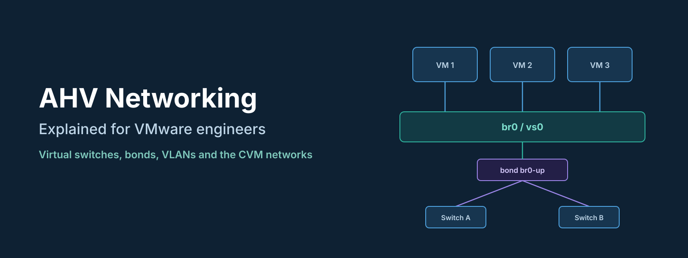
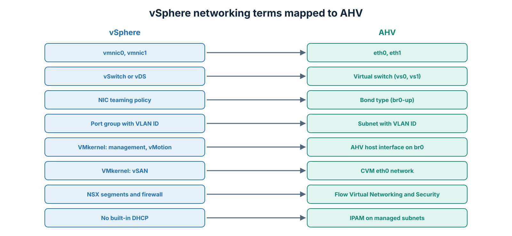
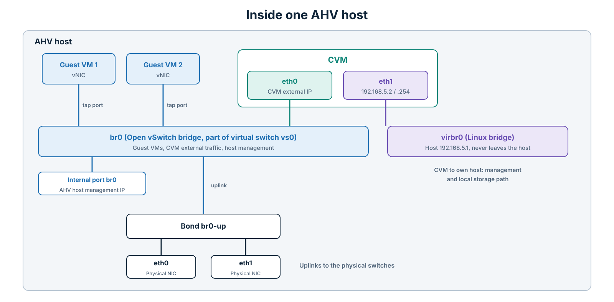
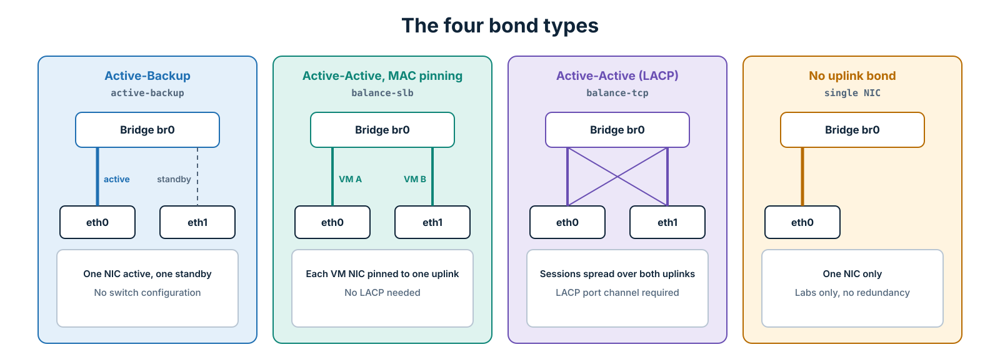
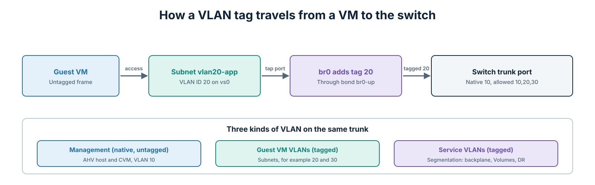
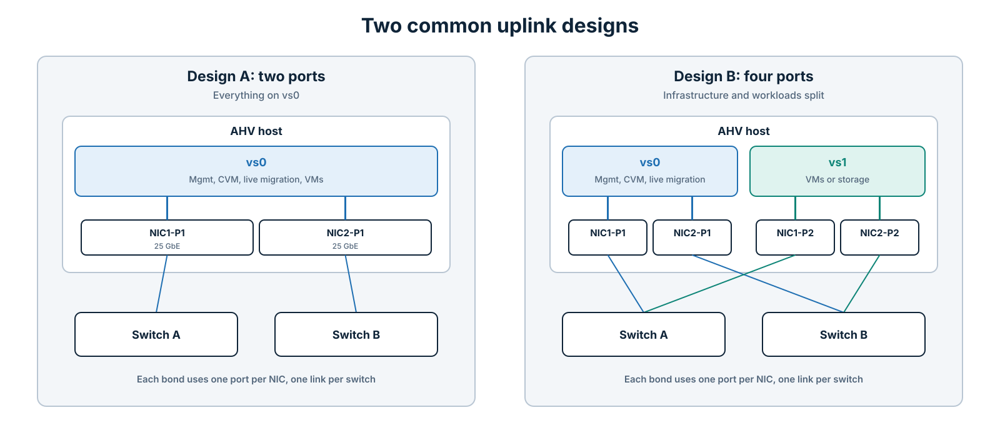

Every VMware-to-Nutanix project I have worked on reaches the same moment. The cluster is up, Prism looks familiar enough, and then someone from the network or virtualization team asks: "Where are the port groups? Where is the vDS? How do I set up NIC teaming?"

AHV networking is not harder than vSphere networking. It just uses different names, and a few pieces work in a different place. Once you see how the parts connect, it becomes very predictable.

This guide is written for engineers who know vSphere and want to understand AHV networking properly, from the physical NIC all the way to the VM. It starts with the basics, then goes into bonds, VLANs, the CVM networks, design examples, the upstream switch configuration, and the commands I use for troubleshooting.

* * *

## Contents

1. The quick translation from vSphere to AHV
2. The building blocks: Open vSwitch, bridges and ports
3. Inside one AHV host
4. Virtual switches (vs0, vs1)
5. Uplinks and bond types
6. VLANs: host, CVM and guest traffic
7. Subnets and VM NICs
8. IPAM: the DHCP you did not know you had
9. MTU and jumbo frames
10. Live migration, segmentation and Flow
11. Design examples
12. Upstream switch configuration
13. Commands for checking the configuration
14. Common mistakes

* * *

## 1. The Quick Translation from vSphere to AHV

If you remember only one section, make it this one.

| vSphere term | AHV equivalent | Notes |
|---|---|---|
| ESXi host | AHV host | AHV is based on KVM, with Open vSwitch for networking |
| vmnic0, vmnic1 | eth0, eth1 (physical NICs) | Physical NIC names on the host |
| Standard vSwitch / vDS | Virtual switch (vs0, vs1) | Defined once in Prism and applied to every host, like a vDS |
| Uplinks / NIC teaming | Bond (for example `br0-up`) | The bond holds the physical uplinks |
| Teaming policy | Bond type | Active-Backup, Active-Active with MAC pinning, Active-Active (LACP) |
| Port group | Subnet (network) | A VLAN that VMs connect to |
| VLAN ID on a port group | VLAN ID on a subnet | VLAN 0 means untagged |
| VMkernel adapter (management) | AHV host interface on `br0` | The host management IP |
| vMotion VMkernel | Host management network | Live migration uses the host network by default |
| vSAN VMkernel | CVM `eth0` network | Storage traffic between CVMs |
| Trunk port group (VLAN 4095) | VM NIC in trunk mode | Configured per VM NIC |
| No built-in equivalent | IPAM | AHV can hand out IP addresses to VMs itself |
| NSX segments and VPCs | Flow Virtual Networking | Overlay networks and VPCs |
| NSX distributed firewall | Flow Network Security | Microsegmentation between VMs |


*Figure 1: The same ideas, with different names.*
{: style="text-align: center;"}

* * *

## 2. The Building Blocks: Open vSwitch, Bridges and Ports

AHV uses **Open vSwitch (OVS)**, an open-source software switch that runs in the Linux kernel on each host. By default, it behaves like a normal layer 2 learning switch. It keeps a MAC address table, forwards frames, and supports VLAN tagging, LACP, and port mirroring.

Four OVS terms are worth learning, because you will see them in commands and logs:

- **Bridge:** One instance of the software switch on a host. The default bridge is `br0`. If you create a second virtual switch, you get a second bridge, such as `br1`.
- **Bond:** A group of physical NICs that act as one uplink for a bridge. The default bond on `br0` is called `br0-up`.
- **Tap port:** The connection between a VM's virtual NIC and the bridge. Each VM NIC gets one.
- **Internal port:** A port that gives the AHV host itself an interface on the bridge. The internal port named `br0` carries the host management IP.

If you think of `br0` as a switch, the bond is its uplink to the physical network, tap ports are where VMs plug in, and the internal port is where the host plugs in.

* * *

## 3. Inside One AHV Host

This is the part that usually clears up the confusion. Here is what a single AHV host looks like with the default configuration.


*Figure 2: The default networking inside one AHV host.*
{: style="text-align: center;"}

There are two separate networks inside every host.

### The External Network (`br0`)

This is the network the outside world sees. It carries:

- **Host management:** the AHV host IP, on the internal port `br0`.
- **CVM external traffic:** the CVM's `eth0` interface. This is the CVM IP you see in Prism, and it carries Prism, cluster communication, and storage replication between CVMs.
- **Guest VMs:** every VM NIC connects to `br0` (or another bridge) through a tap port.

All of it leaves the host through the bond `br0-up` and the physical NICs inside it.

### The Internal Network (`virbr0`)

The second network never leaves the host. `virbr0` is a native Linux bridge, not an OVS bridge, and it connects the CVM to its own host. It carries management and storage communication between the CVM and the AHV host it runs on, including the I/O path from the hypervisor to local storage.

It uses the `192.168.5.0/24` range on every host:

| Interface | Address | Role |
|---|---|---|
| AHV host on `virbr0` | `192.168.5.1` | Host side of the internal link |
| CVM `eth1` | `192.168.5.2` | CVM side of the internal link |
| CVM `eth1` (secondary) | `192.168.5.254` | Used for the internal storage path |

Two practical consequences:

- **Never use `192.168.5.0/24` on the default VLAN** of your external network. It overlaps with the internal network and causes problems. If you must use that range, put it on a different VLAN.
- **Do not change anything on `virbr0`.** It is managed by the platform and is the same on every host.

* * *

## 4. Virtual Switches (vs0, vs1)

In older AOS versions, you configured bridges and bonds host by host from the command line. Since AOS 5.19, Nutanix uses **virtual switches**, which are managed from Prism and applied to the whole cluster. This is the closest thing to a vSphere Distributed Switch.

- **vs0** is created automatically and maps to the bridge `br0`. It holds the management, CVM, and (by default) VM traffic.
- **vs1, vs2, and so on** are virtual switches you create yourself. Each maps to a new bridge, such as `br1`, with its own physical uplinks.

A virtual switch has these settings:

| Setting | Meaning |
|---|---|
| Name and description | For example, `vs1` for "VM and storage traffic" |
| Uplinks per host | Which physical NICs on each host belong to this switch |
| Bond type | How traffic is spread across those uplinks |
| MTU | The frame size on the physical uplinks |

You find them in Prism Element under **Settings > Network > Network Configuration > Virtual Switch**, or in Prism Central under the cluster's network settings.

**How changes are applied:** when you change a virtual switch, Prism applies the change to the hosts one at a time. Depending on the change, it can move a host into maintenance mode while it updates. Treat uplink and bond changes as maintenance work, even though the cluster stays online.

**One rule to remember:** once virtual switches are in use, make uplink and bond changes in Prism. Changing bridges and bonds manually on individual hosts can leave the cluster inconsistent with what Prism expects.

* * *

## 5. Uplinks and Bond Types

The bond decides how traffic from the bridge is spread across the physical NICs. In vSphere terms, this is the NIC teaming policy.


*Figure 3: How each bond type uses the uplinks.*
{: style="text-align: center;"}

| Bond type in Prism | OVS mode | Upstream switch | How traffic is spread | Closest vSphere policy |
|---|---|---|---|---|
| **Active-Backup** | `active-backup` | No special config | One NIC is active, the other waits | Explicit failover (active/standby) |
| **Active-Active with MAC pinning** | `balance-slb` | No LACP, both ports in the same VLANs | Each VM NIC is pinned to one uplink, and the pinning is rebalanced over time | Route based on originating virtual port |
| **Active-Active** | `balance-tcp` with LACP | LACP port channel required | Each TCP session can use a different uplink | Route based on IP hash, or LACP on a vDS |
| **No uplink bond** | Single uplink | Not applicable | One NIC only, no redundancy | Single uplink |

### Active-Backup

This is the default and the simplest option. One NIC carries all the traffic, and the other takes over if the first fails. It works with any switch configuration and is the easiest to troubleshoot.

The limitation is bandwidth. The bridge can never use more than one NIC's worth of throughput. On 25 GbE uplinks, that is often fine. On 10 GbE with heavy traffic, it may not be.

### Active-Active with MAC Pinning

Each VM NIC, and the host and CVM interfaces, is pinned to one of the uplinks, and OVS rebalances the pinning periodically. The upstream switch does not need LACP, because each MAC address only appears on one port at a time.

Total bandwidth for the bridge goes up, but a single VM NIC still uses only one uplink at a time. Be careful with multicast-heavy workloads, which do not always behave well with this mode.

### Active-Active (LACP)

This is the mode for maximum throughput. The bond forms an LACP link aggregation with the upstream switch, and traffic is hashed per TCP session, so even a single VM can use more than one uplink when it has several connections.

It requires the most coordination with the network team:

- The switch ports must be in an LACP port channel. With two switches, that needs a multi-chassis link aggregation, such as Cisco vPC or Dell VLT.
- During imaging or recovery, the host may come up before LACP negotiates. Configure the switch so the member ports keep forwarding if LACP is not negotiated (on Cisco, `no lacp suspend-individual`), and enable LACP fallback on the host side.

### No Uplink Bond

A single NIC with no redundancy. This is fine for a lab, not for production.

### Which One Should You Choose?

- Start with **Active-Backup** unless you have a measured bandwidth problem.
- Move to **Active-Active with MAC pinning** if you need more total bandwidth and do not want LACP.
- Choose **Active-Active (LACP)** when you need the maximum, and the network team is ready to support port channels.

* * *

## 6. VLANs: Host, CVM and Guest Traffic

There are three kinds of VLAN to think about.


*Figure 4: VLAN tags are added on the bridge and carried over a trunk to the switch.*
{: style="text-align: center;"}

### Host and CVM Management VLAN

The AHV host and the CVM normally share the same management network. You have two options:

- **Native (untagged) VLAN on the switch:** The switch delivers management traffic untagged on the trunk, and nothing has to be tagged on the host or CVM. This is the simplest option and the easiest one for imaging with Foundation.
- **Tagged VLAN:** The host and the CVM tag their own traffic. This works, but it must be configured on both the host and the CVM, and a mistake cuts off access to that node.

My advice for most clusters: use the native VLAN for management, and tag everything else.

### Guest VM VLANs

Each VM network is a **subnet** with a VLAN ID, which is the equivalent of a port group. When a VM sends a frame, OVS adds the VLAN tag on the bridge, and the frame leaves through the bond as a tagged frame on the trunk.

### Service VLANs

With network segmentation, some services, such as backplane traffic, Volumes iSCSI, or DR replication, get their own VLAN and a separate interface on the CVM. These are covered in section 10.

**The physical switch ports must be trunks** that carry every VLAN used on that virtual switch: the native management VLAN plus all the guest and service VLANs.

* * *

## 7. Subnets and VM NICs

### Creating a Subnet

In Prism Element, go to **Settings > Network > Network Configuration > Subnets** and click **Create Subnet**. In Prism Central, go to **Network & Security > Subnets**. The main fields are:

- **Name:** for example, `vlan20-app`.
- **Virtual switch:** which virtual switch the subnet uses, such as `vs0`.
- **VLAN ID:** the tag for this network. `0` means untagged.
- **IP address management:** optional, explained in the next section.

One subnet is available on every host attached to that virtual switch, so VMs can live migrate between hosts without any network change.

### VM NIC Modes

A VM NIC can work in two modes:

- **Access (default):** The NIC belongs to one subnet and sees untagged frames. This is the equivalent of connecting a VM to a normal port group.
- **Trunk:** The NIC receives several VLANs. The primary subnet arrives untagged and the extra VLANs arrive tagged, so the guest operating system has to handle the tags. This is useful for virtual routers, firewalls, or appliances that need several VLANs on one NIC.

Trunk mode is configured with `acli`. For example:

```bash
acli vm.nic_create myVM network=vlan.10 vlan_mode=kTrunked trunked_networks=10,20,30
```

* * *

## 8. IPAM: The DHCP You Did Not Know You Had

This feature has no direct vSphere equivalent. When you create a subnet, you can enable **IP address management (IPAM)**. AHV then acts as the DHCP server for that subnet and gives each VM NIC an address from a pool you define.

- **Without IPAM (unmanaged subnet):** AHV only forwards traffic. VMs get IPs from your own DHCP server or are configured statically, exactly like in vSphere.
- **With IPAM (managed subnet):** You define the network address, gateway, DNS servers, and a pool. AHV answers the VM's DHCP requests itself. You can also assign a fixed IP to a specific VM NIC.

Two warnings:

- If the VLAN already has a DHCP server, do not enable IPAM on the same subnet without a plan. AHV answers DHCP for its VMs, and you will end up with two sources of addresses.
- IPAM reserves the addresses it gives out. If someone sets a static IP inside the guest that conflicts with the pool, you get duplicates.

IPAM is very useful for labs, test environments, and DR test networks, where you want addressing without depending on external DHCP.

* * *

## 9. MTU and Jumbo Frames

- **The CVM uses MTU 1500** on its interfaces, and Nutanix does not support changing it. That standard size performs well and is stable.
- **Hosts and guest VMs can use jumbo frames (MTU 9000)** if an application needs them. You set the MTU on the virtual switch, and the guest sets its own MTU inside the operating system.
- **Jumbo frames must be configured end to end:** virtual switch, physical NICs, every switch port in the path, and the destination. One device left at 1500 causes dropped packets that look like random application problems.
- **Physical switches** are commonly set to 9216 on server ports, so they can carry any frame size the hosts use.

A practical approach: keep `vs0` at 1500, and use a separate virtual switch with MTU 9000 for traffic that benefits from it, such as external storage or backup networks.

To test jumbo frames between two points, send a ping that is not allowed to fragment. 8972 is 9000 minus 28 bytes of IP and ICMP headers:

```bash
ping -M do -s 8972 <destination-ip>
```

* * *

## 10. Live Migration, Segmentation and Flow

### Live Migration

Live migration in AHV is the equivalent of vMotion. By default, it runs over the host management network on `br0`, so make sure the `vs0` uplinks have enough bandwidth for it, especially during maintenance, when many VMs move at once. When a VM moves, AHV sends a RARP broadcast so the physical switches learn the VM's new location quickly.

### Network Segmentation

By default, the CVM uses `eth0` for almost everything. **Network segmentation** separates some traffic onto its own VLAN and CVM interface:

- **Backplane segmentation:** isolates traffic between CVMs and hosts in the cluster onto a non-routed network.
- **Service-specific segmentation:** gives a single service its own network, such as Volumes iSCSI or DR replication.

Segmentation is configured in Prism Element under **Settings > Network > Network Configuration > Internal Interfaces**. If you are planning Volumes segmentation for Kubernetes or OpenShift, I covered it in detail in [Planning Nutanix Volumes Network Segmentation for OpenShift Workloads](/hybrid-infrastructure/nutanix/openshift/2026/11/09/nutanix-volumes-network-segmentation-openshift.html).

### Flow Virtual Networking and Flow Network Security

These are the AHV answers to NSX:

- **Flow Virtual Networking** adds overlay networks and VPCs, managed from Prism Central by a network controller. VMs in a VPC can use overlapping IP ranges, with routing and NAT to the outside.
- **Flow Network Security** adds microsegmentation. You write policies based on categories, such as "web tier can talk to app tier on port 8443", and they are enforced on the AHV host, close to the VM.

Neither is required for basic AHV networking, but both are worth knowing about when the customer asks "what replaces NSX?"

* * *

## 11. Design Examples


*Figure 5: Two common designs, with two and four physical ports per host.*
{: style="text-align: center;"}

### Design A: Two Ports per Host

| Virtual switch | Uplinks | Bond type | Traffic |
|---|---|---|---|
| `vs0` | 2 × 25 GbE, one to each switch | Active-Backup or Active-Active | Management, CVM, live migration, guest VMs |

This is the most common design and works very well with 25 GbE. Everything is on one virtual switch, and VLANs separate the guest networks.

### Design B: Four Ports per Host

| Virtual switch | Uplinks | Bond type | Traffic |
|---|---|---|---|
| `vs0` | 2 ports, one on each NIC | Active-Backup | Management, CVM, live migration |
| `vs1` | 2 ports, one on each NIC | Active-Active (LACP) | Guest VMs, or storage or backup traffic |

This design separates infrastructure traffic from workload traffic on different physical links. It is a good fit when the VM traffic is heavy, when a network needs jumbo frames, or when the security team wants physical separation.

**Tips for both designs:**

- Spread each bond across two different physical NICs, so one failed card does not take down a whole virtual switch.
- Connect the two uplinks of each bond to two different physical switches.
- Use the same NIC models, speeds, and port layout on every host in the cluster.
- Leave unused ports disconnected, or disable them. During imaging, the installer can add every connected interface to the default bond.

* * *

## 12. Upstream Switch Configuration

This is what the physical switch ports connected to an AHV host typically look like. The example uses Cisco NX-OS syntax, with VLAN 10 as the native management VLAN and VLANs 20 and 30 for VMs.

**For Active-Backup or Active-Active with MAC pinning:**

```text
interface Ethernet1/10
  description AHV-Host01-eth0
  switchport mode trunk
  switchport trunk native vlan 10
  switchport trunk allowed vlan 10,20,30
  spanning-tree port type edge trunk
  mtu 9216
  no shutdown
```

**For Active-Active with LACP**, the ports join a port channel. With two switches, the port channel must be a vPC or a similar multi-chassis link aggregation:

```text
interface port-channel110
  description AHV-Host01-bond
  switchport mode trunk
  switchport trunk native vlan 10
  switchport trunk allowed vlan 10,20,30
  spanning-tree port type edge trunk
  mtu 9216
  no lacp suspend-individual
  vpc 110

interface Ethernet1/10
  description AHV-Host01-eth0
  channel-group 110 mode active
  no shutdown
```

Some notes for the network team:

- **Edge trunk (PortFast):** the host ports should not take part in spanning tree. Without this, ports can take a long time to forward after a link change, which slows down host failover.
- **Native VLAN:** must match the management VLAN that the hosts and CVMs use untagged.
- **Adding a VLAN later:** use `switchport trunk allowed vlan add <id>`. Without `add`, the command replaces the whole list and can remove the management VLAN.

* * *

## 13. Commands for Checking the Configuration

You will mostly configure AHV networking in Prism, but these commands are very useful for checking what is really happening. Run them from any CVM. `hostssh` runs a command on every AHV host in the cluster.

| What you want to see | Command |
|---|---|
| Physical NICs on each host, with link state and speed | `manage_ovs show_interfaces` |
| Bridges, bonds and their uplinks | `manage_ovs show_uplinks` |
| The OVS configuration on every host | `hostssh "ovs-vsctl show"` |
| Bond status and which NIC is active | `hostssh "ovs-appctl bond/show br0-up"` |
| LACP negotiation status | `hostssh "ovs-appctl lacp/show br0-up"` |
| All subnets and their VLANs | `acli net.list` |
| Details of one subnet | `acli net.get <subnet-name>` |
| NICs of one VM | `acli vm.nic_get <vm-name>` |

Use these commands to look, and Prism to change. That keeps the cluster configuration consistent.

* * *

## 14. Common Mistakes

| Mistake | What happens | How to avoid it |
|---|---|---|
| Using `192.168.5.0/24` on the default VLAN | Conflicts with the internal CVM network | Use another range, or a different VLAN |
| LACP on the host but not on the switch, or the reverse | Flapping links or no connectivity | Agree the bond type with the network team before changing it |
| Missing VLAN on the trunk | VMs on that subnet cannot communicate | Check the allowed VLAN list on every host port |
| MTU 9000 on only part of the path | Large packets dropped, random application issues | Configure MTU end to end and test with `ping -M do` |
| Both uplinks to the same switch | One switch failure isolates the host | Connect each bond to two switches |
| Both uplinks on the same NIC card | One card failure isolates the host | Use one port from each NIC |
| Enabling IPAM on a VLAN with existing DHCP | Two sources of IP addresses | Use IPAM only where you own addressing |
| Manual OVS changes on one host | The host differs from the rest of the cluster | Make changes in Prism with virtual switches |
| Different NIC models or speeds across hosts | Inconsistent behaviour and complex troubleshooting | Standardize hardware in the cluster |

* * *

## Conclusion

AHV networking comes down to a few ideas. Each host runs Open vSwitch. A virtual switch, such as `vs0`, is a bridge defined once in Prism for the whole cluster. A bond decides how the physical uplinks are used. Subnets are the port groups that VMs connect to. And every host has a private `virbr0` network that connects the CVM to its own hypervisor.

If you come from vSphere, keep the translation table nearby for the first few weeks. Start with a simple design, Active-Backup on `vs0` with a native management VLAN, and only add LACP, extra virtual switches, or segmentation when there is a clear reason. A simple network is easier to operate, easier to troubleshoot, and easier to hand over to the next engineer.

* * *

*This guide reflects AHV networking with virtual switches in current AOS releases, checked in November 2026. Menu names and defaults can change between versions, so confirm details against the AHV Administration Guide for your release.*
