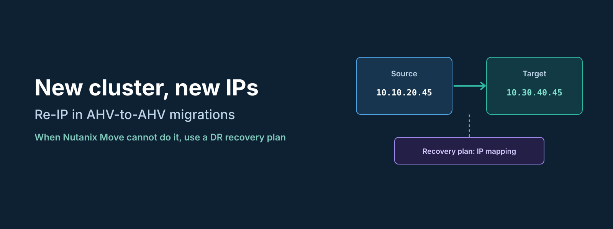
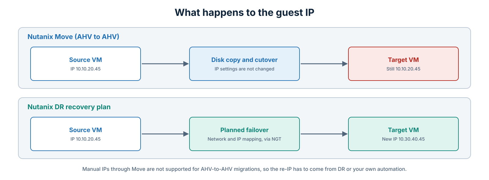
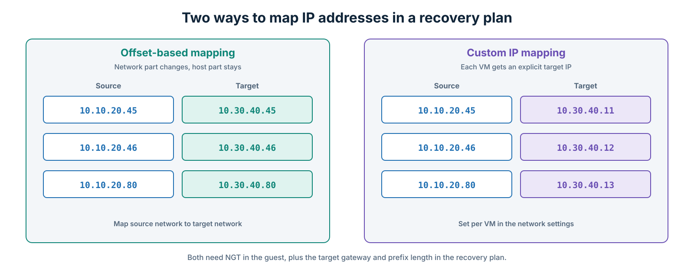
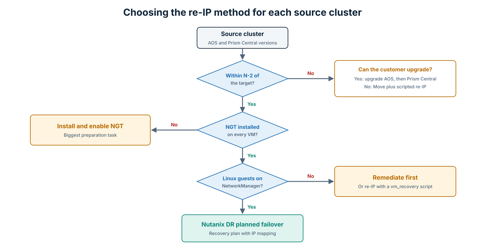
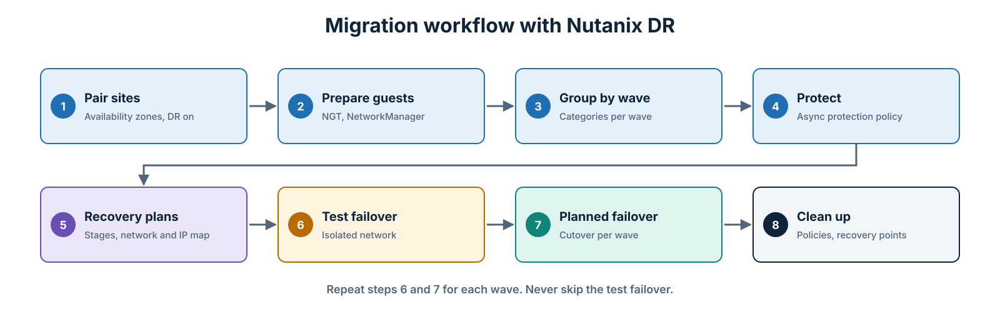

Most migration requests I get are about moving VMs as they are: same name, same IP, new platform. This one was different. A customer was moving workloads from two existing AHV clusters to a new AHV cluster, and every migrated VM had to come up on the new cluster with a **new IP address**, set automatically. No manual changes inside the guests.

Nutanix Move was the obvious tool for the data copy, so that is where I started. It did not get me all the way there, and the alternative turned out to be a feature most people associate with disaster recovery, not migration.

This post explains why Move was not enough, how a Nutanix DR recovery plan handles the re-IP, what has to be true for it to work, and what to do for clusters that do not meet those conditions.

* * *

## The Requirement

| Item | Details |
|---|---|
| Source | Two AHV clusters on different AOS and Prism Central versions |
| Target | A new AHV cluster on a newer AOS and Prism Central release |
| Guests | Windows and Linux VMs with static IP addresses |
| Requirement | Each VM gets a new IP, subnet, and gateway on the target, applied automatically |

* * *

## Why Nutanix Move Was Not Enough

Move is very good at what it is built for: copying VM disks to AHV with a short cutover window. For ESXi and Hyper-V sources, it can even prepare the guest and keep its existing IP configuration.

What it does not do is assign a **different** static IP to a VM during an AHV-to-AHV migration. I opened a support case to confirm, and the answer was clear: setting manual IPs through Move is not supported.

That left two choices. Either someone changes the IPs by hand after every cutover, which the customer did not accept, or the re-IP comes from somewhere else.


*Figure 1: What each tool does with the guest IP during an AHV-to-AHV move.*
{: style="text-align: center;"}

* * *

## Why a DR Recovery Plan Can Do It

Nutanix DR, the Prism Central-based protection policies and recovery plans, already has to solve this problem. When you fail over to another site, VMs usually land on different subnets. Recovery plans therefore include **network mapping** and **IP address mapping**, applied inside the guest through Nutanix Guest Tools (NGT) when the VM boots on the target.

A planned failover is also a clean migration mechanism. Replication copies the data in advance, the source VMs are shut down, a final sync runs, and the VMs start on the target. Used this way, DR becomes a migration tool with re-IP built in.

### Two Ways to Map the IP Addresses


*Figure 2: Offset-based mapping keeps the host part. Custom mapping sets each IP explicitly.*
{: style="text-align: center;"}

- **Offset-based mapping:** You map each source network to a target network. The network part of the address changes to the target subnet and the host part stays the same, so `10.10.20.45` on the source becomes `10.30.40.45` on the target. If the new IP plan follows the old one, this alone does the job.
- **Custom IP mapping:** If the host part has to change too, you set the target IP for each VM explicitly in the recovery plan's network settings. This is more work up front, but it covers any IP plan.

For both methods, the recovery plan needs the **gateway and prefix length** for the target networks. Keeping the same prefix length on source and target makes life easier.

* * *

## What Has to Be True for It to Work

This is the part to get right before you promise anything to the customer.

**1. NGT on every VM.**
IP mapping and static IP preservation during failover depend on NGT. In a large migration, installing and enabling NGT on every VM is the biggest preparation task, so start early.

**2. Supported versions on both sides.**
Nutanix recommends the same versions on the source and target, and supports replication across Prism Central and AOS versions within a limited window: N to N-2 minor versions, or N to N-1 for LTS versions. A source that is too far behind the target is outside that window. In my case, one source cluster was inside the window and the other was not. Get the exact combination confirmed by Nutanix Support in writing before you commit to it.

**3. Linux guests managed by NetworkManager.**
On Linux VMs that do not use Nutanix IPAM, static IP mapping relies on NetworkManager, with `nmcli` version 0.9.10.0 or later. In my experience, these are the guests most likely to be missed:

- **Ubuntu Server with netplan:** the default renderer is `systemd-networkd`, not NetworkManager.
- **Debian:** often uses `ifupdown` with `/etc/network/interfaces`.
- **SLES:** uses `wicked` by default.
- **RHEL or CentOS 7:** usually fine, but check for interfaces marked `NM_CONTROLLED=no`.

A quick check on each Linux VM tells you where it stands:

```bash
systemctl is-active NetworkManager        # should return: active
nmcli --version                           # should be 0.9.10.0 or later
nmcli -t -f DEVICE,STATE,CONNECTION dev   # the NIC should be "connected", not "unmanaged"
```

Run it across the Linux inventory, with an Ansible ad-hoc command for example, and split the VMs into two groups: ready for DR re-IP, and needing remediation first.

**4. Know the limits.**

- Only one IP address per vNIC is mapped. VMs with several IPs on the same NIC need extra handling.
- DNS server settings inside the guest are not changed by the IP mapping. Use the in-guest `vm_recovery` script that NGT runs after recovery, or your own automation.
- Licensing for Nutanix DR has to be in place on both sides, even for a one-time migration.

* * *

## Choosing the Path for Each Cluster


*Figure 3: The decision I used for each source cluster.*
{: style="text-align: center;"}

For the cluster inside the supported version window, Nutanix DR was the clear choice. For the cluster outside it, there were two realistic options:

- **Upgrade the source cluster first**, AOS before Prism Central, to bring it into the supported window. Check the upgrade path with the Nutanix Upgrade Paths tool, and note that newer Prism Central releases have minimum AOS requirements for the clusters they manage.
- **Keep Move for the data copy and handle the re-IP with automation.** A script is staged inside each guest before cutover and applies the new IP on first boot on the target, driven by a CSV mapping file. It works, but it is your automation to maintain and not a Nutanix-supported feature, so test it well.

* * *

## Running the Migration with Nutanix DR


*Figure 4: The wave-based workflow with a planned failover per wave.*
{: style="text-align: center;"}

1. **Pair the sites:** Pair the source and target Prism Central instances as availability zones and enable Nutanix DR on both.
2. **Prepare the guests:** Install and enable NGT on every VM in scope. Fix any Linux VMs that are not managed by NetworkManager.
3. **Group by wave:** Create a category for each migration wave and assign the VMs to it.
4. **Protect:** Create a protection policy with asynchronous replication, using the wave categories.
5. **Build the recovery plans:** Add power-on stages, then configure network mapping with the target gateway and prefix. Add custom IP mapping where the host part changes.
6. **Test first:** Run a **test failover** into an isolated network and confirm that every VM comes up with the right IP, gateway, and DNS.
7. **Cut over:** Run a **planned failover** for the wave. The source VMs shut down, the final replication runs, and the VMs start on the target with their new IPs.
8. **Clean up:** When all waves are done, remove the VMs from the protection policies, delete leftover recovery points, and unpair the availability zones.

A test failover is the step I would never skip. It is the only way to prove the re-IP works for each operating system before the customer's users depend on it.

* * *

## Lessons Learned

- **Confirm tool limits early.** One support case answered a question that could otherwise have surfaced on cutover night.
- **DR is also a migration tool.** If you need re-IP, staged power-on, and a tested cutover, a recovery plan already has all three.
- **Versions decide the design.** The same customer ended up with two approaches because the two source clusters were on different releases.
- **Linux networking is where re-IP fails.** Check NetworkManager on every Linux guest before the first wave.
- **Test failover is cheap insurance.** It costs an hour and saves a long night.

* * *

## Conclusion

Nutanix Move is still my first choice for most migrations, but it is not designed to give AHV-to-AHV migrated VMs new IP addresses. When the requirement is a fully automatic re-IP, Nutanix DR with a planned failover is the native way to do it, as long as NGT is installed, the versions are inside the supported window, and the Linux guests use NetworkManager.

For clusters that do not meet those conditions, decide early between upgrading first and scripting the re-IP yourself. Both work. What does not work is discovering the gap during the cutover window.

* * *

*Details in this post were checked against Nutanix documentation and a Nutanix Support case in November 2026. Version rules and guest requirements can change between releases, so confirm them for the versions in your environment.*
