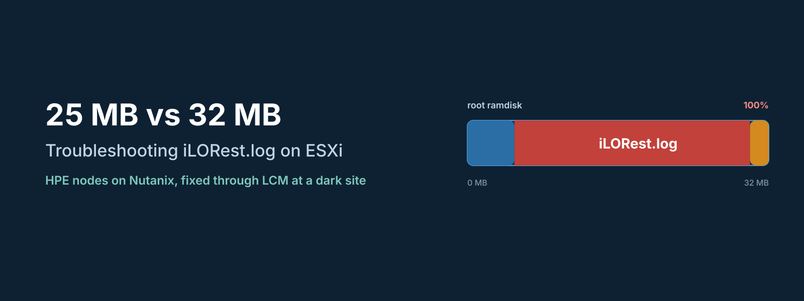
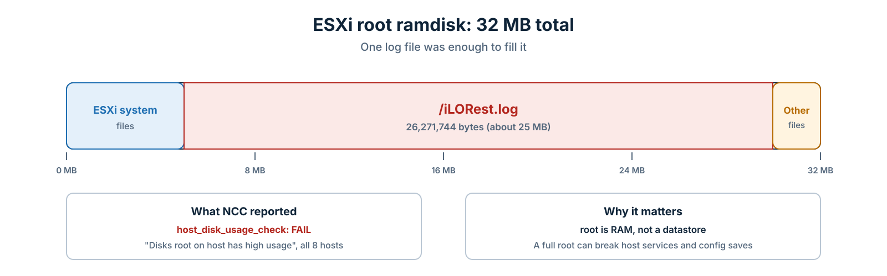
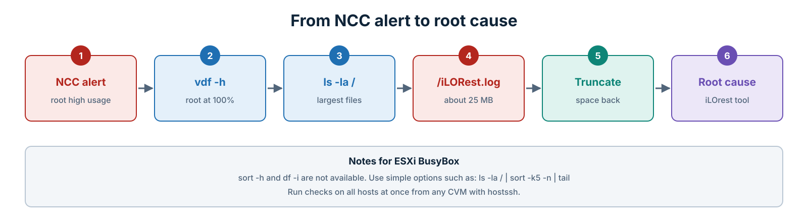
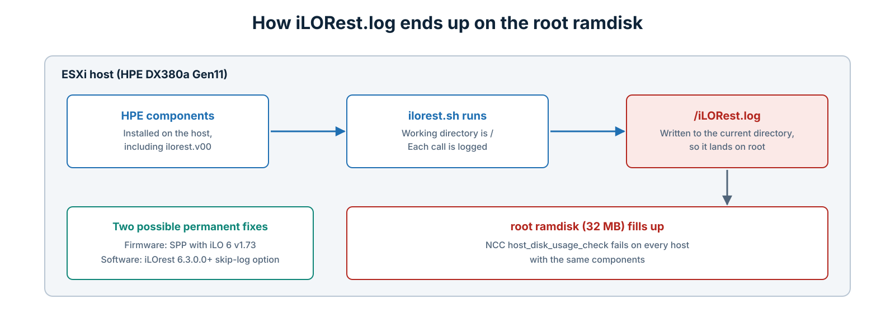
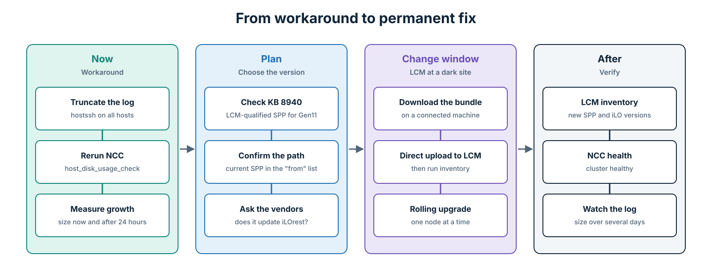

Some problems look serious because of how many hosts they hit at once. This one started with an NCC health check failing on every host in an 8-node Nutanix cluster, all with the same message: the ESXi `root` disk had high usage.

When all hosts fail together, your first thought is a cluster-wide problem. The real cause turned out to be a single log file of about 25 MB, sitting in a place where 25 MB is a lot of space.

This post walks through how I found it, how I cleared it safely on all hosts, and why the permanent fix ended up being a firmware upgrade through Nutanix LCM at a dark site.

* * *

## The Environment

| Component | Details |
|---|---|
| Hardware | HPE ProLiant DX380a Gen11, 8 nodes |
| Hypervisor | VMware ESXi 8.0 Update 3 |
| Nutanix | AOS 7.5.1.8, NCC 5.3.1 |
| Firmware before the fix | iLO 6 v1.70p26 |
| Site | Dark site, with no direct internet access |

* * *

## The Symptom

The NCC check `host_disk_usage_check` failed on all 8 nodes with the same result:

```text
FAIL: Disks root on host <host-ip> has high usage.
```

The important word in that message is **root**. On ESXi, `root` is not a datastore and not a boot device partition. It is a small ramdisk that holds the root file system in memory. Deleting VMs or freeing datastore space does nothing for it.

On these hosts, the `root` ramdisk was 32 MB in total and showed 100% used.


*Figure 1: Why one log file was enough to fill the root ramdisk.*
{: style="text-align: center;"}

A full root ramdisk is not just a cosmetic alert. ESXi services write small files there, and when it is full, things like configuration saves and management agents can start failing. It is worth fixing quickly, even before you know the root cause.

* * *

## Finding the Culprit


*Figure 2: The troubleshooting path I followed.*
{: style="text-align: center;"}

### Step 1: Confirm which ramdisk is full

From an SSH session on one host, `vdf` shows the ESXi ramdisks and their usage:

```bash
vdf -h
```

To check all hosts at once, run it from any CVM with `hostssh`:

```bash
hostssh "vdf -h | grep -i -E '^root'"
```

Every host showed the same picture: `root` was full.

### Step 2: Work within the BusyBox limits

ESXi uses a BusyBox shell, and several commands you would normally use on Linux behave differently or are missing. During this investigation, `sort -h` and `df -i` both failed. If you are used to a full Linux toolset, this slows you down, so stick to simple options.

To list the largest files in `/`, this works on BusyBox:

```bash
ls -la / | sort -k5 -n | tail -10
```

### Step 3: Find the large file

The listing showed a file of 26,271,744 bytes, about 25 MB, in the root of the file system: `/iLORest.log`. Next to it was a smaller debug log called `rest.debug.log`.

```bash
ls -l /iLORest.log /rest.debug.log
```

A 25 MB log in a 32 MB ramdisk, together with the normal system files, explains a 100% full disk on its own.

* * *

## Clearing the Space Safely

Both files are logs, so clearing them does not affect the host. I truncated `iLORest.log` instead of deleting it, so any process holding the file open could keep writing to it without errors, and removed the debug log.

On a single host:

```bash
: > /iLORest.log
rm -f /rest.debug.log
vdf -h | grep -i -E "^root"
```

On all hosts at once, from a CVM:

```bash
hostssh ': > /iLORest.log; rm -f /rest.debug.log'
hostssh "vdf -h | grep -i -E '^root'"
```

Because the ramdisk lives in memory, the space is freed immediately. Then rerun the NCC check:

```bash
ncc health_checks hardware_checks disk_checks host_disk_usage_check
```

This is a workaround, not a fix. If whatever writes the log keeps running, the file grows back. Record the size right after cleaning and again after 24 hours, so you know the growth rate and how often you need to clean it until the permanent fix is in place.

* * *

## Why It Happens

The file name points to the **HPE iLO RESTful Interface Tool (iLOrest)**. On HPE nodes running ESXi, the HPE components installed on the host include iLOrest. You can see it in the `vdf` output as `ilorest.v00`.

Broadcom KB 404265 describes this exact behaviour. The `ilorest.sh` script creates `iLORest.log` in whatever directory it is run from. When it runs from `/`, the log lands on the root ramdisk, and every call adds to it. The workaround in the KB is the same as above: remove or move the file.


*Figure 3: How the log ends up on the root ramdisk.*
{: style="text-align: center;"}

There are two parts to a permanent fix:

- **Newer firmware:** HPE support tied the growth to iLO 6 v1.70p26 and recommended Service Pack for ProLiant (SPP) 2026.03.00.00.01, which includes iLO 6 v1.73.
- **Newer iLOrest:** HPE's iLOrest release notes state that version 6.3.0.0 added a global option to skip creating `iLORest.log`.

These are not the same thing. A firmware update changes the iLO, while iLOrest is a software component on the ESXi host. That is why I asked HPE and Nutanix to confirm whether the SPP update through LCM also updates the iLOrest component, and why I kept monitoring the log after the upgrade instead of declaring the problem solved.

* * *

## The Permanent Fix: SPP Through Nutanix LCM at a Dark Site

On Nutanix-certified HPE nodes, firmware should be upgraded with **Nutanix LCM**, not by running HPE tools directly on the hosts. LCM handles maintenance mode, the CVM shutdown, and the health checks between nodes, which is what keeps the cluster safe during a rolling upgrade.

### Step 1: Pick a version that Nutanix has qualified

The SPP that HPE recommends is not automatically supported by Nutanix. Nutanix KB 8940 lists the SPP versions LCM supports for each hardware generation and the versions you can upgrade from.

For this cluster, the result was clear:

| Item | Result |
|---|---|
| Target SPP | 2026.03.00.00.01 (Gen11), matching HPE's recommendation |
| Newer HPE releases | Not in the Nutanix matrix for Gen11, so not used |
| Upgrade path | The installed SPP must be in the supported "from" list for a direct LCM upgrade |

If your current SPP is too old for a direct upgrade, LCM may need an intermediate version first.

### Step 2: Prepare the bundle for the dark site

With no internet access, LCM cannot download the payload itself. Download the LCM HPE firmware bundle from the Nutanix portal on a connected machine, then upload it to LCM with direct upload. The main bundle always carries the latest payload. If you need an intermediate hop, the older bundle is listed under **Other Versions** on the LCM downloads page.


*Figure 4: From immediate workaround to permanent fix.*
{: style="text-align: center;"}

### Step 3: Plan the time window

HPE estimated 30 to 60 minutes per server for the firmware update. That does not include the LCM work around it: entering maintenance mode, shutting down the CVM, rebooting, and waiting for the cluster to be healthy before moving to the next node. For 8 nodes upgraded one at a time, I planned for a long window and kept the option to split it across two nights.

### Step 4: Run the upgrade and verify

After an LCM inventory, I ran the upgrade through LCM. In the same window, I also upgraded Nutanix Files Manager and the Files file server from 5.2.1 to 5.3. Once LCM completed:

1. Run a new LCM inventory and confirm the SPP and iLO versions on every node.
2. Run NCC and confirm the cluster is healthy.
3. Check the size of `/iLORest.log` on every host, then check again over the following days.

The last step matters most. The upgrade is only a success if the log stays small.

* * *

## Lessons Learned

- **Read the NCC message carefully.** "Disks root" meant the ESXi ramdisk, not a datastore. That one word saved a lot of time.
- **All hosts failing at once does not always mean something big.** Here it was the same small component behaving the same way on identical hosts.
- **Clear the symptom first, then chase the cause.** A full root ramdisk can break host services, so the workaround should not wait for the change window.
- **Know your shell.** ESXi's BusyBox does not support every Linux option. Simple commands get you there faster.
- **Check the Nutanix matrix before you accept a vendor's version.** The hardware vendor's latest release is not automatically supported by LCM.
- **Firmware and host software are different fixes.** Confirm which one actually solves your problem before closing the case.

* * *

## Quick Reference

| Task | Command |
|---|---|
| Check ramdisk usage on all hosts | `hostssh "vdf -h"` |
| Find the log on all hosts | `hostssh "ls -l /iLORest.log /rest.debug.log"` |
| Clear the logs on all hosts | `hostssh ': > /iLORest.log; rm -f /rest.debug.log'` |
| Recheck in NCC | `ncc health_checks hardware_checks disk_checks host_disk_usage_check` |

* * *

## Conclusion

A 25 MB file does not sound like a production problem until you remember where it lives. On ESXi, the root ramdisk is tiny, and anything that writes to `/` can fill it.

If you run Nutanix on HPE nodes with ESXi and see `host_disk_usage_check` failing for `root` on several hosts at once, check for `/iLORest.log` first. Clear it, measure how fast it grows, and plan the permanent fix through LCM with a firmware version that Nutanix has qualified for your hardware.

* * *

*Versions in this post reflect the environment and the vendor documentation at the time of the work in October 2026. Check the current Nutanix LCM compatibility matrix for your hardware before planning an upgrade.*
