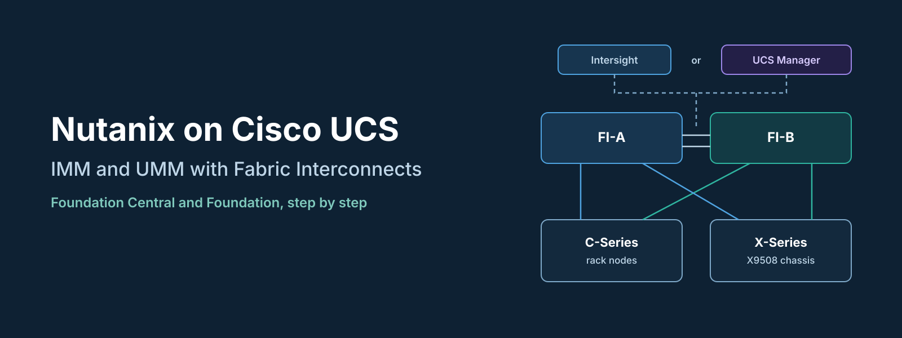
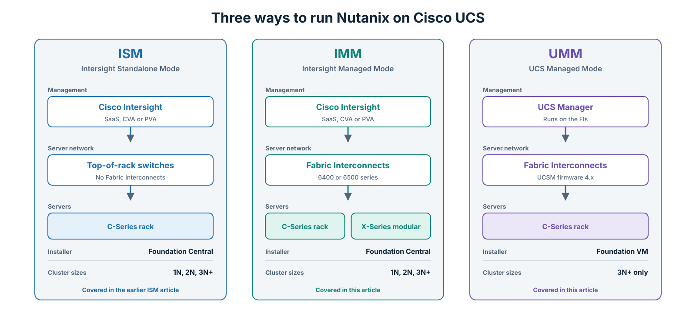
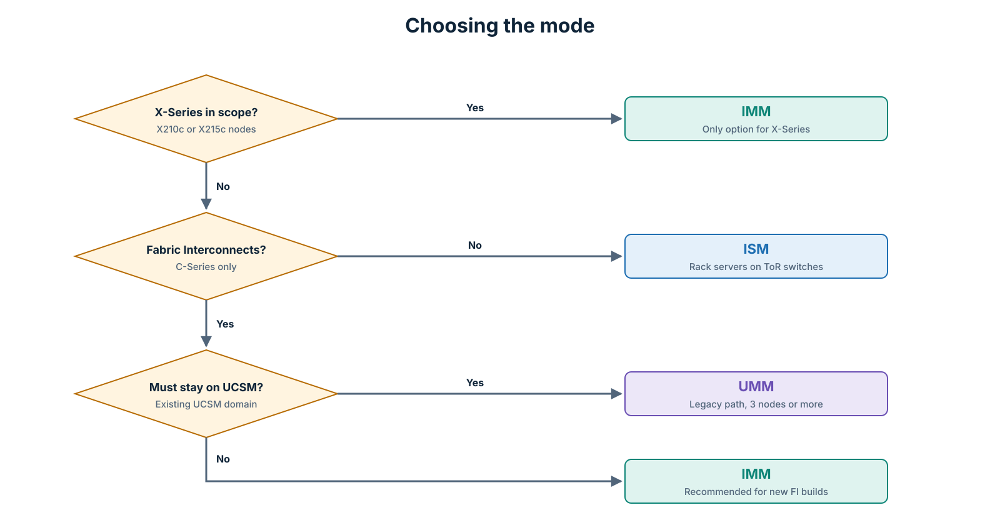
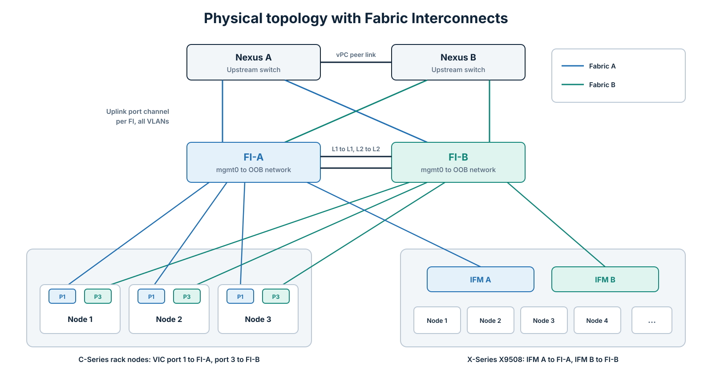
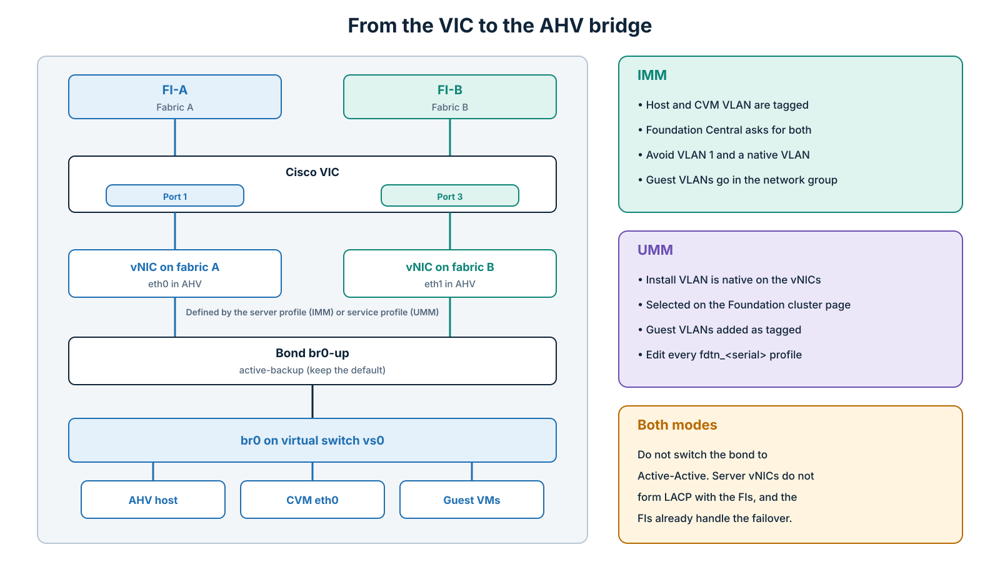
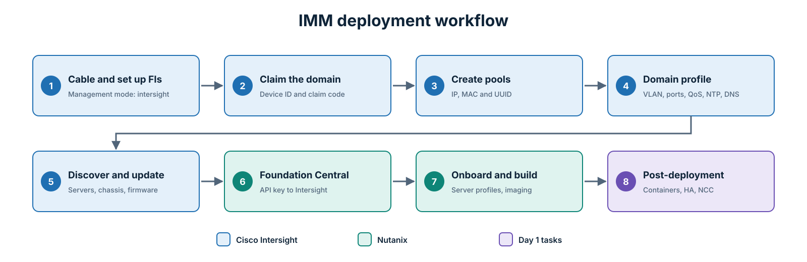
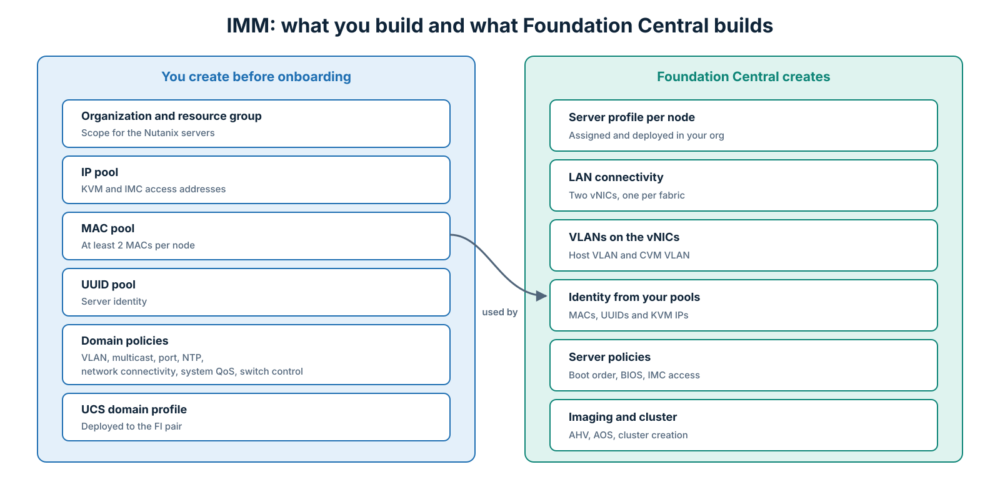
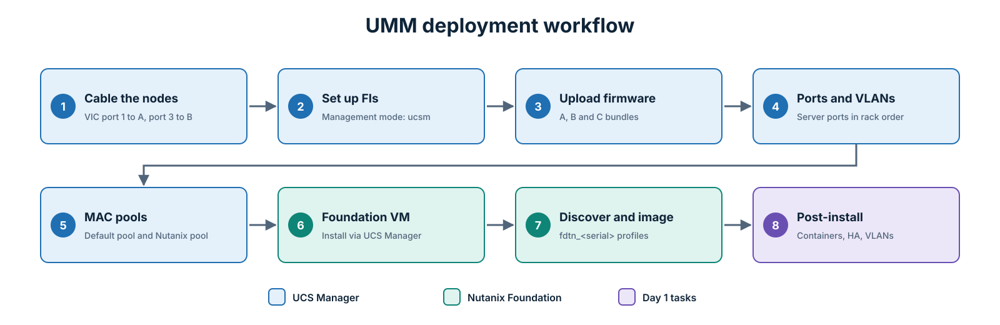

In an [earlier post](/hybrid-infrastructure/nutanix/cisco-ucs/2026/02/01/nutanix-cisco-ucs-standalone-deployment.html) I covered the simplest way to run Nutanix on Cisco UCS: C-Series rack servers in **Intersight Standalone Mode (ISM)**, connected straight to top-of-rack switches and built with Foundation Central. Many Cisco customers don't build that way, though. They already run Fabric Interconnects, or they want X-Series modular servers, and that means one of the other two modes.

This post covers both of them:

- **Intersight Managed Mode (IMM):** Fabric Interconnects managed from Cisco Intersight, with C-Series rack servers, X-Series compute nodes, or both. The cluster is built with Foundation Central.
- **UCS Managed Mode (UMM):** Fabric Interconnects running UCS Manager, with C-Series rack servers. The cluster is built with the Nutanix Foundation VM.

I have put the steps together from the Cisco Compute Hyperconverged with Nutanix design guide for IMM, the Cisco field guides for IMM and UMM, and the Nutanix Field Installation Guide for Cisco HCI, then added the notes I would want on site. The hypervisor throughout is **AHV**.

* * *

## The Three Modes at a Glance


*Figure 1: What changes between the three deployment modes.*
{: style="text-align: center;"}

| | ISM | IMM | UMM |
|---|---|---|---|
| Fabric Interconnects | Not used | Required | Required |
| Policies and profiles managed in | Intersight | Intersight | UCS Manager |
| C-Series rack servers | Yes | Yes | Yes |
| X-Series modular servers | No | Yes | No |
| Installer | Foundation Central | Foundation Central | Foundation VM |
| 1-node and 2-node clusters | Yes | Yes | No |
| Firmware upgrades through LCM | Via Intersight API | Via Intersight API | Via UCS Manager |

The difference that matters most day to day is **who owns the server configuration**. In IMM, Foundation Central creates the server profiles in Intersight for you. In UMM, the Foundation VM logs in to UCS Manager and creates the service profiles there. In both cases you prepare the Fabric Interconnects first, and the Nutanix installer takes over from the server level down.

* * *

## Choosing the Mode


*Figure 2: The questions I ask before picking a mode.*
{: style="text-align: center;"}

- **X-Series in scope:** For Nutanix, X-Series compute nodes are supported in IMM only.
- **Fabric Interconnects in the design:** If the rack servers connect to top-of-rack switches, it's ISM. If they connect to FIs, it's IMM or UMM.
- **IMM or UMM:** Cisco and Nutanix both point new deployments to IMM. UMM still makes sense when the customer already runs a UCS Manager domain and wants the Nutanix nodes in it, but remember that UMM doesn't support 1-node or 2-node clusters.

You can't mix modes inside one Fabric Interconnect pair. A domain is either in Intersight Managed Mode or in UCS Manager mode, and switching between them means wiping the FI configuration. Decide before you rack anything.

* * *

## Common Building Blocks

Both modes use the same physical layout. The FIs sit between the servers and the data center network, and every server gets one path through Fabric A and one through Fabric B.


*Figure 3: C-Series and X-Series behind the same Fabric Interconnect pair.*
{: style="text-align: center;"}

### Cabling

- **FI to FI:** L1 to L1 and L2 to L2. These are the cluster links between the pair. They don't carry data traffic.
- **Management:** `mgmt0` on each FI goes to the out-of-band management network.
- **Uplinks:** Each FI has its own uplink port channel to the upstream switches. With a Nexus pair, use a vPC so each FI port channel lands on both switches. The trunks must carry every VLAN the cluster needs: hypervisor and CVM management, plus the guest VM VLANs. Enable jumbo frames on the upstream switches where possible.
- **C-Series nodes:** For a 4-port VIC with two cables, **port 1 goes to FI-A and port 3 goes to FI-B**. With four cables, ports 1 and 2 go to FI-A and ports 3 and 4 go to FI-B. With two VICs, port 1 of each VIC goes to FI-A and port 3 of each VIC goes to FI-B.
- **X-Series chassis:** The X9508 connects through its two Intelligent Fabric Modules (IFMs). IFM A goes to FI-A and IFM B goes to FI-B. The compute nodes reach the fabric through the IFMs, so there's nothing to cable per node.

Record which FI ports you used for servers and which for uplinks. You need that list when you configure the port roles.

### How the Server Network Reaches AHV


*Figure 4: The two fabric paths become the two uplinks of the AHV bond.*
{: style="text-align: center;"}

The Nutanix installer creates two vNICs on each node, one pinned to Fabric A and one to Fabric B. AHV sees them as `eth0` and `eth1`, and puts them in the `br0-up` bond on `br0` (virtual switch `vs0`). The AHV host, the CVM, and the guest VMs all use that bridge.

Two rules apply in both modes:

- **Keep the bond in active-backup.** The Cisco field guides say it plainly: do not change the default virtual switch bond type to Active-Active. Server vNICs don't form an LACP port channel with the FIs, and the FIs already give you a path through each fabric.
- **Know where your VLAN tags come from.** In IMM, the host and CVM VLANs are tagged, and Cisco advises against using VLAN 1 or a native VLAN. In UMM, Foundation sets the installation VLAN as native on the vNICs, and you add guest VLANs as tagged afterwards. If you mix these up, the CVMs lose network after the node reboots into the installer.

### IP Addresses to Plan

Each node needs **three addresses**: a CIMC or KVM address, an AHV host address, and a CVM address. On top of that, the cluster needs a virtual IP and an iSCSI Data Services IP, and you need DNS A records for the hosts. Prepare the full list before the installer asks for it.

* * *

# Part 1: Intersight Managed Mode (IMM)


*Figure 5: The IMM build, from Fabric Interconnect setup to a running cluster.*
{: style="text-align: center;"}

## IMM Prerequisites

| Item | What you need |
|---|---|
| Fabric Interconnects | A supported pair, for example the UCS 6536 that Cisco used in its design guide |
| Servers | C-Series rack servers and/or X-Series compute nodes in an X9508 chassis, listed as supported for Nutanix |
| Cisco Intersight | SaaS, Connected Virtual Appliance (CVA), or Private Virtual Appliance (PVA), with the license tier required for server profiles (Cisco's guide uses Infrastructure Services Advantage) |
| Prism Central | With Foundation Central enabled and upgraded to the latest version |
| Web server | An HTTP server reachable from the CIMC/KVM network, hosting the AOS package and the AHV ISO |
| Network services | Working DNS and NTP for Intersight, Prism Central, and the cluster |

For reference, the Cisco design guide validated FI firmware 4.3(6), X-Series server firmware 5.4(0), Foundation Central 1.8.2, AOS 7.3.1.1, and AHV 10.3.1.1. Use those as a sanity check, not as your target. Your versions come from the current Nutanix and Cisco compatibility lists.

## Step 1: Initial Setup of the Fabric Interconnects

Connect to the console of FI-A. The first question decides the whole deployment: the management mode must be `intersight`.

```text
Enter the configuration method. (console/gui) ? console
Enter the management mode. (ucsm/intersight)? intersight
You have chosen to setup a new Fabric interconnect in "intersight" managed mode. Continue? (y/n): y
Enforce strong password? (y/n) [y]: y
Enter the password for "admin":
Confirm the password for "admin":
Enter the switch fabric (A/B) []: A
Enter the system name: NTNX-FI
Physical Switch Mgmt0 IP address : 10.10.10.11
Physical Switch Mgmt0 IPv4 netmask : 255.255.255.0
IPv4 address of the default gateway : 10.10.10.1
DNS IP address : 10.10.10.5
Configure the default domain name? (yes/no) [n]: yes
Default domain name : lab.local
```

Then connect to FI-B. It detects its peer and asks to join:

```text
Enter the configuration method. (console/gui) ? console
Installer has detected the presence of a peer Fabric interconnect. This Fabric interconnect will be added to the cluster. Continue (y/n) ? y
Enter the admin password of the peer Fabric interconnect:
Peer Fabric interconnect Mgmt0 IPv4 Address: 10.10.10.11
Physical Switch Mgmt0 IP address : 10.10.10.12
```

The prompts change slightly between firmware releases, so read each one rather than typing from memory. If DHCP is available on the management network, you can also use the browser-based Express Setup instead of the console.

## Step 2: Claim the Domain in Intersight

1. Browse to the management IP of FI-A and log in as `admin`.
2. Open the **Device Connector** tab. Check that the connector shows **Connected**, then copy the **Device ID** and the **Claim Code**.
3. In Intersight, go to **System > Targets > Claim a New Target**.
4. Select **Cisco UCS Domain (Intersight Managed)** and click **Start**.
5. Paste the Device ID and Claim Code, select the resource group, and click **Claim**.
6. Confirm that both FIs appear under the domain, and check the management mode on the **Operate** tab.
7. If the FI firmware is below your target version, upgrade it now, before any servers are configured.

If the Device Connector doesn't connect, the problem is almost always DNS, the default gateway, or a proxy between the FI management network and Intersight. Fix that before you go further.

## Step 3: Organization and Resource Group (Optional but Recommended)

If Intersight serves more than one team or customer, create a **resource group** for the Nutanix domain and an **organization** for its pools, policies, and profiles. Cisco's guide uses an organization called `HCI-NTNX-Org`. Foundation Central will ask for this organization when it creates the cluster, so choose a clear name.

An organization can either be tied to a resource group or shared, not both.

## Step 4: Create the Pools

Go to **Configure > Pools > Create Pool** and create the following in your organization.

| Pool | Example name | What to enter |
|---|---|---|
| IP | `Ntx-IP-Pool` | Netmask, gateway, primary DNS, and a block of addresses for KVM and IMC access, at least one per node |
| MAC | `Ntx-MAC-Pool` | A starting MAC and block size, with at least two addresses per node plus room to grow |
| UUID | `Ntx-UUID-Pool` | Prefix and block, so a profile can move to another server |

The IP pool is the one people get wrong. For out-of-band access, it must be in the **same Layer 2 subnet as the FI `mgmt0` interfaces**. For in-band access, it must match the in-band VLAN defined in the domain profile.

## Step 5: Create the Domain Policies

Go to **Configure > Policies > Create Policy**, filter on the **UCS Domain** platform, and create:

1. **Multicast policy** (`Ntx-Multicast`): enable **Snooping State** and **Source IP Proxy State**.
2. **VLAN policy** (`VLAN-FI`): click **Add VLANs** and add every VLAN the cluster needs: the AHV host VLAN, the CVM VLAN (usually the same as the host VLAN), and the guest VM VLANs. Attach the multicast policy. Avoid VLAN 1, and don't set a native VLAN unless you have a clear reason.
3. **Port policy** for each FI (`FI-A-Port`, `FI-B-Port`): select the switch model, for example **UCS-FI-6536**.
   - **Port roles:** set the ports that connect to C-Series VIC ports or to the X-Series IFMs to **Server**. Leave **Manual Server Numbering** disabled unless you need fixed numbering.
   - **Port channel:** create an **Ethernet Uplink Port Channel** from your uplink ports. Cisco's guide used ports 27 and 28 with port channel ID 51 on FI-A and 52 on FI-B, admin speed **Auto**.
4. **NTP policy** (`NTP-Policy`): enable NTP and add your servers.
5. **Network Connectivity policy**: add the DNS servers.
6. **System QoS policy** (`Ntx-QoS`): set the **Best Effort** class to **MTU 9216**. This lets jumbo frames through the fabric if you need them later. It doesn't change the MTU inside AHV.
7. **Switch Control policy**: the defaults are fine.


*Figure 6: The split of work in IMM. You build the domain; Foundation Central builds the servers.*
{: style="text-align: center;"}

## Step 6: Create and Deploy the UCS Domain Profile

1. Go to **Configure > Profiles > UCS Domain Profiles > Create UCS Domain Profile**.
2. Enter a name (for example `HCI-NTNX-Domain`) and select the organization.
3. **Domain assignment:** select the FI pair you claimed.
4. **VLAN configuration:** select `VLAN-FI` for both FIs.
5. **Port configuration:** select `FI-A-Port` for FI-A and `FI-B-Port` for FI-B.
6. **UCS domain configuration:** select the NTP, Network Connectivity, System QoS, and Switch Control policies.
7. Review the summary and click **Deploy**.

Deploying the profile pushes the port roles to the FIs, and server discovery starts.

## Step 7: Discover the Servers and Update Firmware

- **C-Series:** each rack server appears in the server list once its server ports come up.
- **X-Series:** the X9508 chassis is discovered through the IFM ports first, then the compute nodes inside it. A chassis profile is optional for the Nutanix build.
- Use **Request** next to the refresh button on the server list if discovery seems slow.

Check that the server firmware matches the version Nutanix supports for your AOS release. To upgrade, select the servers, open the **...** menu, choose **Upgrade Firmware**, pick the version, and run it for all servers together.

**Do not create server profiles for the Nutanix nodes yourself.** Foundation Central creates them. Leave the servers unassigned, with no profile attached.

## Step 8: Prepare Prism Central and Foundation Central

Foundation Central runs as a service in Prism Central, and that creates the classic chicken-and-egg problem: on a greenfield site there is no Nutanix cluster yet to host Prism Central. There are three ways around it.

- **Prism Central on an existing Nutanix cluster.** This is the preferred option when it's available. In Prism Element, go to **Settings > Prism Central Registration > Deploy**, upload the PC metadata and binary, and give it valid DNS. Intersight discovery depends on DNS.
- **A temporary Prism Central on non-Nutanix ESXi.** Cisco's guide deploys a Prism Central 2022.6 OVA on a standalone ESXi host, builds the first cluster from it, and then moves to a Prism Central on the new Nutanix cluster. It works, but treat that PC as disposable. Cisco also notes that a nested Prism Central on a laptop under Workstation or VirtualBox isn't reliable.
- **The standalone Foundation Central appliance.** Nutanix now ships Foundation Central as its own appliance, which removes the Prism Central requirement. Check its release notes for the Cisco deployment types it supports before you rely on it for an FI-based build.

Whichever you use:

1. Go to **Services > Foundation Central** and enable it.
2. Upgrade Foundation Central to the latest version through LCM. On an older Prism Central such as 2022.6, Cisco's guide upgrades it manually. You copy the Foundation Central bundle to the PC, stop the `foundation_central` service with `genesis stop foundation_central`, replace the contents of `/home/docker/foundation_central/`, fix ownership, and run `cluster start`. Follow the exact commands for your version.
3. In Foundation Central, go to **Settings > Generate API Key** and create a key, for example `Foundation-Central-Key1`. You select it at the end of the cluster wizard.

## Step 9: Connect Foundation Central to Intersight

1. In Intersight, go to **System > Settings > API Keys > Generate API Key**.
2. Select **API key for OpenAPI schema version 3**, add a description and an expiry date, and generate it.
3. Copy the **API Key ID** and download or copy the **Secret Key** right away. Intersight shows the secret only once.
4. In Foundation Central, go to **Settings > Connect Hardware Provider**.
5. Enter a connection name, select the Intersight deployment type (SaaS, CVA, or PVA), paste the API Key ID and the Secret Key, and click **Connect**. For SaaS, the Intersight URL fills in for your region.

## Step 10: Stage the Installers on a Web Server

Foundation Central doesn't upload the images itself. The nodes pull them over HTTP through their CIMC/KVM connection, so the web server must be reachable from the IP pool you created in Step 4.

You need:

- The **AOS** package and its **metadata** JSON file.
- The **AHV** ISO and its **SHA256** checksum.

A small Linux VM running any web server is enough. Test both URLs from a machine on the KVM network before you start the wizard.

## Step 11: Onboard the Nodes

1. In Foundation Central, go to **Nodes > Manually Onboarded > Onboard Nodes**.
2. Confirm the Intersight connection and click **Next**.
3. Foundation Central lists the unconfigured servers it can see in Intersight. Select the Nutanix nodes and click **Onboard**.

If a node is missing, it's usually because it already has a server profile assigned, or it isn't in the resource group your API key can see.

## Step 12: Create the Cluster

From the onboarded nodes, select **Actions > Create Cluster** and fill in the wizard.

| Section | Field | Notes |
|---|---|---|
| Cluster | Cluster name | Also used in the server profile names |
| | Intersight organization | The org with your pools, for example `HCI-NTNX-Org` |
| | Replication factor | RF2 for most clusters, RF3 needs five nodes or more |
| Imaging | Image all nodes | Select **I want to image all nodes with AOS and hypervisor installers** |
| | AOS download URL and metadata URL | From your web server |
| | Hypervisor | AHV |
| | AHV ISO URL and SHA256 checksum | From your web server |
| Network | Host VLAN and CVM VLAN | Tagged VLAN IDs that exist in `VLAN-FI` |
| | MAC pool | `Ntx-MAC-Pool` |
| | IP pool | `Ntx-IP-Pool`, used for KVM access |
| | Bond mode | Leave the default active-backup |
| Services | Time zone, DNS, NTP | Must match what the network actually provides |
| Nodes | Hypervisor IP, CVM IP, hostname | One set per node |
| Security | API key | The Foundation Central key from Step 8 |

Click **Submit** and follow the progress in Foundation Central. Behind the scenes it creates a server profile for each node in your organization, with a LAN connectivity policy of two vNICs (one on each fabric) carrying the host and CVM VLANs. It takes identities from your MAC and IP pools, deploys the profiles, images the nodes with AHV and AOS, and forms the cluster.

When it finishes, check the new server profiles in Intersight. This is also the moment to note their names, because you'll edit their policies when you add VLANs later.

## Step 13: Post-Deployment Tasks in IMM

1. Browse to Prism Element at `https://<cluster-VIP>:9440`, log in as `admin`, and change the default password at first login.
2. Accept the EULA and configure Pulse.
3. **Storage:** create the storage container.
4. Enable **Rebuild Capacity Reservation**, so the cluster doesn't accept writes it can't protect after a node failure.
5. In the cluster details, set the **iSCSI Data Services IP**. You need it for Prism Central and for Volumes.
6. Go to **Settings > Manage VM High Availability** and select **Enable HA Reservation**.
7. Go to **VM > Network Config** and create the guest VM subnets on `vs0`.
8. Change the default passwords for AHV (`root`, `admin`, `nutanix`) and the CVM `nutanix` user, then rerun NCC.
9. Run a full NCC check and clear every failure and warning.
10. Register the cluster with your permanent Prism Central. If you used a temporary PC to build it, now is the time to replace it.

* * *

# Part 2: UCS Managed Mode (UMM)


*Figure 7: The UMM build. UCS Manager is prepared by hand, then Foundation does the rest.*
{: style="text-align: center;"}

## UMM Prerequisites

| Item | What you need |
|---|---|
| Fabric Interconnects | A supported pair running UCS Manager |
| Servers | C-Series rack servers supported for Nutanix in UMM, at least three |
| UCS firmware | An infrastructure (A) bundle on the FIs, plus the B and C bundles uploaded to UCS Manager |
| Foundation VM | The latest Nutanix Foundation VM, on ESXi, AHV, Workstation, Fusion, or VirtualBox |
| Software | AOS (STS or LTS) and the AHV installer from the Nutanix portal |
| Network services | Working DNS and NTP, and 10 Gb Ethernet or faster end to end on the FI uplinks |

When the Cisco UMM field guide was last updated, it recommended UCS Manager infrastructure firmware 4.3(5c) and the C-Series server bundle 4.3(5a). Check the current Nutanix compatibility matrix for your AOS version before you pick yours.

## Step 1: Cable the Nodes

Use the same layout as in the common section. For a 4-port VIC with two cables, port 1 goes to FI-A and port 3 goes to FI-B. Then pick an uplink design: one switch, one switch with port channels, two switches without port channels, or two switches with vPC. Two switches with vPC is what I'd use in production.

## Step 2: Initial Setup of the Fabric Interconnects

This time the management mode is `ucsm`, and you also set a **cluster IP**. UCS Manager runs on the cluster IP, not on either FI's own address.

On FI-A:

```text
Enter the configuration method. (console/gui) ? console
Enter the management mode. (ucsm/intersight)? ucsm
Enter the setup mode; setup newly or restore from backup. (setup/restore) ? setup
You have chosen to setup a new Fabric interconnect. Continue? (y/n): y
Enforce strong password? (y/n) [y]: y
Enter the password for "admin":
Confirm the password for "admin":
Is this Fabric interconnect part of a cluster(select 'no' for standalone)? (yes/no) [n]: yes
Enter the switch fabric (A/B) []: A
Enter the system name: NTNX-UCS
Physical Switch Mgmt0 IP address : 10.10.10.21
Physical Switch Mgmt0 IPv4 netmask : 255.255.255.0
IPv4 address of the default gateway : 10.10.10.1
Cluster IPv4 address : 10.10.10.20
Configure the DNS Server IP address? (yes/no) [n]: yes
  DNS IP address : 10.10.10.5
Configure the default domain name? (yes/no) [n]: yes
  Default domain name : lab.local
```

On FI-B, answer `y` when it offers to join the cluster, enter the admin password of FI-A, and give FI-B its own `mgmt0` address.

With DHCP on the management network, you can use the HTTPS Express Setup instead. In that case, configure FI-A, wait about five minutes, then configure FI-B.

Log in to both FIs as `admin` to confirm the setup, then open UCS Manager on the **cluster IP**.

## Step 3: Upload the Firmware Bundles

Go to **Equipment > Firmware Management > Download Tasks > Download Firmware** and upload the B-Series and C-Series bundles that match your infrastructure bundle. Check the combination against the Cisco UCS hardware compatibility list.

This step is easy to skip, and skipping it fails the installation. Foundation and LCM expect the exact server bundle that Nutanix has qualified to be present in UCS Manager. I've seen this go wrong when the qualified C-bundle was 4.3(4a) but the matching A-bundle had been deferred by Cisco. Foundation failed with "Firmware Package with version 4.3(4a)C is not available or valid for this setup". The fix was to run the newer 4.3(4e) infrastructure bundle on the FIs and upload the 4.3(4a) C-bundle on its own. The version numbers will be different for you, but the lesson is the same: the C-bundle Nutanix asks for must exist in UCS Manager.

## Step 4: Configure the Ports and VLANs

1. **Server ports:** Go to **Equipment > Fabric Interconnects > Fabric Interconnect A > Fixed Module > Ethernet Ports**. Select the ports of the **first** server, right-click, and choose **Configure as Server Port**. Do the same on Fabric Interconnect B.
2. Wait until that server appears under **Equipment > Rack-Mounts > Servers**, then repeat for the next server, **in physical rack order**. UCS Manager numbers servers in the order it discovers them. If that order doesn't match the rack, you'll have a confusing time during maintenance and upgrades.
3. **Uplink ports:** On both FIs, select the uplink ports and choose **Configure as Uplink Port**.
4. **Uplink port channels (optional):** Go to **LAN > LAN Cloud > Fabric A > Port Channels**, create a port channel with the FI-A uplinks, and do the same for Fabric B.
5. **VLANs:** Go to **LAN > LAN Cloud > VLANs > Add**. Create at least one VLAN for AHV host and CVM management, plus your guest VM VLANs.

## Step 5: Prepare the MAC Pools

Foundation has a specific requirement here, and both points cause failed installs when they're missed.

1. **Default MAC pool:** Go to **LAN > Pools > root > MAC Pools > MAC Pool default** and create a block with at least **2 MACs per node** for two cables, or **4 per node** for four cables. Foundation uses it during the install.
2. **Nutanix MAC pool:** Create a separate pool for the cluster, sized for the same number of MACs per node plus future expansion. Write down its name. You select it in Foundation.
3. Check that every server shows **Unassociated** and has no service profile.
4. Optionally, configure NTP and the time zone in UCS Manager and claim the domain in Intersight for monitoring.

## Step 6: Deploy the Foundation VM

1. Download the latest Foundation VM from the Nutanix portal and uncompress it.
2. Deploy the OVF on ESXi, AHV, Workstation, Fusion, or VirtualBox.
3. Put it on a network that can reach the FI cluster IP, the CIMC subnet, DNS, NTP, and the future host and CVM addresses. Internet access is useful but not required. The VM uses DHCP by default, and you can set a static IP from its console.
4. Power it on and open the Foundation web interface at `http://<foundation-vm-ip>:8000`. Update Foundation if a newer version is offered.
5. Download AOS and the AHV installer from the Nutanix portal so you can upload them in the wizard.

## Step 7: Run the Foundation Wizard

**Start page**

- Select **Cisco (install via UCS Manager)**. Don't select the option to install without UCS Manager. It isn't supported for nodes behind FIs.
- Enter the UCS Manager cluster IP, username, and password.
- Enter the netmask and gateway for the hypervisor and CVM addresses. These can be in a different subnet from the CIMCs.
- Enter the netmask and gateway for the CIMC addresses. These must match the UCS Manager management subnet.
- Only add a second interface to the Foundation VM if it can't reach all of these networks from one.

**Nodes page**

- Click **Discover Nodes**. Don't add nodes manually.
- Select the nodes for the cluster. Use **Reorder Blocks** if the order doesn't match the rack.
- Enter the CIMC, AHV host, and CVM IP addresses and hostnames for each node. **Range Autofill** saves a lot of typing.
- Make sure the DNS A records for the hosts exist.

Be careful on this page. If you select a server that is already in use, Foundation shuts it down and reimages it, and its data is gone.

**AOS and hypervisor**

- Upload the AOS package, wait for the scan, and select the version. Don't add extra AOS arguments or change the CVM memory.
- Upload the AHV installer, wait for the scan, and select it.

**Cluster page**

- Leave **Skip cluster formation** unchecked.
- **Don't enable CVM network segmentation** here. It makes the installation fail. If you need segmentation, configure it after the cluster is built.
- Enter the cluster name, time zone, and redundancy factor. RF2 is the usual choice.
- Enter the cluster virtual IP, NTP servers, and DNS servers. They're optional in the form, but you want them.
- **Create a new UCS organization** for the cluster and select it.
- Don't skip service profile creation.
- Select the **Nutanix MAC pool** from Step 5, not the default pool.
- Select the **management VLAN**. Foundation sets it as the native VLAN on the vNICs.

**Security page**

- Set a cluster password instead of the default if you want to.
- Enable Cluster Lockdown if your security policy requires it. Otherwise, choose the SSH security method.
- Click **Start**.

## Step 8: What Foundation Creates in UCS Manager

While the install runs, Foundation builds the server side of UCS Manager for you. It creates a sub-organization for the cluster, then a service profile for each node named **`fdtn_<serial_number>`** with its vNICs, MAC addresses from your pool, and boot order. Then it associates the profiles, images the nodes, and forms the cluster.

Leave these profiles alone during the install. After it, they're where you add guest VLANs.

## Step 9: Post-Installation Tasks in UMM

1. Open Prism Element at `https://<cluster-VIP>:9440`, log in as `admin`, and change the default password at first login.
2. Accept the EULA and configure Pulse.
3. Create the storage containers.
4. Enable **Rebuild Capacity Reservation**.
5. Set the **iSCSI Data Services IP**.
6. Enable **VM High Availability Reservation**.
7. Change the default passwords for AHV (`root`, `admin`, `nutanix`) and the CVM `nutanix` user, then rerun the NCC password check.
8. Clear all NCC failures and warnings.
9. Deploy or register Prism Central. Confirm the PC version is compatible with your AOS, configure NTP and DNS on it, and upgrade Prism Central before AOS when an upgrade needs both.

* * *

## Day 2: Adding Guest VLANs

This is the task I get asked about most after the handover, and it works differently in each mode. In both, the VLAN must exist **on the fabric and on the cluster** before a VM can use it.

**In UMM:**

1. In UCS Manager, go to **LAN > LAN Cloud > VLANs > Add** and create the VLAN.
2. Go to **Servers > Service Profiles**, open the Nutanix sub-organization, and select a `fdtn_<serial>` profile.
3. On the **Network** tab, select the Fabric A vNIC, click **Modify**, tick the new VLAN as **tagged (not native)**, and save. Repeat for the Fabric B vNIC.
4. Repeat for **every** node's service profile. Keep the installation VLAN as native.

**In IMM:**

1. Add the VLAN to the **VLAN policy** (`VLAN-FI`) and redeploy the UCS domain profile.
2. Add the VLAN to the **Ethernet Network Group policy** used by the cluster's LAN connectivity policy. Clusters can have more than one, so check which one the profiles actually use.
3. Deploy the change to each server profile in the cluster. Cisco notes that adding VLANs doesn't trigger a reboot, but do it in a change window anyway, one node at a time.

**Then, on the cluster (both modes):**

- In Prism Element, go to **VM > Network Config > Create Subnet**, or in Prism Central go to **Infrastructure > Network & Security > Subnets > Create Subnet**.
- Enter the name, the VLAN ID, and the virtual switch (`vs0`), and enable IPAM if Nutanix should hand out addresses.

## Day 2: Firmware and Software Upgrades with LCM

Use **LCM only**. The Cisco UMM guide is explicit about not using the old Upgrade Software page.

- **UMM:** On the first inventory, LCM asks for the management mode. Select **UCS Manager** and enter its IP and credentials. LCM then upgrades the server firmware through UCS Manager, one node at a time.
- **IMM:** LCM drives the firmware through the Intersight API. It needs LCM 3.0.1 or later and AOS 6.8 or later. Each server must be connected to Intersight, associated with a server profile, and in an **Active** state, with no Intersight workflows running and no pending firmware upgrade. The Intersight account behind the integration needs Account Administrator or Server Administrator rights. For each node, LCM enters maintenance mode, downloads the firmware bundle, updates the firmware policy, deploys and activates the profile, and moves on.

In both modes, run NCC before the upgrade, and make sure HA Reservation is enabled so the cluster can move VMs during the rolling reboots.

## Day 2: Expanding the Cluster

Each new node needs the same three IPs: CIMC/KVM, host, and CVM. Clear any old installation from it first. Only clusters with three nodes or more can be expanded.

- **UMM:** Use the existing Foundation VM and click **Reset** to clear the old session. Enter the UCS Manager details and subnets, discover nodes, and select only the new ones. On the cluster page, tick **Skip cluster creation** and select the same MAC pool. When the node is prepared, expand the cluster from Prism Element, add the new tagged VLANs to its service profile, and mount your containers on it.
- **IMM:** Expansion has two phases. Foundation Central prepares the node: profile, policies, and imaging. Then you add it to the cluster from Prism Central. Only HCI nodes are supported for this path, not storage-only or compute-only.

* * *

## Mistakes I'd Check for First

| Symptom | Likely cause |
|---|---|
| FI doesn't appear in Intersight | Device Connector can't reach Intersight because of DNS, gateway, or proxy |
| Node missing from Foundation Central | A server profile is already attached, or the node is outside the API key's resource group |
| Imaging stalls at the start in IMM | The web server isn't reachable from the KVM IP pool network |
| CVMs lose network after reboot in IMM | VLAN 1 or a native VLAN used for host and CVM traffic |
| Foundation fails on firmware in UMM | The qualified C-bundle isn't uploaded to UCS Manager |
| Foundation fails early in UMM | The default MAC pool has no free addresses |
| Install fails at cluster creation in UMM | CVM network segmentation was enabled in the wizard |
| Guest VM traffic drops after a change | Bond changed to Active-Active, or VLAN added on one fabric only |
| Node numbers don't match the rack in UMM | Server ports enabled out of physical order |

* * *

## Conclusion

IMM and UMM look alike from the rack, with the same FIs, the same cabling, and the same two vNICs per node. The difference is where the configuration lives and which tool builds it. In IMM you build the domain in Intersight and let Foundation Central create the server profiles. In UMM you prepare UCS Manager by hand and let the Foundation VM create the service profiles.

For a new deployment, I'd go with IMM. It's the only mode that supports X-Series for Nutanix, it supports small edge clusters, and it fits where both Cisco and Nutanix are heading. UMM is still a valid choice when the customer already runs a UCS Manager domain and wants the Nutanix nodes inside it.

Whichever mode you choose, the success of the build is decided before the installer starts. Get the VLAN tagging, the pools, the firmware bundles, and the reachability between Intersight or UCS Manager, the installer, and the KVM network right, and the Nutanix part usually goes smoothly.

* * *

*Steps in this post follow the Cisco Compute Hyperconverged with Nutanix design and field guides and the Nutanix Field Installation Guide for Cisco HCI as of November 2026. Menu names and supported versions change between releases, so check the current guides and compatibility lists for your versions before you start.*
