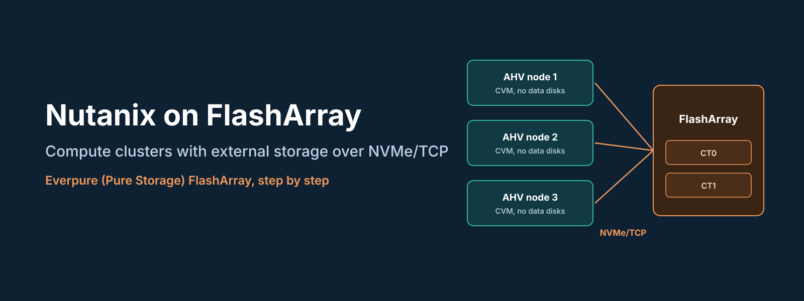
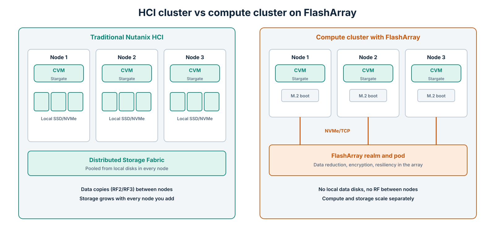
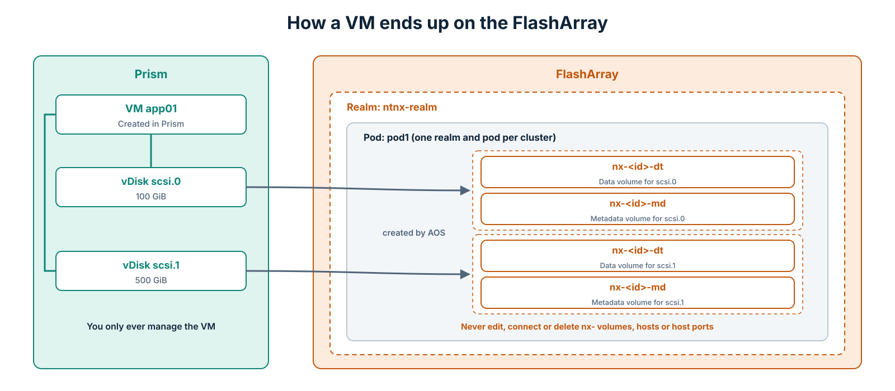
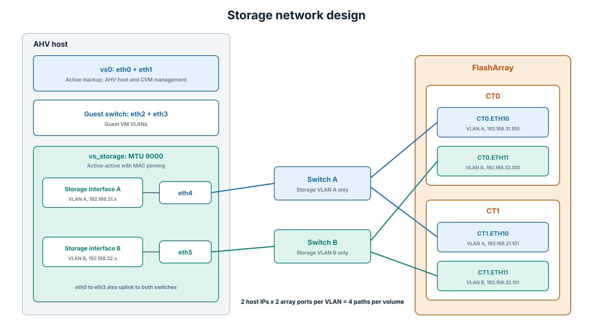
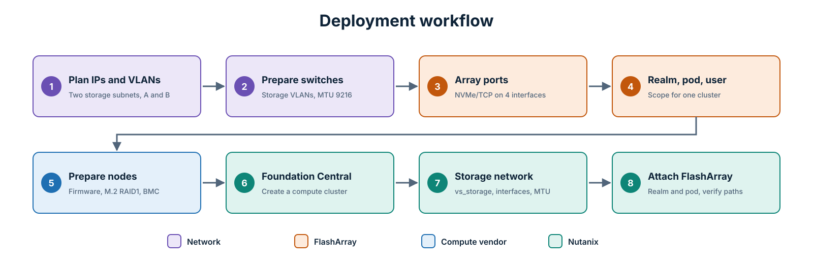
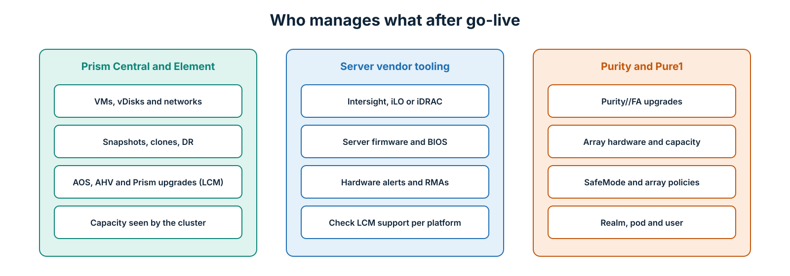

For most of its history, a Nutanix cluster meant one thing: servers with local disks, pooled into the Distributed Storage Fabric. That changed with AOS 7.5. Nutanix can now run AHV compute clusters whose VM data lives on an external array, and FlashArray from Everpure (the new name of Pure Storage) was the first array to reach general availability, in December 2025.

I covered the Dell side of this story in my [PowerStore article](/hybrid-infrastructure/nutanix/dell-powerstore/2026/11/04/nutanix-dell-powerstore-external-storage.html). This post does the same for FlashArray: how the integration works, what it needs, and how to build it step by step. I've kept it vendor-neutral on the compute side. Cisco UCS, HPE, and Dell servers each have their own preparation, but the array, the network, and the Nutanix steps are the same for all of them.

This is a fully supported, generally available solution, not a preview. Nutanix publishes its own [NCP with Everpure FlashArray deployment guide](https://portal.nutanix.com/page/documents/details?targetId=Nutanix-Cloud-Platform-with-Pure-Storage-Deployment-Guide-v7_5%3Atop-ncp-with-pure-storage-flasharray-architecture-c.html) on the support portal, and it has kept growing since launch: FlashArray//C support, Nutanix Kubernetes Platform (NKP) support, and, with AOS 7.5.1, synchronous replication and live migration between compute clusters.

Most of the procedure here follows the FlashStack with Nutanix deployment guide from Cisco, which is the most complete step-by-step walkthrough published so far. I've added details from the Nutanix guide, Everpure material, and the field.

* * *

## What Changes Compared to HCI


*Figure 1: Same CVM and Prism experience, different place for the data.*
{: style="text-align: center;"}

In a compute cluster on FlashArray:

- **The CVM is still there.** Every node runs a CVM, and Stargate inside it still handles the VM I/O. The difference is where it sends that I/O: to the FlashArray over **NVMe/TCP** instead of to local disks.
- **The nodes have no data disks.** Each node boots AHV from mirrored M.2 drives and keeps nothing else locally. The boot drives can't hold VM data.
- **The array protects the data.** There's no RF2 or RF3 between nodes. Data reduction, encryption at rest, and resiliency all happen in the FlashArray.
- **Compute and storage scale separately.** Need more CPU and memory? Add a node. Need more capacity? Grow the array. That's usually the reason a customer chooses this design over HCI.
- **Prism stays the control plane.** You create VMs, disks, snapshots, and protection policies in Prism exactly as you do on HCI.

* * *

## How Nutanix Uses the FlashArray


*Figure 2: Every vDisk becomes a pair of volumes inside the cluster's realm and pod.*
{: style="text-align: center;"}

This is the part worth understanding before you touch the array, because it explains most of the rules later on.

- **Realm and pod.** You give each Nutanix cluster its own **realm** on the FlashArray, with a **pod** inside it. The cluster only ever works inside that pod. One FlashArray can serve several Nutanix clusters, each in its own realm and pod, but each cluster connects to exactly one array.
- **Two volumes per vDisk.** When you create a vDisk in Prism, AOS creates two thin-provisioned volumes for it in the pod: a **data volume** (suffix `-dt`) and a **metadata volume** (suffix `-md`). A VM with three disks has six volumes on the array.
- **Everything is prefixed `nx-`.** AOS also creates the host objects and host ports it needs. All of them carry the `nx-` prefix, and they belong to Nutanix.

The golden rule: **never modify, connect, or delete volumes, hosts, or host ports with the `nx-` prefix** from the array side. Cisco's guide warns that doing so can cause data unavailability. If something looks wrong on the array, fix it from Prism or open a case.

Because each vDisk has its own volumes, array features like QoS and snapshots can work at the level of a single disk. That's a real difference from datastore-based designs, where one LUN holds many VMs.

* * *

## Requirements and Support

### Software Versions

| Component | Minimum version |
|---|---|
| AOS | 7.5 |
| AHV | 11.0 |
| Prism Central | 7.5 |
| LCM | 3.3 |
| NCC | 5.3 |
| Purity//FA | 6.10.3 |
| Foundation Central | 1.10 for Cisco UCS. HPE uses Foundation Central 2.0. Check the guide for your platform |

The Foundation Central version is the one that trips people up. Cisco's guide is explicit that **Foundation Central 2.0 is not supported for Cisco UCS** in this design, and that going back from 2.0 is difficult. Check which version your server platform needs before you upgrade anything.

### Hardware

| Item | Requirement |
|---|---|
| FlashArray | FlashArray//X, //XL, or //C |
| Array network ports | Ethernet ports for NVMe/TCP. //X R4 can use its onboard 25 GbE ports. //X R3 and //XL need added NICs |
| Compute | Servers qualified by Nutanix for external storage (Cisco UCS, HPE ProLiant, and Dell PowerEdge, depending on release and model) |
| Boot | Two identical M.2 SSDs in RAID1 per node (Cisco's guide recommends 480 GB) |
| Network | 10 GbE minimum end to end, 25 GbE or 100 GbE recommended, jumbo frames for storage |

### Protocol

**NVMe/TCP is the only supported protocol.** Fibre Channel and iSCSI aren't supported, and Fibre Channel isn't planned. If the customer's FlashArray is FC-only today, plan for Ethernet ports on the array and storage VLANs on the switches.

### Cluster Size and Scale

- At the first release, production clusters needed **five nodes** minimum, and three for non-production. Later releases lowered the minimum to **three nodes**. Check the release notes for your AOS version.
- 1-node and 2-node clusters aren't supported.
- A cluster scales to **32 nodes** and **5,000 vDisks**.
- Plan at least **1 TB of FlashArray capacity per node** for Nutanix's own use, on top of VM data.

### Prism Central

You need Prism Central 7.5 or later. At the first release, Nutanix asked for a dedicated, highly available Prism Central for these clusters, separate from any Prism Central that manages existing HCI clusters. Check whether that still applies to your version before you plan to reuse an existing one.

* * *

## Network Design


*Figure 3: Two storage VLANs, one per switch, give every volume four paths.*
{: style="text-align: center;"}

The storage network is built like a classic two-fabric SAN, just over Ethernet:

- **Two storage VLANs and subnets, A and B.** Storage VLAN A exists only on switch A, and storage VLAN B only on switch B. They don't cross.
- **On the FlashArray,** each controller has one NVMe/TCP port in each VLAN. In Cisco's example, `CT0.ETH10` and `CT1.ETH10` are on VLAN A, and `CT0.ETH11` and `CT1.ETH11` are on VLAN B.
- **On each AHV host,** two dedicated NICs carry storage, one to each switch, on a separate virtual switch for storage with MTU 9000. Each host gets one storage IP per VLAN.
- **The result:** two host IPs times two array ports per VLAN gives **four NVMe/TCP paths per volume**. You check for exactly that after attaching the array.
- **Management and guest traffic stay off the storage NICs.** The host keeps `vs0` for AHV and CVM management, and usually a separate virtual switch for guest VLANs.
- **Storage must be Layer 2 adjacent.** The host storage interfaces and the array ports in the same VLAN must be in the same subnet, with no routing in the path.

Here is the layout from Cisco's design, which works well as a template:

| Virtual switch | Uplinks | Bond type | MTU | Carries |
|---|---|---|---|---|
| `vs0` | eth0, eth1 | Active-backup | 9000 in Cisco's design (1500 is fine) | AHV host and CVM management |
| Guest switch | eth2, eth3 | Active-backup or active-active with MAC pinning | 1500 | Guest VM VLANs |
| `vs_storage` | eth4, eth5 | Active-active with MAC pinning | 9000 | Storage VLAN A and B |

If your servers connect to Cisco Fabric Interconnects, LACP isn't available for any of these virtual switches. With servers on top-of-rack switches, check the Nutanix guide for your platform before you choose an LACP bond.

### IP Address Plan

Prepare this list before you start. These example values come from Cisco's guide.

| Item | Example | Count |
|---|---|---|
| AHV host management | 10.106.1.71 to .76 | One per node |
| CVM management | 10.106.1.81 to .86 | One per node |
| BMC (CIMC, iLO, or iDRAC) | 10.106.0.60 to .65 | One per node |
| Storage interface A | 192.168.31.x | One per node, plus growth |
| Storage interface B | 192.168.32.x | One per node, plus growth |
| Cluster virtual IP | 10.106.1.70 | One |
| iSCSI Data Services IP | 10.106.1.69 | One |
| FlashArray management | Array VIP and controller IPs | Per array |
| FlashArray NVMe/TCP ports | 192.168.31.100, .101 and 192.168.32.100, .101 | Four |
| Foundation Central appliance | 10.106.1.50 | One, static |
| Prism Central | 10.106.2.5 | One, or three for scale-out |

* * *

## Deployment Workflow


*Figure 4: The order I follow. The array and network come before any node is imaged.*
{: style="text-align: center;"}

## Step 1: Prepare the Switches

The switch configuration depends on your vendor, but the requirements are the same. This example uses NX-OS syntax, based on Cisco's design.

Create the VLANs on both switches, then put each storage VLAN only where it belongs:

```text
vlan 1061
  name IB-Mgmt
vlan 3010
  name NVMe-TCP-A
vlan 3020
  name NVMe-TCP-B
```

The FlashArray ports are access ports with jumbo frames. On switch A:

```text
interface Ethernet1/25
  description FlashArray CT0.ETH10
  switchport mode access
  switchport access vlan 3010
  mtu 9216
  spanning-tree port type edge
  no shutdown

interface Ethernet1/26
  description FlashArray CT1.ETH10
  switchport mode access
  switchport access vlan 3010
  mtu 9216
  spanning-tree port type edge
  no shutdown
```

Switch B is the same, with VLAN 3020 and the `ETH11` ports.

The host-facing ports, or the uplinks to the Fabric Interconnects in a UCS design, are trunks with `mtu 9216`. They carry the management VLAN and guest VLANs on both switches, storage VLAN A only on switch A, and storage VLAN B only on switch B.

Cisco recommends connecting the FlashArray to the top-of-rack switches, not directly to Fabric Interconnects. Direct attachment is supported, but it isn't the recommended design.

## Step 2: Configure the NVMe/TCP Ports on the FlashArray

SSH to the FlashArray management address as `pureuser`. Enable the four ports:

```bash
purenetwork eth enable ct0.eth10
purenetwork eth enable ct1.eth10
purenetwork eth enable ct0.eth11
purenetwork eth enable ct1.eth11
```

Give each one an address, MTU 9000, and the `nvme-tcp` service:

```bash
purenetwork eth setattr --address 192.168.31.100/24 --mtu 9000 --servicelist nvme-tcp ct0.eth10
purenetwork eth setattr --address 192.168.31.101/24 --mtu 9000 --servicelist nvme-tcp ct1.eth10
purenetwork eth setattr --address 192.168.32.100/24 --mtu 9000 --servicelist nvme-tcp ct0.eth11
purenetwork eth setattr --address 192.168.32.101/24 --mtu 9000 --servicelist nvme-tcp ct1.eth11
```

Check the result:

```bash
purenetwork eth list
```

All four ports should be enabled, with the right address, MTU 9000, and `nvme-tcp` in the services column.

## Step 3: Create the Realm, Pod, and Nutanix User

Still on the array CLI:

```bash
# 1. A realm for this Nutanix cluster
purerealm create ntnx-realm

# 2. A pod inside the realm
purepod create ntnx-realm::pod1 --quota-limit 25T

# 3. A management access policy scoped to the realm
purepolicy management-access create --role admin --realm ntnx-realm ntnx-admin-access

# 4. The account Nutanix will use
pureadmin create ntnx-admin --access-policy ntnx-admin-access
```

Write down the realm name, the pod name, and the account credentials. You need all of them in Step 7.

Two points to check here:

- **Pod capacity.** Cisco's guide limits the pod with `--quota-limit`. Another published field guide recommends setting **Advertised Size** on the pod instead of a quota. Follow the current Nutanix and Everpure guidance for your Purity version, and remember the 1 TB per node that Nutanix uses internally.
- **Default protection.** If the array uses Purity's default protection, new volumes are added to a protection group automatically. Field guides recommend removing the Nutanix volumes from it before production, because array-side snapshots then overlap with Nutanix data protection. Decide which layer protects the VMs. Normally that's Nutanix, from Prism.

For one array serving several clusters, repeat this step with a new realm, pod, and user for each cluster.

## Step 4: Prepare the Compute Nodes

This is the vendor-specific part. Whatever the platform, the checklist is the same:

- **Firmware:** bring BIOS, BMC, and NIC firmware to the versions on the Nutanix compatibility list for external storage.
- **Boot drives:** two identical M.2 SSDs in RAID1.
- **BMC:** a static IP and credentials on each node (CIMC, iLO, or iDRAC).
- **NICs:** cable the management, guest, and storage NIC pairs as in Figure 3, and record which physical port becomes which `ethX`.
- **Clean nodes:** no old hypervisor or Nutanix installation.

For Cisco UCS, the servers must be in **Intersight Managed Mode**, and you need separate vNIC pairs for infrastructure, guest VMs, and storage. The infrastructure vNIC names (`ntnx-infra-1-A` and `ntnx-infra-1-B` in Cisco's guide) are case-sensitive, and if several clusters share one UCS domain, each needs its own LAN connectivity policy and Ethernet network group policy. If you're on Cisco, my [IMM article](/hybrid-infrastructure/nutanix/cisco-ucs/2026/11/09/nutanix-cisco-ucs-imm-umm-deployment.html) covers the Fabric Interconnect and Intersight preparation in detail.

## Step 5: Build the Cluster with Foundation Central

### Deploy the Foundation Central appliance

You can use the Foundation Central service in an existing Prism Central, or the standalone Foundation Central appliance, which removes the Prism Central requirement on day 0. Cisco's guide uses the appliance:

1. Deploy the appliance VM with 2 vCPUs and 4 GB of RAM, and give it a **static IP**. DHCP isn't supported.
2. Run the setup script from the VM console.
3. Log in at `https://<FCA-IP>:9440` as `admin`.

### Upload the images

The appliance hosts the images itself. Upload the AOS package, its metadata JSON, and the AHV ISO with an HTTP POST to `http://<FCA-IP>:8053/files/images`. Then send a GET to the same address to list the files and copy each full URL. You paste those URLs into the cluster wizard. Follow the exact request format in the Foundation Central documentation for your version.

### Connect the hardware provider and onboard the nodes

1. Go to **Settings > Connect Hardware Provider** and add your server management platform. For Cisco, select **Cisco Intersight**, choose the deployment type, and enter an Intersight API key (schema version 3) and its secret. The key needs **Server Administrator** rights in the organization and **read-only** rights on the domain. Only one Intersight connection is allowed.
2. Go to **Nodes > Manually Onboarded > Onboard Nodes**, choose the management mode (IMM for Cisco), select the nodes, and click **Onboard Nodes**.

### Create the compute cluster

Select the onboarded nodes and start **Create Cluster**. The key choice is the cluster type.

| Section | Field | Value |
|---|---|---|
| Cluster details | Cluster type | **Compute Cluster** (not HCI) |
| | Cluster name | For example `fs-ntnx` |
| | Organization | The org holding your pools and policies |
| Networking | Gateway, netmask, cluster virtual IP | Management subnet |
| Infrastructure NIC pair | VLAN, MTU, MAC pool | Management VLAN. Don't select LACP |
| BMC access | IP pool or addresses | Out-of-band network |
| Nodes | AHV IP, CVM IP, hostname | One set per node. Bulk fill is available |
| Images | AOS, metadata, and AHV URLs | From the appliance (port 8053) |
| CVM settings | Time zone, NTP, DNS | Must be reachable |
| Security | API key | The Foundation Central key |

Click **Create Deployment**. Cisco measured 60 to 90 minutes for the build, plus 60 to 90 minutes more when firmware also needs updating.

## Step 6: Build the Storage Network in Prism Element

Log in to Prism Element at `https://<cluster-VIP>:9440`, change the default `admin` password, accept the EULA, and configure Pulse.

When Prism asks about external storage, choose **I'll do this later**. The storage network has to exist before the array can be attached.

### Clean up vs0

Go to **Settings > Network > Network Configuration > Virtual Switch** and edit `vs0`. Make sure only the management NICs (`eth0` and `eth1`) are uplinks on every host. Depending on the platform, the installer may have added the storage NICs to `vs0`. Remove them.

### Create the storage virtual switch

Create a new virtual switch, for example `vs_storage`:

- **MTU:** 9000
- **Bond type:** active-active with MAC pinning
- **Uplinks:** the storage NICs (`eth4` and `eth5`) on every host

### Create the storage interfaces

On the **Internal Interfaces** tab, create one interface per storage VLAN on `vs_storage`:

| Interface | VLAN | IP pool | Netmask |
|---|---|---|---|
| `storage_vlan3010` | 3010 | 192.168.31.x, one per host plus growth | 255.255.255.0 |
| `storage_vlan3020` | 3020 | 192.168.32.x, one per host plus growth | 255.255.255.0 |

For each one, select the **External Storage** feature, set **MTU 9000**, and click **Enable interface**.

### Test jumbo frames before attaching

From any CVM, test all four array ports with a 9000-byte packet that is not allowed to fragment. The CVM interfaces for the two storage networks are `ntnx0` and `ntnx1`. Check which one has which subnet with `ip addr` on the CVM, then:

```bash
ping 192.168.31.100 -M do -s 8972 -I ntnx0 -c 2
ping 192.168.31.101 -M do -s 8972 -I ntnx0 -c 2
ping 192.168.32.100 -M do -s 8972 -I ntnx1 -c 2
ping 192.168.32.101 -M do -s 8972 -I ntnx1 -c 2
```

`8972` plus 28 bytes of headers is exactly 9000. If a small ping works and this one fails, an MTU is wrong somewhere: host, switch port, or array port. Fix it before you continue. An MTU mismatch on the storage path is the problem you least want to discover after VMs are running.

## Step 7: Attach the FlashArray

1. In Prism Element, go to **Storage > Attach External Storage**.
2. Select **FlashArray** as the vendor and give the array a name.
3. Enter the FlashArray **management IP** and the **account** you created in Step 3.
4. Select the **realm** and the **pod**.
5. Click **Attach**.

Then verify:

- In Prism, each volume shows **four active NVMe/TCP paths**.
- On the array, `purepod list` shows the pod, and `nx-` hosts and volumes start to appear inside the realm. Look, but don't touch.

Cisco's guide is clear that external storage must be attached before any VM is created.

## Step 8: Finish the Cluster Configuration

1. **Guest networking:** create the guest virtual switch on `eth2` and `eth3`, then create the VM subnets with their VLAN IDs.
2. **HA:** go to **Settings > Data Resiliency > Manage VM High Availability** and select **Enable HA Reservation**.
3. **Data Services IP:** set it under **Settings > General > Cluster Details**. Prism Central needs it.
4. **Prism Central:** deploy or register Prism Central 7.5 or later. In Cisco's guide, PC is deployed from Prism Element on the new cluster, sized Small, on FlashArray-backed storage.
5. **Passwords:** change the `nutanix` password on the CVMs and the `root`, `admin`, and `nutanix` passwords on the AHV hosts. Then run:

    ```bash
    ncc health_checks system_checks default_password_check
    ```

6. **Health:** run a full NCC check and clear every failure and warning.

## Step 9: Create a Test VM

Before handover, create one VM and follow it to the array:

1. Upload an OS ISO and, for Windows, the Nutanix VirtIO ISO.
2. Create the VM with a disk on the external storage container and a NIC on a guest subnet.
3. Install the OS, then install Nutanix Guest Tools.
4. Take a snapshot from Prism, restore it, and clone the VM.

Each of these is a small test of the integration. If snapshots, restores, and clones work from Prism and new `nx-` volumes appear in the pod, the cluster is ready for workloads. Nutanix Move works as usual for migrating VMs from ESXi into the new cluster.

* * *

## Data Protection

Protection works from Prism Central, with some differences from HCI that depend on the AOS version.

**With AOS 7.5:**

- Prism Central-based DR with **asynchronous replication**: categories, protection policies, and recovery plans, as on HCI.
- Replication between a compute cluster on FlashArray and a standard HCI cluster, **in either direction**.
- Backup integration with the usual vendors (HYCU, Commvault, Veeam, Rubrik, Cohesity) for backup and standard restore.

**Added in AOS 7.5.1,** according to Nutanix: **synchronous replication**, **Metro Availability** with a witness, and **cross-cluster live migration**.

**Not supported at the first release:**

- Prism Element protection domains
- NearSync replication
- Cross-hypervisor DR (ESXi to AHV)
- Multicloud Snapshot Technology
- Instant restore from third-party backups

On the array side, Everpure offers its own features, such as SafeMode immutable snapshots and ActiveDR. These protect the array, not individual VMs in Prism. Agree with the customer on which layer is responsible for VM recovery, and don't let both layers fight over the same `nx-` volumes.

* * *

## Day 2 Operations


*Figure 5: Three management planes. Know which one owns each task.*
{: style="text-align: center;"}

- **AOS, AHV, and Prism upgrades:** through LCM, as on any Nutanix cluster.
- **Server firmware:** check LCM support for your platform. In Cisco's design, LCM doesn't update server firmware on compute-only nodes on external storage, and firmware stays with Intersight.
- **Purity//FA upgrades:** done by Everpure tooling, through Pure1 and support. Prism Central doesn't manage the array software.
- **Capacity:** watch it in both Prism and the array. Data reduction happens in the array, so the array view is the real one.
- **Expansion:** prepare the new node with Foundation Central (**Prepare Node for Cluster**), using the same network settings and AOS and AHV versions. Then add it from Prism Central (**Infrastructure > Hardware > Clusters > Expand Cluster**) and map its uplinks to the same virtual switches. The Foundation Central appliance can't expand clusters by itself.

* * *

## Limitations to Know Before You Design

| Area | Limitation at the first release |
|---|---|
| Protocol | NVMe/TCP only. No FC, no iSCSI, no RDMA or iSER |
| Cluster size | No 1-node or 2-node clusters. Maximum 32 nodes |
| Arrays | One FlashArray per cluster. One realm and pod per cluster |
| Storage | No live migration between storage containers |
| Boot | No Repair Host Boot Disk from Prism Element |
| Products | NDB, NUS, and NDK not supported at first. NKP support was added after the first release |
| Array objects | `nx-` volumes, hosts, and host ports must not be changed from the array, and Pure volume copies can't overwrite them |

Several of these were expected to be lifted in later releases. The point of the table is to check them against the release you're deploying, not to rule the design out.

* * *

## Mistakes I'd Check for First

| Symptom | Likely cause |
|---|---|
| Jumbo ping fails, small ping works | MTU 9000 missing on a host, switch port, or array port |
| Fewer than four paths per volume | A storage VLAN on the wrong switch, or an array port missing the `nvme-tcp` service |
| Attach fails on credentials | User not tied to the realm's management access policy |
| Realm or pod not listed | Wrong account, or the pod was created outside the realm |
| Wrong Foundation Central version | FC 2.0 used for a Cisco build |
| Storage traffic on the management NICs | Storage NICs left on `vs0` |
| Unexpected array snapshots of Nutanix volumes | Default protection still applied to the pod |

* * *

## Conclusion

Nutanix on FlashArray keeps everything people like about Prism and AHV and moves the data to an array many customers already own and trust. The trade is that you now run three management planes and a real storage network, so the success of the project depends on the preparation more than on the installer.

If I had to keep only three rules from this post, they would be:

1. Build the storage network like a SAN. Two VLANs, two switches, MTU 9000 everywhere, and prove it with the jumbo ping before you attach anything.
2. Give each cluster its own realm and pod, and leave the `nx-` objects alone.
3. Check the support matrix for your exact versions: Foundation Central, minimum node count, data protection features, and LCM firmware support all changed between releases.

* * *

*Steps and versions in this post follow the Cisco FlashStack with Nutanix deployment guide, Nutanix and Everpure announcements, and community field guides as of November 2026. External storage support is moving quickly, so check the current Nutanix compatibility list and release notes for your versions before you start.*
