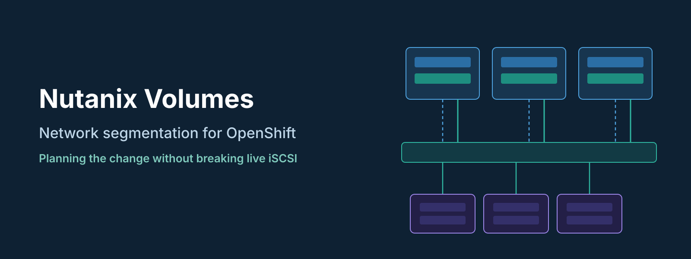
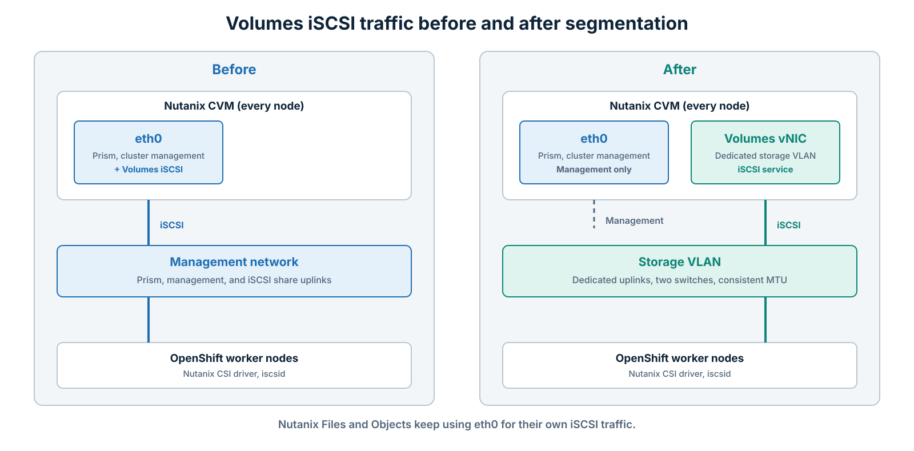

On paper, enabling network segmentation for Nutanix Volumes is a short task in Prism. You create an interface, pick a VLAN, tick a box, and iSCSI traffic moves off the CVM management network.

In practice, it is one of those changes that looks small and touches everything. I am currently preparing it for a Nutanix cluster that provides block storage to an OpenShift cluster through the Nutanix CSI driver. Another cluster in the same environment already runs with Volumes segmentation, so the goal is to bring both clusters to the same design.

This post covers how I am planning the change: what segmentation actually does, what breaks if you rush it, and the checklist I am following before anyone clicks **Enable** in production.

* * *

## Why Segment iSCSI Traffic at All?

By default, Volumes traffic uses the CVM `eth0` interface. That is the same interface used for Prism, cluster management, and other CVM services. For a few application VMs this is fine. Once a container platform starts creating and attaching dozens of persistent volumes, it gets harder to justify.

There are four reasons I prefer a dedicated network for iSCSI:

- **Performance isolation:** Storage I/O no longer competes with management traffic on the same uplinks.
- **Security:** iSCSI clients only need to reach a storage VLAN, not the management network of the cluster.
- **Troubleshooting:** When something is slow, you know exactly which links, VLAN, and switch ports to look at.
- **Consistency:** If one cluster is segmented and another is not, every runbook, firewall rule, and new OpenShift node has two variations. That is where mistakes come from.

* * *

## How It Works

Nutanix calls this **service-specific segmentation**. When you enable it for Volumes, Prism adds a new virtual NIC to every CVM on a dedicated VLAN, and Volumes iSCSI traffic is served from that interface instead of `eth0`.


*Figure 1: Volumes traffic before and after segmentation, using dedicated uplinks.*
{: style="text-align: center;"}

A quick reminder of how iSCSI on Nutanix works, because it matters for the rest of this post. Clients do not connect to a specific CVM. They log in to the **iSCSI Data Services IP**, and the cluster redirects each session to a healthy Stargate. If that Stargate goes down, the initiator logs in again and gets redirected to another one. This is why Nutanix does not need client-side multipathing for path resilience.

Segmentation changes the network those logins happen on. That is the whole point, and it is also the source of the disruption.

| | **Before segmentation** | **After segmentation** |
|---|---|---|
| CVM interface for Volumes | `eth0` (management) | Dedicated CVM interface on the storage VLAN |
| Network iSCSI clients reach | Management network | Storage network only |
| Physical uplinks | Shared with management | Dedicated uplinks on a separate virtual switch, or shared `vs0` uplinks with a separate VLAN |
| Nutanix Files and Objects | `eth0` | Still `eth0` (not affected) |

* * *

## What to Check Before You Start

These are the points I confirmed from the Nutanix documentation and community material. None of them are optional in my view.

**1. Build redundancy into the new network.**
Stargate does not monitor the health of a segmented network, so the cluster will not route around a broken storage link for you. Whichever design you choose below, the virtual switch carrying the storage VLAN needs at least two uplinks in a fault-tolerant bond, connected to two separate physical switches.

**2. One service at a time.**
You can only enable segmentation for one service per operation. If you also plan to segment replication or other services, schedule them as separate changes.

**3. Understand the DR limitation.**
When Volumes segmentation is enabled, volume group attachments are not recovered during VM recovery. If your DR runbooks rely on volume groups being re-attached automatically, they need a manual step.

**4. Files and Objects stay where they are.**
Nutanix service VMs such as Files and Objects continue to use `eth0` for their own iSCSI traffic. You do not need to change anything for them, but do not expect that traffic to move either.

**5. Plan the IP addresses and VLAN properly.**
You need a VLAN configured end to end on the switches, one IP address per CVM on the new network, and an address for clients to use for discovery. Size the IP pool for future node additions, not just today's node count, and keep the MTU consistent from the CVM to the client.

**6. Know who is using the cluster.**
This sounds obvious, but it was the first thing that slowed me down. Before touching the network, I need to know which OpenShift workloads actually have persistent volumes on this cluster and who owns them.

* * *

## The OpenShift Side

On the OpenShift cluster, the Nutanix CSI driver creates volume groups on Nutanix and attaches them to worker nodes over iSCSI. A few details matter here.

**The StorageClass decides the network.**
The CSI StorageClass for Volumes has a parameter called `isSegmentedIscsiNetwork`. It is commented out in most examples, so it is easy to miss. For a segmented cluster, it should be set to `"true"`:

```yaml
apiVersion: storage.k8s.io/v1
kind: StorageClass
metadata:
  name: nutanix-volumes-segmented
provisioner: csi.nutanix.com
parameters:
  storageType: NutanixVolumes
  storageContainer: <container-name>
  csi.storage.k8s.io/fstype: ext4
  isSegmentedIscsiNetwork: "true"
  # Secret references as in your existing StorageClass
allowVolumeExpansion: true
reclaimPolicy: Delete
```

Kubernetes does not let you edit the parameters of an existing StorageClass. In practice, this means creating a new StorageClass for the segmented network and deciding what happens to the PVCs that were created with the old one. That decision belongs in the plan, not in the change window.

**The worker nodes need iSCSI working.**
RHCOS ships the iSCSI initiator utilities, but the `iscsid` service is disabled by default. If it is not running, attachments fail with `iscsiadm: can not connect to iSCSI daemon`. Enable it through the Machine Config Operator so new nodes get it automatically. The worker nodes also need a route to the new storage VLAN, which is easy to forget when the platform team and the storage team are different people.

**Take an inventory before the change.**
These are the commands I use to see what is attached and where:

```bash
# Persistent volumes created by the Nutanix CSI driver
oc get pv -o custom-columns=NAME:.metadata.name,CLAIM:.spec.claimRef.name,NAMESPACE:.spec.claimRef.namespace,SC:.spec.storageClassName | grep -i nutanix

# Which worker node each volume is attached to
oc get volumeattachments

# Active iSCSI sessions on a worker node
oc debug node/<worker-node> -- chroot /host iscsiadm -m session
```

The output of these three commands becomes the list of workloads I need to confirm with the application owners.

* * *

## The Part That Can Hurt: Live iSCSI Sessions

Enabling Volumes segmentation moves the iSCSI service to the new interface. Clients that are logged in through the old network lose their sessions, and the Nutanix guidance is that iSCSI client connections must be migrated to the new segmented network.

For a VM with one volume group, that is a short outage you can plan around. For OpenShift, it means every stateful pod using Nutanix Volumes on that cluster can lose its storage at the same moment. Depending on the application and the file system, the result ranges from a few retries to a file system remounted read-only, or a pod stuck until someone restarts it.

That is why I treat this as an application change, not a network change. The questions that need answers before the change window are:

- Which namespaces and applications have PVCs on this cluster?
- Can those applications be scaled down for the window, and who approves it?
- Are there recent backups of the data on those volumes?
- How do existing PVs reconnect after the change? This is the main thing I want to see in testing.

* * *

## My Rollout Plan

| Step | Task | Notes |
|---|---|---|
| 1 | Inventory all Nutanix CSI volumes and their owners | Use the commands above |
| 2 | Agree a change window with the application owners | Include scale-down and rollback approval |
| 3 | Prepare the network | VLAN on both switches, plus the virtual switch for the chosen design (Option A or B below) |
| 4 | Confirm the worker nodes can reach the storage VLAN | Routing or a dedicated interface, depending on the OpenShift network design |
| 5 | Test on a non-production multi-node cluster | Enable segmentation with real PVCs attached and record exactly what happens |
| 6 | Take backups and scale down stateful workloads | StatefulSets and Deployments with Nutanix PVCs |
| 7 | Enable segmentation in Prism Element | Settings > Network > Network Configuration > Internal Interfaces |
| 8 | Create the segmented StorageClass and reconnect the workloads | Based on the behaviour confirmed in step 5 |
| 9 | Scale up and verify | Check pods, PVC status, iSCSI sessions, and application health |
| 10 | Monitor for at least a day | Watch Prism alerts and OpenShift events for storage errors |

A note on step 5. My first idea was to test this on my nested lab, but the lab is a single-node cluster, and a single-node test would not tell me much about session redirection across CVMs. I will run the test on a multi-node non-production cluster with a small Kubernetes deployment and a couple of real PVCs. A test that does not look like production only gives you false confidence.

* * *

## Choosing the Network Design

Before the implementation steps, there is one decision to make: does the storage VLAN get its own physical uplinks, or does it share the existing `vs0` uplinks?

| | **Option A: Dedicated uplinks (`vs1`)** | **Option B: Shared uplinks (`vs0`)** |
|---|---|---|
| Separation | Physical and logical | Logical only (VLAN) |
| Bandwidth | Storage has its own links | Storage shares links with management and VMs |
| NICs needed per node | Four ports or more | Two ports are enough |
| Effort and risk | Higher: uplinks move between switches, applied host by host | Lower: no uplink changes on the hosts |
| Jumbo frames | Easy to enable on `vs1` only | Changing the `vs0` MTU affects all traffic on it |
| Best fit | Production clusters with heavy container storage | Clusters with spare bandwidth, or no free NIC ports |

Option A is the cleaner design and the one I recommend when the hardware allows it. Option B is still a real improvement over running iSCSI on the management network, because the traffic gets its own VLAN, its own CVM interface, and its own firewall boundary. It just does not get its own bandwidth.

Field names in Prism can vary slightly between AOS versions, so check the Security Guide for your version before the change window.

### Option A: Dedicated Uplinks on a New Virtual Switch

**Prepare the physical network**

1. Pick two unused NIC ports on every node, ideally one port on each of two different NICs.
2. Cable them to two separate physical switches.
3. Configure the switch ports as trunks carrying the storage VLAN. If you plan to use LACP, create the port channels now and match them to the bond mode you will choose on the virtual switch.
4. If you use jumbo frames, set the MTU on the switch ports (9216 is a common value) and plan 9000 end to end, including the OpenShift worker interfaces.

**Free the ports from `vs0` (only if they are currently assigned to it)**

5. In Prism Element, open **Settings > Network > Network Configuration > Virtual Switch**.
6. Edit `vs0` and remove the ports you selected for storage. Prism applies uplink changes to the hosts one at a time, so do this in a maintenance window and wait until the task completes on every host.
7. Check that `vs0` still has two healthy uplinks on every node before you continue.

**Create the storage virtual switch**

8. On the same page, click **Create VS** and name it `vs1`.
9. Select the storage ports on every host, choose the bond type (Active-Backup, or Active-Active with LACP if the switches are ready for it), and set the MTU.
10. Save and wait for the task to complete on all hosts. Confirm in the network visualization that both uplinks on every node are up.

**Create the Volumes interface**

11. Go to **Settings > Network > Network Configuration > Internal Interfaces** and click **Create New Interface**.
12. On **Interface Details**, enter a descriptive name, the storage VLAN ID, and select **`vs1`** as the virtual switch. Create or select the IP pool for the CVM interfaces, with at least one address per node plus room for growth.
13. On **Feature Selection**, enable **Volumes** and complete the remaining network details for the iSCSI service.
14. Save and enable the interface, then follow the task until it completes on every CVM.

### Option B: Shared Uplinks on `vs0`

**Prepare the physical network**

In this design, the switch ports for the `vs0` uplinks are already configured as trunks, so no port mode change is needed.

1. Add the storage VLAN to the allowed VLAN list on every `vs0` trunk port, on both switches. Do not change the native VLAN or remove any VLAN that is already allowed.
2. If the trunks are members of port channels, add the VLAN on the port-channel interface so every member port carries it.

> **Add the VLAN, do not replace the list.** On Cisco switches, `switchport trunk allowed vlan <id>` replaces the whole allowed list, while `switchport trunk allowed vlan add <id>` appends to it. Using the wrong one removes the management and VM VLANs from the uplinks. Change one switch at a time, confirm the bond is still healthy on every node, and only then change the second switch.

3. Keep the `vs0` MTU as it is unless you are ready to support jumbo frames for everything on `vs0`, including management and guest VMs. For most clusters, I would leave it at 1500 in this design.

**Create the Volumes interface**

4. Go to **Settings > Network > Network Configuration > Internal Interfaces** and click **Create New Interface**.
5. On **Interface Details**, enter a descriptive name, the storage VLAN ID, and select **`vs0`** as the virtual switch. Create or select the IP pool for the CVM interfaces.
6. On **Feature Selection**, enable **Volumes** and complete the remaining network details for the iSCSI service.
7. Save and enable the interface, then follow the task until it completes on every CVM.

**Watch the bandwidth**

8. After the change, monitor uplink utilization on `vs0` during busy periods. If storage traffic starts affecting management or VM traffic, that is a strong signal to plan Option A.

### After Either Option

For both designs, do not start reconnecting the OpenShift workloads until the interface task has finished on all CVMs. From this point, the steps on the OpenShift side are the same: create the segmented StorageClass, reconnect the workloads, and run the verification checklist.

* * *

## Verification Checklist

- Every CVM shows the new interface with the correct IP address and VLAN.
- The virtual switch carrying the storage VLAN has two healthy uplinks on every node.
- Worker nodes can reach the new iSCSI address, and test pings pass with the planned MTU.
- `iscsiadm -m session` on each worker shows sessions on the new network.
- All PVCs are `Bound`, and all stateful pods are `Running` with no restart loops.
- Applications can read and write data, confirmed by the application owners.
- No new storage alerts in Prism and no attach errors in OpenShift events.

* * *

## Rollback

The rollback is to disable the Volumes interface and migrate the iSCSI client connections back to `eth0`. It is just as disruptive as enabling segmentation, so it needs its own approval in the change request and the same scale-down steps. I write the rollback before the implementation steps. If the rollback is not clear, the plan is not ready.

* * *

## Lessons So Far

- **Start with the workloads, not the network.** The Prism part takes minutes. Finding out who uses the cluster took longer.
- **Read the StorageClass, not just the Prism settings.** `isSegmentedIscsiNetwork` is easy to miss because it is usually commented out.
- **Test on something that looks like production.** A single-node lab cannot show you how sessions move between CVMs.
- **Treat the rollback as a real plan.** Disabling segmentation is not a free undo.

* * *

## Conclusion

Volumes network segmentation is the right design for clusters serving container storage. It isolates storage traffic, simplifies troubleshooting, and keeps clusters consistent. The risk is not in Prism. It is in the live iSCSI sessions behind every persistent volume.

Plan it as an application change, inventory the workloads first, test on a multi-node cluster, and agree the rollback before the window. Once I have completed the test, I will share a follow-up with what actually happened to the existing sessions and how long the workloads took to recover.

* * *

*Details in this post were checked against Nutanix and Red Hat documentation in November 2026. Behaviour can change between AOS and CSI driver versions, so confirm it for the versions in your environment before planning the change.*
