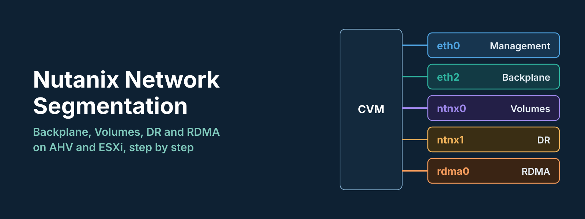

By default, every Nutanix CVM sends almost all of its external traffic through one interface, `eth0`. Prism, SSH, storage replication between nodes, iSCSI to external clients, and replication to a DR site all leave through it, on the management VLAN. For many customers that's fine. For others, usually because of a security or compliance requirement, it isn't. **Network segmentation** is how Nutanix splits that traffic onto separate VLANs, and even separate physical NICs.

A few weeks ago I wrote about one real case: [isolating Nutanix Volumes iSCSI traffic](/hybrid-infrastructure/nutanix/openshift/2026/11/09/nutanix-volumes-network-segmentation-openshift.html) for an OpenShift cluster. Now I'm preparing **backplane segmentation** for a customer with two clusters. While reading the AOS Security Guide line by line for that change, I decided to write the full picture in one place: what segmentation is, every type, on both AHV and ESXi, with the steps, the commands, and the impact of each.

One detail changes the whole plan, and it's easy to miss: **on AHV, enabling the backplane network needs a full guest VM shutdown**. On ESXi it doesn't, and the service-specific types don't on either hypervisor. If you're about to promise a customer "a rolling change with no downtime", read the impact section first.

The post is long, so here's the map:

| Section | What it covers |
|---|---|
| Understanding Network Segmentation | The concepts: traffic types, interfaces, logical and physical, AHV and ESXi |
| Choosing, impact, prerequisites, common steps | What to pick, what it costs, what to prepare |
| Part 1: Backplane | Replication, HA and live migration on their own network |
| Part 2: Volumes | iSCSI to external clients on its own network |
| Part 3: Disaster recovery | Replication between sites on its own network |
| Part 4: RDMA | Stargate-to-Stargate traffic over RoCE |
| Operations | Changing, disabling, change plan, common mistakes |

Steps and notes follow the AOS Security Guide (7.3 at the time of writing) and the Nutanix AHV Networking best practice guide.

* * *

## Understanding Network Segmentation

### The problem segmentation solves

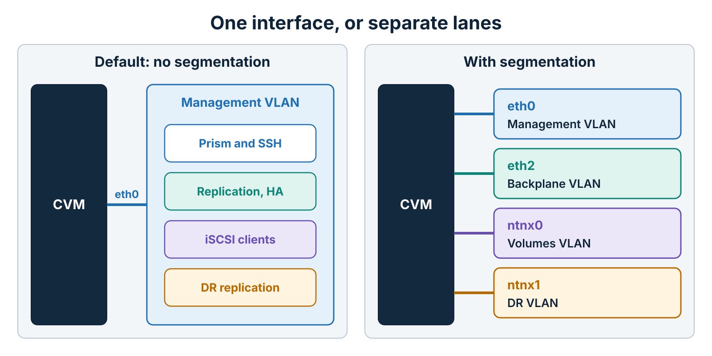
*Figure 1: Without segmentation, all external CVM traffic shares eth0 and the management VLAN. With it, each type gets its own lane.*
{: style="text-align: center;"}

Think of `eth0` as a single road that every kind of traffic has to use. Administrators reach Prism on it, the nodes copy data to each other on it, iSCSI clients read and write on it, and the DR site receives replication on it. Everything shares one VLAN, one subnet, and the same firewall rules.

That causes two kinds of concern:

- **Security.** The management network is usually routed and reachable from many places: jump hosts, monitoring tools, admin workstations. Storage replication and iSCSI traffic don't need to be reachable from any of them.
- **Traffic separation.** A busy iSCSI workload or a large replication job shares the same path as the management traffic. Some customers want them on different VLANs or even different NICs, so one can't affect the other.

Segmentation gives each traffic type its own lane: a dedicated CVM interface, its own VLAN and subnet, and optionally its own physical NICs.

### The CVM interfaces and what they carry

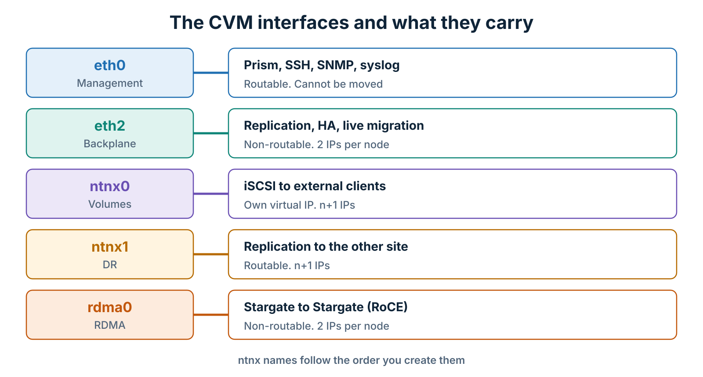
*Figure 2: One interface per traffic type. Management always stays on eth0.*
{: style="text-align: center;"}

| Type | CVM interface | Host side | Subnet | Addresses | Hypervisors | Configured in Prism under |
|---|---|---|---|---|---|---|
| Management | `eth0` | Existing | Routable, cluster gateway | Existing | All | Not movable |
| Backplane | `eth2` | New interface per host (`vmk2` on ESXi, `br0-backplane` on AHV) | Non-routable | 2 per node | AHV, ESXi, Hyper-V | **Backplane LAN** row |
| Volumes (iSCSI) | `ntnx0`, `ntnx1`... | None | Your iSCSI subnet, can be routed to clients | At least n+1 | AHV, ESXi | **Create New Interface** |
| Disaster recovery | `ntnx0`, `ntnx1`... | None | Routable, with gateway | At least n+1 | AHV, ESXi | **Create New Interface** or CLI |
| RDMA | `rdma0` | Host interface on the RDMA network | Non-routable | 2 per node | AHV, ESXi | **RDMA** row |

A few things that help when reading this table:

- **Management can't be moved.** It always stays on `eth0`. Segmentation moves other traffic away from it.
- **`eth1` is never involved.** It's the internal link between each CVM and its own host (`192.168.5.x`).
- **`eth2` and `rdma0` already exist.** AOS creates them during upgrades and leaves them unused until you enable the feature. Never configure or delete them by hand.
- **Service vNICs are named in the order you create them.** If you isolate Volumes first, it gets `ntnx0`, and DR then gets `ntnx1`. Don't assume a name from someone else's design.
- **"n" in "n+1" is the number of nodes.** The extra address is for the service's virtual IP.

### Cluster-level and service-level segmentation

The types fall into two families, and the difference explains most of the steps later:

| | Cluster-level: backplane and RDMA | Service-level: Volumes and DR |
|---|---|---|
| What moves | The cluster's own internal traffic | The traffic of one service |
| CVM side | `eth2` or `rdma0` gets an address | A new vNIC (`ntnx0`, `ntnx1`) is added |
| Host side | Every host gets an interface too | Nothing on the host |
| IPs | 2 per node | n+1, including a virtual IP |
| Subnet | Non-routable, no gateway | Routed if clients or the other site are elsewhere |
| Configured with | A dedicated row in Prism (**Backplane LAN**, **RDMA**) | **Create New Interface**, plus feature settings |

### Logical or physical separation

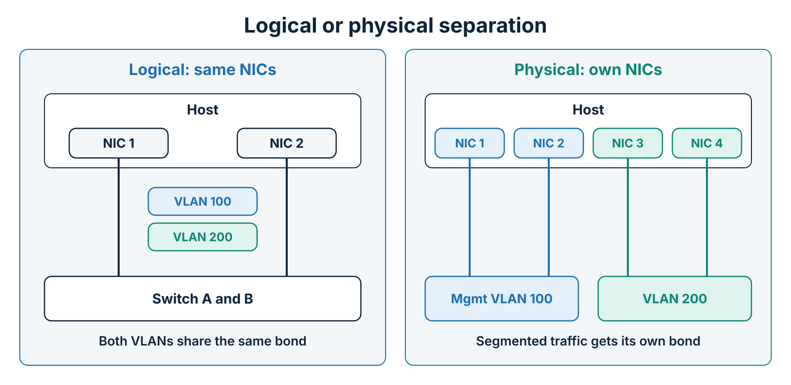
*Figure 3: Logical separation uses a new VLAN on the existing NICs. Physical separation adds dedicated NICs.*
{: style="text-align: center;"}

Every type can be built in one of two ways:

- **Logical (shared uplinks):** the segmented traffic gets a new VLAN, but uses the same NICs and bond as management. It needs no new hardware, only the VLAN on the switch trunks. The separation is at Layer 2.
- **Physical (dedicated uplinks):** the segmented traffic gets its own virtual switch with its own NICs, usually to its own switch ports. It needs at least two extra NICs per host, connected to two switches for redundancy.

Nutanix recommends a separate VLAN in both cases. Physical separation adds bandwidth isolation on top. Choose it when the customer wants the traffic on different cables, or when replication, live migration or iSCSI traffic is heavy enough to compete with management.

### How a CVM interface reaches the network on AHV and ESXi

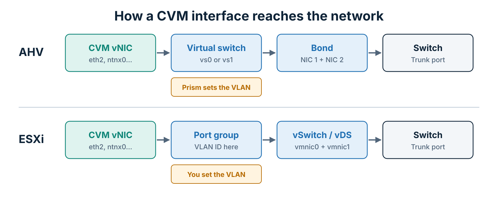
*Figure 4: On AHV, Prism configures the VLAN. On ESXi, you create the port group and the VLAN lives there.*
{: style="text-align: center;"}

This is the main difference between the hypervisors, and it changes your preparation steps:

- **On AHV,** the CVM interface connects to a Nutanix **virtual switch** (`vs0`, or a new one such as `vs1`), which is a bridge with a bond of physical NICs. You choose the virtual switch in the Prism wizard and enter the VLAN ID, and **Prism configures the VLAN for you**. For backplane, AOS also creates the host's internal interface automatically.
- **On ESXi,** the CVM interface connects to a **port group** on a standard or distributed vSwitch. Prism can't create port groups or set VLANs on ESXi hosts. **You create the port groups yourself, with the VLAN ID on them,** on every host, before running the wizard. For backplane, AOS then creates the `vmk2` VMkernel adapter on the host port group you select.

In short: on AHV you prepare at most a virtual switch, and Prism does the rest. On ESXi you prepare port groups for every segmented network.

### Routable or non-routable

| Type | Subnet | Why |
|---|---|---|
| Backplane | Non-routable, no gateway | Only CVMs and hosts in the same cluster talk on it. The CVM's default route stays on `eth0`, and a gateway on the backplane risks split routing |
| RDMA | Non-routable | Only Stargate on the CVMs in the same cluster talks on it |
| Volumes | Routed only if needed | Clients in the same subnet connect directly. Clients in other subnets need a client subnet and gateway in the settings |
| DR | Routable, with gateway | Replication goes to another site, through routers |

### What happens when you enable a type

The workflow is the same in principle for every type:

1. You prepare the switches and the host network.
2. You fill in the wizard in Prism, and Prism **validates** the settings before changing anything.
3. AOS assigns addresses from the subnet or IP pool to every CVM (and every host, for backplane and RDMA).
4. The CVMs **reboot one at a time**, so the cluster services move to the new interface. Some types need more than one round of reboots.
5. You finish with follow-up tasks: restarting Acropolis on AHV for the backplane, moving iSCSI clients for Volumes, reconfiguring remote sites for DR.

* * *

## Which Segmentation Do You Need?

Nutanix is honest about this: in most cases it recommends the default configuration, with no segmentation of any kind, because it's simpler to run. Segmentation solves specific problems, so start from the requirement:

| Requirement | Segmentation type |
|---|---|
| Keep storage replication, HA and live migration off the management network | Backplane |
| Put replication and live migration on dedicated physical NICs | Backplane on a dedicated virtual switch |
| Give external iSCSI clients (OpenShift, Kubernetes, physical servers, VMs) their own storage network | Volumes |
| Separate production and non-production iSCSI traffic | Volumes, two networks |
| Send replication to the DR site over its own network or WAN link | Disaster recovery |
| Metro Availability over a stretched Layer 2 network | Disaster recovery with `--stretched_metro` |
| Use RDMA NICs for Stargate-to-Stargate traffic | RDMA |

They can be combined. A cluster can have a backplane, a Volumes network and a DR network at the same time, each on the existing virtual switch or on its own. When a requirement comes from a security policy, ask which traffic it's actually meant to protect. Sometimes the concern is iSCSI or DR traffic, not the backplane.

* * *

## Impact on Each Hypervisor

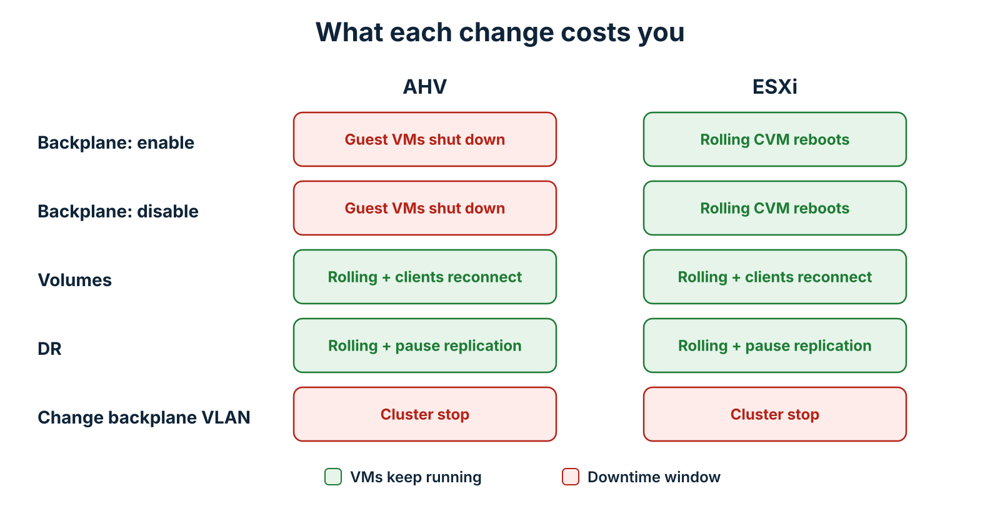
*Figure 5: Only the backplane on AHV, and changing the backplane VLAN, need downtime.*
{: style="text-align: center;"}

This is the table to show the customer before any change is approved.

| Type | AHV | ESXi |
|---|---|---|
| Backplane: enable | **Guest VMs shut down**, all hosts in maintenance mode, rolling CVM reboots | Rolling CVM reboots (up to two rounds), guest VMs keep running |
| Backplane: disable | **Same downtime procedure** | Rolling CVM reboots, no cluster downtime |
| Backplane: change VLAN or subnet | `backplane_ip_reconfig`, **cluster stop** | Same, except not supported on distributed switches |
| Volumes or DR: enable | CVMs reboot several times, one after another | Same |
| Volumes or DR: disable | Rolling restart, **the service is disrupted** until follow-up tasks are done | Same |
| Volumes: after enabling | iSCSI clients log out and reconnect to the new virtual IP | Same |
| DR: before enabling or disabling | Disable replication schedules running on the hosts | Same |
| RDMA | Plan a maintenance window. The guide doesn't describe guest VM impact | Same |

Two consequences for planning:

- **Configure one segmentation type at a time.** Prism doesn't let you enable several services at once, and you want to verify each one before adding the next.
- **With several clusters, do them one at a time.** Finish, verify, and run NCC on the first before you touch the second.

* * *

## Prerequisites for Every Type

| Item | What to check |
|---|---|
| AOS version | 5.5 or later for logical backplane, 5.11 or later for physical backplane, Volumes and DR, 6.6 or later for RDMA with ZTR. Any current release is fine |
| Cluster health | Full NCC run with no failures, data resiliency OK in Prism |
| VLANs | New VLAN IDs, unique in the network, configured on the physical switches first |
| Proxy ARP | Disabled within the Nutanix VLANs |
| CVM `eth2` | Not created or configured by hand (KB 9479 and Field Advisory 78 cover removing a manual one) |
| NSX | CVM interfaces not connected to port groups backed by NSX NVDS switches |
| ESXi switches | Standard or distributed, but the same type for all management and backplane traffic in the cluster, not mixed |
| Dedicated uplinks | At least two NICs per host, to two different switches, link up before you start |
| Reserved ranges | None of the segmented subnets overlap `169.254.0.0/16`, `192.168.5.0/24`, `192.168.7.2/27`, `10.100.0.0/16` or `10.200.32.0/24` |
| Prism Central upgrades | If the cluster uses a segmented Data Services IP in a secondary subnet, also configure a DSIP in the same subnet as Prism Central, or PC can't run cluster upgrades |
| Access | IPMI/iLO/iDRAC console access to every host, in case management connectivity breaks |

Redundancy matters more once traffic is segmented. Nutanix notes that **Stargate doesn't monitor the health of a segmented network**, so with physical segmentation, network failures aren't tolerated. Every dedicated virtual switch needs two or more uplinks in a fault-tolerant configuration, connected to two separate physical switches.

* * *

## Common Step 1: Configure the Physical Switches

Do this before anything else in Prism, and test it, for every segmentation type. If the VLAN isn't on the switch ports, validation will fail, or worse, the CVMs will reboot onto a network where they can't reach each other.

### Shared uplinks

Add the new VLAN to the trunks that already carry `vs0` or `vSwitch0` traffic. On NX-OS, for every host-facing port:

```text
interface Ethernet1/1
  switchport trunk allowed vlan add 200
```

Use **`add`**. `switchport trunk allowed vlan 200` without `add` **replaces** the allowed list, and you'll cut off management and guest traffic on that port. I've seen it happen. Check the result with `show interface Ethernet1/1 switchport` before moving to the next port.

If the ports are access ports today, they must become trunks first, with the current management VLAN kept as the native (untagged) VLAN. On AHV, changing a host port from access to trunk while the host is using it is a change of its own, and needs its own window.

### Dedicated uplinks

Configure the new ports as trunks carrying only the segmented VLAN:

```text
interface Ethernet1/21
  description esx01-vmnic2 / ahv01-eth2 backplane
  switchport mode trunk
  switchport trunk allowed vlan 200
  spanning-tree port type edge trunk
  no shutdown
```

Use the same MTU as the rest of the cluster's ports. One NIC per host goes to switch A and the other to switch B. Make sure the VLAN is allowed on the inter-switch link (vPC peer link or equivalent), or the two halves of the network can't reach each other when a host fails over to its other NIC.

Non-routable networks (backplane, RDMA) need no SVI and no gateway. Routed networks (Volumes with remote clients, DR) need a gateway that your network team configures as usual.

## Common Step 2: IP Address Pools

Service-specific networks always use an **IP pool**, which you can create in the **Create New Interface** wizard. The backplane can use a whole subnet or a pool, but Prism can only create backplane pools from the CLI. To create a pool from any CVM:

```bash
network_segmentation --ip_pool_name=BackplanePool --ip_pool_netmask=255.255.255.0 \
  --ip_ranges="[('172.16.200.10', '172.16.200.49')]" ip_pool create
```

A pool can hold several ranges, all in the same subnet. The same command creates pools for Volumes and DR.

Remember that cluster expansion takes addresses from these pools: two per new node for the backplane, and one per new node for each service-specific network. If a pool is empty, the expansion fails.

If you need specific addresses, for example to match the last octet of the management IPs, AOS supports a **custom IP mapping**: a JSON file that maps each CVM (and, for the backplane, each host) external IP to its segmented IP from the pool. The Volumes example from the guide, on ESXi:

```json
{
  "svmips": {
    "10.47.240.141": "10.47.6.141",
    "10.47.240.142": "10.47.6.142",
    "10.47.240.143": "10.47.6.143"
  }
}
```

```bash
network_segmentation --service_network --ip_pool=pool1 --desc_name="Volumes Seg 1" \
  --service_name=kVolumes --host_physical_network=dv-volumes-network-1 \
  --service_vlan=151 --ip_map_filepath=/home/nutanix/ip_map.json
```

For backplane mapping, the JSON also has a `hostips` section. Follow "Customizing IP Addresses for each CVM and Host" in the Security Guide for the exact backplane command.

* * *

# Part 1: Backplane Segmentation

## What the Backplane Network Is

Nutanix splits the traffic leaving a CVM into two types:

- **Management traffic:** Prism, SSH, SNMP, remote syslog, and anything else that isn't backplane, including communication between user VMs and CVMs (for example iSCSI clients). It uses CVM interface **`eth0`**.
- **Backplane traffic:** traffic the cluster needs internally: storage RF replication between CVMs, traffic between CVMs and hosts, high availability, and host management. On AHV, **VM live migration** traffic is backplane too. Once segmentation is enabled, all of it uses CVM interface **`eth2`**.

Every CVM already has an `eth2`. AOS creates it automatically during an upgrade to any version that supports segmentation, and it sits unused until you enable the backplane network. Don't delete it, and never configure it by hand.

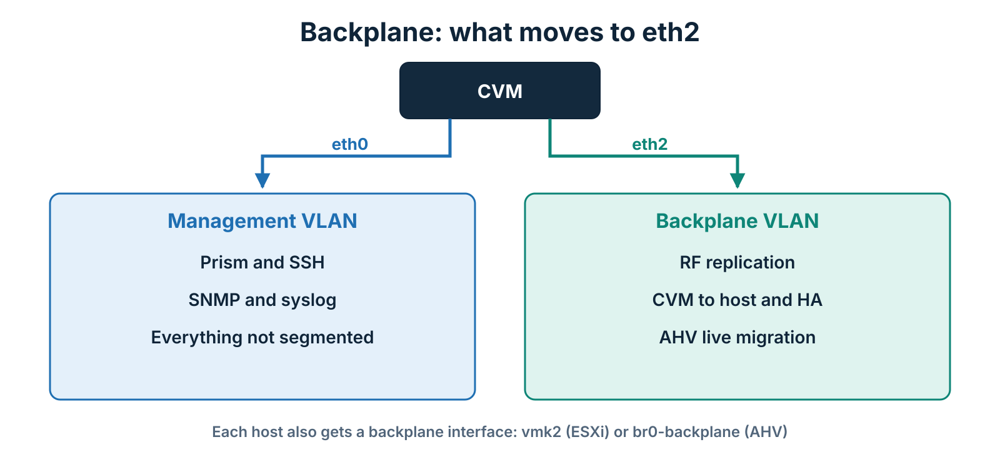
*Figure 6: Without segmentation everything leaves through eth0. With it, internal traffic moves to eth2 on its own VLAN.*
{: style="text-align: center;"}

When you enable the backplane LAN, AOS:

1. Gives every CVM `eth2` an address from the backplane subnet.
2. Creates a backplane interface on every host and gives it an address from the same subnet. On ESXi this is a new VMkernel adapter (`vmk2`). On AHV it's an internal interface on the selected virtual switch (`br0-backplane` when it's on `br0`).
3. Moves the cluster services to the new network through rolling CVM reboots.

That's why the guide says you need **two IP addresses per node**: one for the CVM and one for the host.

* * *

## Backplane Designs: Shared or Dedicated Uplinks

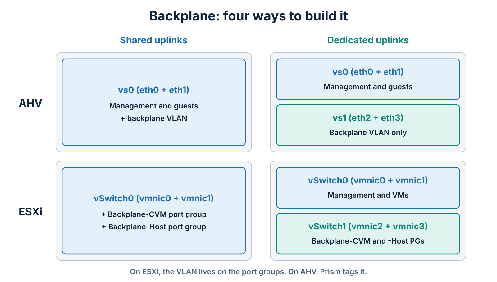
*Figure 7: Logical segmentation shares the existing uplinks. Physical segmentation gives the backplane its own.*
{: style="text-align: center;"}

| | Shared uplinks (logical) | Dedicated uplinks (physical) |
|---|---|---|
| Where the backplane lives | New VLAN on the existing `vs0` / `vSwitch0` | New VLAN on a new virtual switch with its own NICs |
| Extra NICs needed | No | Yes, at least two per host, to two switches |
| Host preparation on AHV | None | Remove uplinks from `vs0`, create `vs1` |
| Host preparation on ESXi | Two port groups on `vSwitch0` | New vSwitch, two port groups |
| Separation | Logical, by VLAN | Physical, by NIC and VLAN |
| Minimum AOS | 5.5 | 5.11 |

In both designs, Nutanix strongly recommends a **separate VLAN** for the backplane. You can leave the VLAN ID empty, but the backplane then lands on the default (untagged) VLAN of the switch, and you've gained very little.

A naming warning before we go further. On an AHV host, the physical NICs are called `eth0`, `eth1`, `eth2`, and so on. The CVM also has an `eth2`. They're different things. In this post, "host NICs" means physical ports, and "CVM `eth2`" means the CVM's backplane vNIC.

* * *

## Backplane Downtime on Each Hypervisor

The backplane is the one type where AHV and ESXi behave very differently, so it's worth looking at in detail.

| | AHV | ESXi |
|---|---|---|
| Guest VMs | **Must be shut down** for the whole procedure | Keep running |
| Hosts | All hosts in maintenance mode | No host maintenance mode |
| CVMs | Rolling reboots | Rolling reboots, up to two rounds |
| Extra steps | Restart Acropolis cluster-wide, exit maintenance mode | None |
| Disabling later | Same downtime procedure | Rolling, no cluster downtime |

The AHV procedure starts with "shut down all the guest VMs in the cluster" and puts every AHV host into maintenance mode before the backplane is configured. It applies to both AHV designs: the guide sends the logical (VLAN-only) case on AHV to the same procedure as the physical one.

On ESXi, the guest VMs keep running while the CVMs reboot one at a time. The guide notes that the change can take up to two rolling reboots. The first moves each CVM's `eth2` to the selected port group, and only happens where it isn't already there. The second moves the cluster services to the new interface.

One consequence that's easy to forget:

- **Prism Central, Files, Objects and other Nutanix service VMs on an AHV cluster are guest VMs too.** They go down with everything else. Shut them down with their own procedures, not with a hard power-off, and expect Prism Central to be unavailable during the window if it runs on this cluster.
* * *

## Backplane Subnet and IP Plan

### Choosing the subnet

The backplane subnet has three rules:

1. **Non-routable, with no gateway.** The CVM's default route stays on `eth0`, and there's no route on the backplane interface. If you pick a routable subnet, you risk split routing. Nutanix recommends a non-routable subnet only.
2. **Big enough for the future.** Two addresses per node. Changing the subnet later uses `backplane_ip_reconfig`, which stops the cluster. Size it for the maximum the cluster could grow to, not for today.
3. **Avoid reserved ranges.** Don't use `169.254.0.0/16` (APIPA), `192.168.5.0/24` (internal CVM to host), `192.168.7.2/27` (cross-cluster TCP proxy), or `10.100.0.0/16` and `10.200.32.0/24` (Objects internal services).

If you don't want to give a whole subnet to the backplane, create a **backplane IP pool** from the CLI (Common Step 2) with only the ranges you want to use. Prism Element can't create backplane pools, only service-specific ones.

### Example IP plan

For a 4-node cluster with management on `10.10.10.0/24` (VLAN 100) and the backplane on VLAN 200:

| Item | Value |
|---|---|
| Backplane VLAN | 200, tagged |
| Backplane subnet | `172.16.200.0/24`, no gateway |
| Addresses used | 8 (2 per node), plus room for every future node |
| CVM `eth2` addresses | Assigned by AOS from the subnet or pool |
| Host backplane addresses | Assigned by AOS from the subnet or pool |

AOS assigns the addresses itself. In the guide's own example, CVMs and hosts alternate (`.1` CVM, `.2` host, `.3` CVM, `.4` host). If you need specific addresses, use the custom IP mapping described in Common Step 2.

* * *

## Backplane on AHV

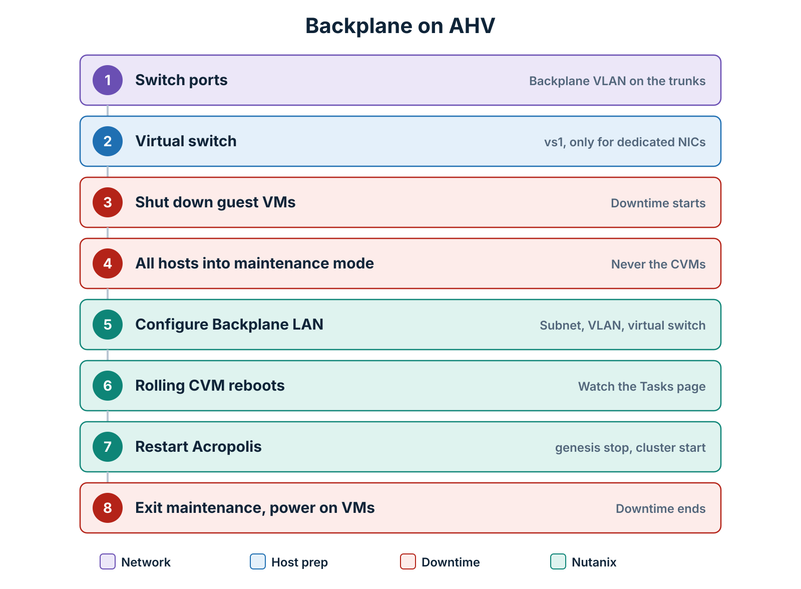
*Figure 8: The AHV procedure. Everything from step 3 to step 8 is inside the downtime window.*
{: style="text-align: center;"}

### A1: Prepare the Virtual Switch (Dedicated Uplinks Only)

Skip this step for the shared uplink design. The backplane will go on `vs0`.

For dedicated uplinks, the host NICs for the backplane must leave `vs0` and join a new virtual switch:

1. In Prism Element, go to **Settings > Network Configuration > Virtual Switch**.
2. Edit **`vs0`** and remove the NICs you'll use for the backplane from its uplinks on every host. Keep at least two NICs in `vs0`.
3. Create a new virtual switch, for example **`vs1`**:
   - **Name and description:** `vs1`, "Backplane"
   - **MTU:** the same as the switch ports
   - **Bond type:** Active-Backup. The AHV networking guide asks for redundant adapters of at least 10 Gbps with a fault-tolerant load balancing algorithm.
   - **Uplinks:** the backplane NICs on every host
4. Check that the uplinks are **up** on every host before you continue. The guide states this as a requirement.

From a CVM, you can check the result:

```bash
acli net.list_virtual_switch
manage_ovs show_uplinks
```

Prism applies virtual switch changes host by host. I prefer doing this preparation as its own change, a day or more before the backplane window. Then, if something goes wrong with the uplinks, you're not troubleshooting it inside a downtime window.

### A2: Shut Down the Guest VMs

Shut down every guest VM from inside the guest OS, or from Prism. That includes Nutanix service VMs, each with its own procedure:

- **Prism Central** on this cluster: shut it down cleanly. You'll work only in Prism Element during the window.
- **Nutanix Files:** stop the file server properly before powering off the FSVMs.
- **Any other appliance** (backup proxies, Objects, NKP nodes): stop them the way their own documentation describes.

Record which VMs were running, so you power on exactly the same set at the end.

```bash
acli vm.list power_state=on
```

### A3: Put All AHV Hosts in Maintenance Mode

From any CVM, list the hosts:

```bash
acli host.list
```

Put **each AHV host** into maintenance mode. Never the CVMs:

```bash
acli host.enter_maintenance_mode 10.10.10.21
acli host.enter_maintenance_mode 10.10.10.22
acli host.enter_maintenance_mode 10.10.10.23
acli host.enter_maintenance_mode 10.10.10.24
```

Each one should return `EnterMaintenanceMode: complete`. Then verify every host:

```bash
acli host.get 10.10.10.21
```

Look for `node_state: "EnteredMaintenanceMode"` and `schedulable: False`. **Don't continue if any node failed to enter maintenance mode.** If HA reservation is enabled, check it first under **Settings > Manage VM High Availability**, because the guide notes nodes can't enter maintenance mode while it's on. Turn it back on at the end.

Never use this procedure on a single-node cluster.

### A4: Enable the Backplane LAN in Prism

1. In Prism Element, click the gear icon and open **Network Configuration**.
2. On the **Internal Interfaces** tab, in the **Backplane LAN** row, click **Configure**.
3. Fill in the dialog:

| Field | Shared uplinks | Dedicated uplinks |
|---|---|---|
| Subnet IP | `172.16.200.0` | `172.16.200.0` |
| Netmask | `255.255.255.0` | `255.255.255.0` |
| VLAN ID | `200` | `200` |
| Virtual Switch | `vs0` | `vs1` |

Then click **Verify and Save**.

Prism validates the settings first. If validation passes, it creates the backplane network, and the CVMs reboot **one at a time**. Follow the progress on the **Tasks** page and don't touch anything until the task completes.

### A5: Restart Acropolis Cluster-Wide

When the task has completed, SSH to any CVM and run:

```bash
allssh genesis stop acropolis
cluster start
```

Then check that every service is up:

```bash
cluster status | grep -v UP
```

If Prism showed **"Failed to restart one or more services after Backplane was enabled"**, the guide says the segmentation task itself completed, but some services didn't start in time. Run `cluster start` and check again.

### A6: Exit Maintenance Mode and Power On

For each host:

```bash
acli host.exit_maintenance_mode 10.10.10.21
acli host.get 10.10.10.21
```

Check for `node_state: "AcropolisNormal"` (or `kAcropolisNormal`) and `schedulable: True`.

Before powering on the guest VMs, run the verification in the section below. If the backplane isn't healthy, you want to know now, while nothing is running. Then:

1. Turn HA reservation back on if you turned it off.
2. Power on Prism Central and the Nutanix service VMs first, then the guest VMs, in the customer's usual order.

* * *

## Backplane on ESXi

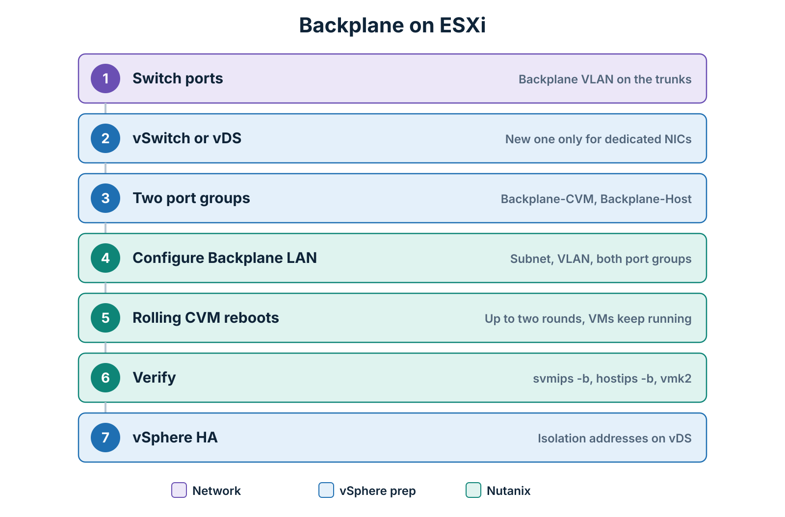
*Figure 9: The ESXi procedure. Guest VMs keep running throughout.*
{: style="text-align: center;"}

On ESXi, Prism can't create VLANs or port groups on the hosts. **The VLAN for the backplane lives on the ESXi port groups**, and you create them yourself before running the wizard. Prism creates the VMkernel adapter (`vmk2`) on the host port group for you. Don't create it by hand.

### E1: Create the Port Groups (Shared Uplinks)

Create two port groups on `vSwitch0` on **every host**, with identical names and the backplane VLAN:

| Port group | Used for | VLAN |
|---|---|---|
| `Backplane-CVM` | CVM `eth2` | 200 |
| `Backplane-Host` | Host `vmk2`, created by Nutanix | 200 |

With standard vSwitches, you can do it on all hosts at once from a CVM:

```bash
hostssh "esxcli network vswitch standard portgroup add -p Backplane-CVM -v vSwitch0; \
esxcli network vswitch standard portgroup set -p Backplane-CVM --vlan-id 200; \
esxcli network vswitch standard portgroup add -p Backplane-Host -v vSwitch0; \
esxcli network vswitch standard portgroup set -p Backplane-Host --vlan-id 200"
```

Check:

```bash
hostssh "esxcli network vswitch standard portgroup list | grep -i backplane"
```

With a vSphere Distributed Switch, create the two distributed port groups once in vCenter with VLAN 200.

The guide also allows leaving the port group fields empty in the wizard, so Prism picks the default port group on `vSwitch0`. I prefer creating them explicitly. On ESXi the VLAN has to live on a port group, and named port groups make it obvious in vCenter what they're for.

### E1 (alternative): Create a Backplane vSwitch (Dedicated Uplinks)

For dedicated uplinks, on every host:

1. Create a new vSwitch, for example `vSwitch1`.
2. Remove the backplane NICs (for example `vmnic2` and `vmnic3`) from `vSwitch0`.
3. Add them to `vSwitch1`, one active and one standby, or both active.
4. Create `Backplane-CVM` and `Backplane-Host` on `vSwitch1`, both with VLAN 200.

The `esxcli` equivalent, one host at a time:

```bash
esxcli network vswitch standard add -v vSwitch1
esxcli network vswitch standard uplink remove -u vmnic2 -v vSwitch0
esxcli network vswitch standard uplink remove -u vmnic3 -v vSwitch0
esxcli network vswitch standard uplink add -u vmnic2 -v vSwitch1
esxcli network vswitch standard uplink add -u vmnic3 -v vSwitch1
esxcli network vswitch standard policy failover set -v vSwitch1 -a vmnic2 -s vmnic3
esxcli network vswitch standard portgroup add -p Backplane-CVM -v vSwitch1
esxcli network vswitch standard portgroup set -p Backplane-CVM --vlan-id 200
esxcli network vswitch standard portgroup add -p Backplane-Host -v vSwitch1
esxcli network vswitch standard portgroup set -p Backplane-Host --vlan-id 200
```

Before you remove any NIC from `vSwitch0`, check that it isn't the only active uplink for management or the CVM port group. If you override the failover order on the port groups, the guide asks that each port group keeps **at least one uplink in its Active list**.

Don't mix switch types. All management and backplane traffic in a cluster must be on standard vSwitches, or all on distributed vSwitches, with the same port group type (normal or NSX segment) on every node.

### E2: Enable the Backplane LAN in Prism

1. In Prism Element, click the gear icon and open **Network Configuration**.
2. On the **Internal Interfaces** tab, in the **Backplane LAN** row, click **Configure**.
3. Fill in the dialog:

| Field | Value |
|---|---|
| Subnet IP | `172.16.200.0` |
| Netmask | `255.255.255.0` |
| VLAN ID | `200`, matching the port groups |
| Host Port Group | `Backplane-Host` |
| CVM Port Group | `Backplane-CVM` |

Then click **Verify and Save**.

After validation, the CVMs reboot in a rolling fashion, up to two rounds. Guest VMs keep running. Follow the progress on the **Tasks** page. When it's done, every host has a new `vmk2` on `Backplane-Host`.

### E3: vSphere HA with Distributed Switches

The guide has a specific warning for ESXi clusters with a **distributed switch** and segmentation enabled. If the management network goes down, ESXi might trigger HA host isolation response and restart all VMs. To avoid it, configure multiple isolation addresses with the **`das.isolationaddress`** advanced option in vCenter.

It's worth reviewing the HA isolation settings on standard switches too, while you're there.

* * *

## Verifying the Backplane

Run these from any CVM after the task completes.

**1. Segmentation status:**

```bash
network_segment_status
```

It should report that network segmentation is enabled.

**2. Backplane addresses of the CVMs and hosts:**

```bash
svmips -b
hostips -b
```

These must show the backplane addresses (`172.16.200.x`), different from the output of `svmips` and `hostips` without `-b`. If they're the same, the cluster isn't using the backplane.

**3. The CVM interfaces:**

```bash
allssh "ip -br addr show eth2"
```

Every CVM should show `eth2` up with its backplane address.

**4. The host interfaces:**

```bash
# AHV
hostssh "ip -br addr | grep -i backplane"

# ESXi
hostssh "esxcli network ip interface ipv4 get | grep vmk2"
```

**5. Reachability across the backplane,** from one CVM to the backplane address of every other CVM and host:

```bash
for ip in $(svmips -b) $(hostips -b); do
  ping -c 2 -W 1 $ip > /dev/null && echo "$ip OK" || echo "$ip FAILED"
done
```

**6. Services and health:**

```bash
cluster status | grep -v UP
ncc health_checks run_all
```

**7. On AHV, test a live migration** of a test VM between two hosts. Live migration now runs over the backplane, so this proves the backplane works host to host, not only CVM to CVM.

Keep the output of steps 1 to 5 for the change record. It's the proof that the change did what it was supposed to do.

* * *

## Backplane Day 2 Operations

### Cluster expansion

- Each new node takes **two addresses** from the backplane subnet or pool. If there aren't enough, the expansion task fails, and you add ranges to the pool first.
- The switch ports of the new node must be configured **exactly** like the existing ones, with the same backplane VLAN. Otherwise the expansion fails at network validation.
- On AHV with dedicated uplinks, prepare the new host's virtual switch the same way. On ESXi, create the same port groups with the same names before you expand.

### AOS upgrades

The upgrade notes in the Security Guide only cover clusters coming from AOS versions without segmentation support, where `eth2` is created automatically during the upgrade. For a segmented cluster, the rule is simple: `eth2` on every CVM belongs to AOS and should never be touched by hand. That includes hardening scripts that "clean up unused interfaces". Run NCC before and after every upgrade as usual.

### Changing the VLAN or subnet later

```bash
backplane_ip_reconfig --backplane_vlan=300 --backplane_ip_pool=NewBackplanePool
```

This command does a **`cluster stop`**, even if you only change the VLAN, so it means cluster downtime. During the run you might see "Failed to reach a node". The guide says to ignore it and not stop the script. Afterwards, verify with `svmips -b` and `hostips -b`.

`backplane_ip_reconfig` isn't supported on ESXi clusters with distributed switches. There, you disable segmentation and enable it again with the new subnet or VLAN.

### Disabling segmentation (the rollback)

- **ESXi:** from any CVM, run `network_segmentation --backplane_network --disable` and confirm with `Y`. The CVMs restart one at a time, with no cluster downtime. Confirm with `network_segment_status`, and check that `svmips` and `svmips -b` now show the same addresses.
- **AHV:** the same downtime procedure as enabling it. Shut down the guest VMs, put all hosts into maintenance mode, click **Disable** in the **Backplane LAN** row, run `allssh genesis stop acropolis` and `cluster start`, exit maintenance mode, and power the VMs back on.

Write the rollback into the change request. On AHV, a rollback is a second downtime window, and the customer should know that before approving the first one.

* * *

* * *

* * *

# Part 2: Volumes (iSCSI) Isolation

Nutanix Volumes presents volume groups over iSCSI to clients outside the cluster: physical servers, VMs on other platforms, and Kubernetes or OpenShift nodes through the Nutanix CSI driver. By default, those clients connect to the cluster **Data Services IP (DSIP)**, which lives on the management network and is served by CVM `eth0`. Volumes isolation gives iSCSI its own VLAN, its own CVM vNIC, and its own target address.

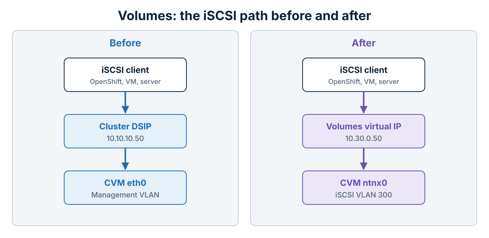
*Figure 10: Before, clients use the DSIP on the management network. After, they use the Volumes virtual IP on the iSCSI VLAN.*
{: style="text-align: center;"}

## What changes, and what doesn't

- **A new vNIC on every CVM**, named `ntnx0` (or the next free name), with an address from the IP pool.
- **A new target address**, the Volumes **virtual IP**, also from the pool. Clients discover and log in to this address instead of the DSIP.
- **No host interface.** Nothing new on AHV or ESXi hosts except the virtual switch or port group you prepare.
- **Existing sessions don't move by themselves.** The DSIP keeps working until you move every client.
- **Guest VMs keep running** on both hypervisors. The CVMs reboot several times, one after another.

## When to use it

- External iSCSI clients that should not reach the management network, which is the most common reason.
- OpenShift or Kubernetes clusters using the Nutanix CSI driver with volume groups.
- Separating production and non-production iSCSI. You can create **up to two Volumes networks** per cluster, each with its own VLAN, pool and virtual IP.

## Design options

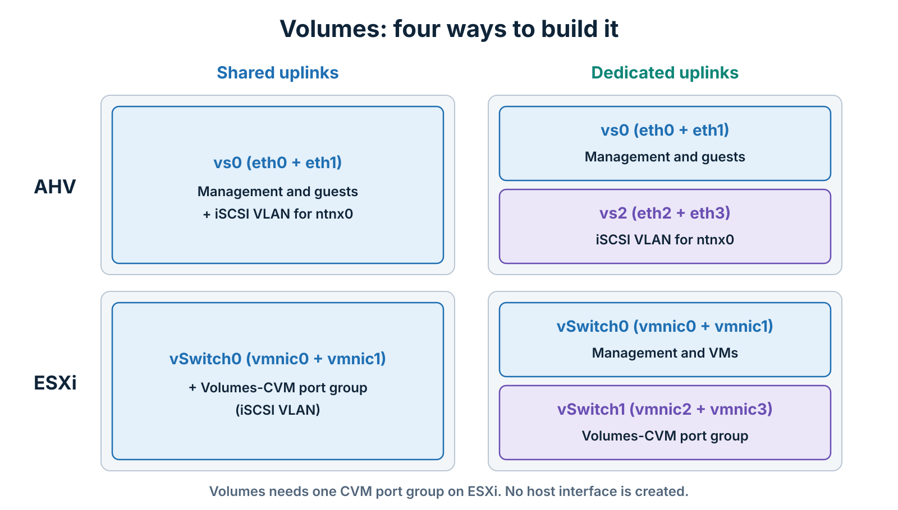
*Figure 11: The same two designs as the backplane, but with only one CVM port group on ESXi.*
{: style="text-align: center;"}

| | Shared uplinks | Dedicated uplinks |
|---|---|---|
| AHV | Select `vs0` and enter the iSCSI VLAN in the wizard | Create `vs2` with its own NICs, select it in the wizard |
| ESXi | Create a `Volumes-CVM` port group with the iSCSI VLAN on `vSwitch0` | Create `vSwitch1` with its own NICs and the `Volumes-CVM` port group on it |

## Planning the network

Example for a 4-node cluster:

| Item | Example |
|---|---|
| iSCSI VLAN | 300 |
| iSCSI subnet | `10.30.0.0/24`, gateway `10.30.0.1` if clients are in other subnets |
| IP pool | `10.30.0.41` to `10.30.0.60`: 4 CVMs + 1 virtual IP + room for growth |
| Virtual IP | `10.30.0.50`, picked from the pool |
| Clients in the same subnet | OpenShift workers with an interface in `10.30.0.0/24` |
| Clients in other subnets | `10.40.0.0/24`, entered as a **client subnet** with the gateway |

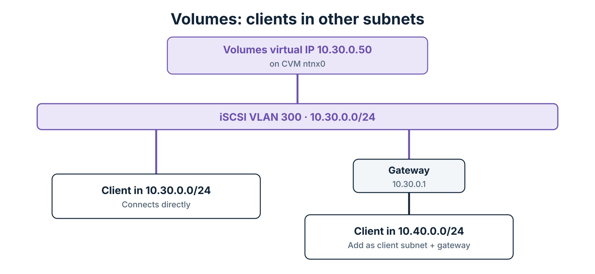
*Figure 12: Clients in the iSCSI subnet connect directly. Clients elsewhere need the client subnet and gateway settings.*
{: style="text-align: center;"}

Two practical points from my OpenShift project:

- **Give the clients an interface in the iSCSI subnet when you can.** Direct Layer 2 access is simpler and avoids pushing iSCSI through a router or firewall.
- **Talk to the client teams early.** Every client must log out and reconnect, and for Kubernetes the target address lives in the CSI configuration. That's usually the longest part of the project, not the Nutanix change.

## The workflow

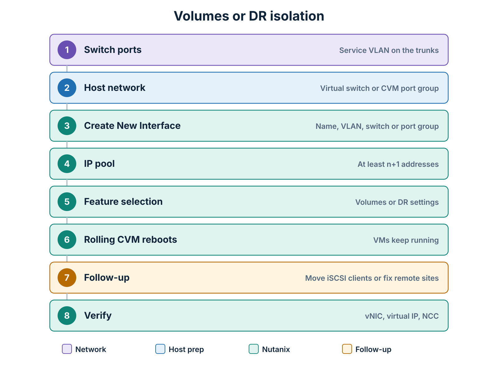
*Figure 13: The same workflow serves Volumes and DR. Only the settings and follow-up tasks differ.*
{: style="text-align: center;"}

## Volumes on AHV

### V1: Configure the switch ports

Add VLAN 300 to the host trunks (shared uplinks), or configure the new ports (dedicated uplinks), as described in Common Step 1. If clients are in other subnets, ask the network team for the gateway on VLAN 300 and routing to the client subnets.

### V2: Prepare the virtual switch (dedicated uplinks only)

For shared uplinks, skip this step. The vNIC will go on `vs0`.

For dedicated uplinks:

1. In Prism Element, go to **Settings > Network Configuration > Virtual Switch**.
2. Edit `vs0` and remove the NICs you'll dedicate to iSCSI from its uplinks on every host.
3. Create a new virtual switch, for example `vs2`, with those NICs as uplinks, MTU matching the switch ports, and a fault-tolerant bond such as Active-Backup.
4. Check that the uplinks are up on every host:

```bash
acli net.list_virtual_switch
manage_ovs show_uplinks
```

### V3: Create the interface

1. In Prism Element, click the gear icon and open **Network Configuration**.
2. On the **Internal Interfaces** tab, click **Create New Interface**.
3. On the **Interface Details** tab:

| Field | Value |
|---|---|
| Name | `Volumes-Prod` |
| VLAN ID | `300` |
| Bridge | `vs0` (shared) or `vs2` (dedicated) |
| IP pool | **Create New IP Pool**: name `Volumes-Pool`, netmask `255.255.255.0`, range `10.30.0.41` to `10.30.0.60`, then **Save** and select it |

4. Click **Next**.

### V4: Feature selection

On the **Feature Selection** tab, select **Volumes** and fill in:

| Setting | Value | Notes |
|---|---|---|
| Virtual IP | `10.30.0.50` | Optional, but set it. Otherwise AOS picks a random address from the pool |
| Client subnet | `10.40.0.0/24` | Only for clients outside `10.30.0.0/24`. Prism accepts one |
| Gateway | `10.30.0.1` | Required if you set a client subnet |

Click **Save**, then **Save** again in the **Create Interface** dialog.

### V5: Wait for the rolling reboots

The CVMs reboot several times, one after another, and other tasks may start. Follow them on the **Tasks** page and don't start anything else until they're all complete. Guest VMs keep running.

Then continue with the client migration and verification below, which are the same on both hypervisors.

## Volumes on ESXi

### VE1: Configure the switch ports

Same as V1.

### VE2: Create the CVM port group

On ESXi, you create one port group for the CVMs, with the iSCSI VLAN. No host port group is needed, because no VMkernel adapter is created for Volumes.

**Shared uplinks,** on every host at once from a CVM:

```bash
hostssh "esxcli network vswitch standard portgroup add -p Volumes-CVM -v vSwitch0; \
esxcli network vswitch standard portgroup set -p Volumes-CVM --vlan-id 300"
```

**Dedicated uplinks,** one host at a time:

```bash
esxcli network vswitch standard add -v vSwitch1
esxcli network vswitch standard uplink remove -u vmnic2 -v vSwitch0
esxcli network vswitch standard uplink remove -u vmnic3 -v vSwitch0
esxcli network vswitch standard uplink add -u vmnic2 -v vSwitch1
esxcli network vswitch standard uplink add -u vmnic3 -v vSwitch1
esxcli network vswitch standard policy failover set -v vSwitch1 -a vmnic2 -s vmnic3
esxcli network vswitch standard portgroup add -p Volumes-CVM -v vSwitch1
esxcli network vswitch standard portgroup set -p Volumes-CVM --vlan-id 300
```

With a distributed switch, create the `Volumes-CVM` distributed port group once in vCenter with VLAN 300. Don't mix standard and distributed switches in the same cluster.

Check the result:

```bash
hostssh "esxcli network vswitch standard portgroup list | grep -i volumes"
```

### VE3: Create the interface

Same as V3, with one difference in the **Interface Details** tab:

| Field | Value |
|---|---|
| Name | `Volumes-Prod` |
| CVM Port Group | `Volumes-CVM` |
| IP pool | `Volumes-Pool`, `10.30.0.41` to `10.30.0.60` |

The VLAN comes from the port group. Then do the feature selection (V4) and wait for the rolling reboots (V5), exactly as on AHV.

## Move the iSCSI clients to the new network

Enabling the network doesn't move existing sessions. Clients stay connected to the DSIP on `eth0` until you move them. Both paths work at the same time, but Nutanix recommends moving every client for real isolation. Do it client by client, in each application's maintenance window.

**Step 1: Log out.** On each client, log out of all iSCSI targets that use the DSIP or CVM `eth0`.

**Step 2: Clean up discovery (optional).** Remove the discovery records for the DSIP.

**Step 3: Update the allowlist.** If volume groups allow clients by IP address and the client's IP changes (because it now uses an interface in the iSCSI VLAN), run from any CVM:

```bash
acli vg.detach_external <vg_name> initiator_network_id=<old_client_ip>
acli vg.attach_external <vg_name> initiator_network_id=<new_client_ip>
```

**Step 4: Reconnect.** Discover the Volumes virtual IP and log in to the targets. On a Linux client:

```bash
iscsiadm -m discovery -t sendtargets -p 10.30.0.50:3260
iscsiadm -m node -p 10.30.0.50:3260 --login
iscsiadm -m session
```

For Kubernetes or OpenShift with the Nutanix CSI driver, the target address also lives in the storage configuration. My [OpenShift post](/hybrid-infrastructure/nutanix/openshift/2026/11/09/nutanix-volumes-network-segmentation-openshift.html) covers that case step by step.

## Adding client subnets later

Prism takes one client subnet. To add more, use the CLI from any CVM:

```bash
network_segmentation --service_network --update --interface="ntnx0" \
  --service_name="kVolumes" --client_subnets="10.40.0.0/24,10.41.0.0/24"
```

The list replaces the existing one, so always include the subnets you already have.

## A second Volumes network

To separate production and non-production iSCSI, repeat the steps with a second VLAN, pool and virtual IP after the first network is complete. It gets the next free vNIC name, for example `ntnx1`. Two is the maximum for Volumes.

## Verify Volumes isolation

```bash
# The vNIC is up with an address from the pool on every CVM
allssh "ip -br addr show ntnx0"

# The CVMs reach each other on the iSCSI network
ping -c 2 -I ntnx0 10.30.0.42
```

Then check:

- The **Internal Interfaces** tab shows the interface enabled, with the virtual IP.
- Each client lists sessions to `10.30.0.50` only (`iscsiadm -m session` on Linux).
- No client is still logged in through the DSIP.
- A full NCC run is clean.

## Limitations

- With Volumes segmentation enabled, **volume group attachments aren't recovered during VM recovery**. Plan your DR runbooks accordingly.
- **Objects worker nodes keep using CVM `eth0`** for iSCSI. Other external clients, such as Files, use the new interface.
- If the cluster's only DSIP is in a segmented secondary subnet, add a DSIP in the Prism Central subnet, or Prism Central can't run cluster upgrades.

## Rolling back Volumes isolation

1. In **Network Configuration > Internal Interfaces**, click **Disable** for the Volumes interface. The cluster does a rolling restart, and **iSCSI through the virtual IP stops working**.
2. Move every client back: log out of the targets on the virtual IP, remove its discovery records, discover the cluster **DSIP**, and log in again.

Schedule the rollback like the original change, with the client teams ready.

* * *

# Part 3: Disaster Recovery Isolation

DR isolation moves replication between sites off `eth0` and onto its own VLAN and vNIC. It applies to protection domains in Prism Element and to Nutanix DR in Prism Central, and to every schedule type: asynchronous, NearSync, synchronous and Metro Availability.

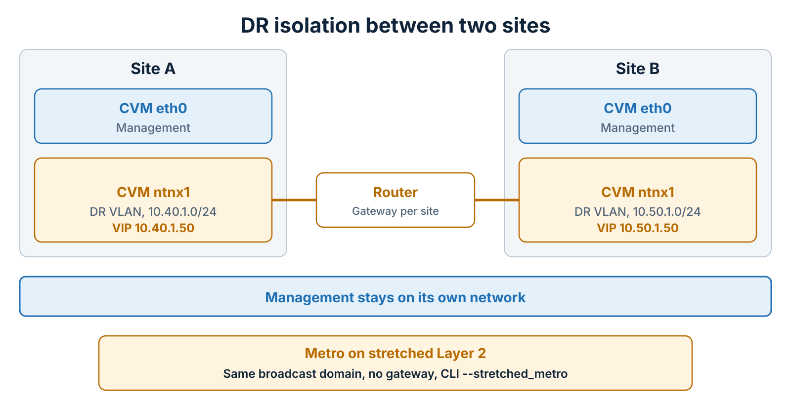
*Figure 14: Each site replicates from its DR interface, through a routed path. Management stays separate.*
{: style="text-align: center;"}

## Prerequisites specific to DR

- The DR VLAN and subnet must be **routable**, with a gateway, because replication goes to another site.
- The pool needs **n+1 addresses**, the extra one for the DR virtual IP.
- Enable DR segmentation **at both sites** before you configure the remote sites.
- **Disable the replication schedules** running on the hosts before enabling or disabling DR segmentation.
- Firewalls between the sites must allow replication between the DR subnets of both sites, not only between their management subnets.

## Steps on AHV and ESXi

The steps are the same as for Volumes, with the DR VLAN and pool:

1. **Switch ports:** add the DR VLAN to the trunks or configure the dedicated ports. Make sure the gateway and routing to the other site exist.
2. **Host network:** on AHV, use `vs0` or a dedicated virtual switch. On ESXi, create a `DR-CVM` port group with the DR VLAN on every host.
3. **Create New Interface:** name (`DR-Replication`), VLAN ID (AHV) or CVM port group (ESXi), and a new pool with n+1 addresses or more.
4. **Feature Selection:** select **Disaster Recovery** and fill in the settings below.
5. **Wait** for the rolling CVM reboots.
6. **Repeat at the other site.**

| Setting | What it does |
|---|---|
| **Virtual IP** | Optional. The DR address of the cluster. For Prism Central-based Nutanix DR, it must be different from the cluster external IP and the Data Services IP |
| **Gateway** | The gateway of the DR subnet |

## Protection domains: reconfigure the remote sites

With Prism Element protection domains, configure the remote sites at **both** locations after enabling segmentation, and again if you disable it later.

There's a catch the guide calls out: after segmentation, the remote site allows only the virtual IP by default, so traffic from the other CVM addresses in the pool can be blocked, and replication fails. Configure the firewall rules to allow the required ports for **all addresses in the segmentation pool**. KB-19733 has the details.

## Prism Central-based Nutanix DR

The Nutanix DR guide has its own "Network Segmentation" section, which applies to protection policies and recovery plans. One limit to plan around: **Prism Central can't configure DR segmentation without a gateway**. If you need that, use the CLI.

## Metro on a stretched Layer 2 network

For Metro Availability between sites in the **same broadcast domain**, you can create the DR network without a gateway, from the CLI only, with `--stretched_metro`. First create the DR IP pool (Common Step 2), then on AHV:

```bash
network_segmentation --service_network --service_name=kDR --ip_pool=DR_pool \
  --service_vlan=124 --desc_name="L2 Stretch for AHV" --host_virtual_switch=vs0 \
  --stretched_metro
```

On ESXi, the same command takes the CVM port group instead of the virtual switch:

```bash
network_segmentation --service_network --service_name=kDR --ip_pool=DR_pool \
  --service_vlan=124 --desc_name="L2 Stretch for ESXi" --host_physical_network=portgroup0 \
  --stretched_metro
```

Without a gateway, DR is limited to clusters in the same Layer 2 domain. Check the AOS release notes for the minimum version that supports this.

## Verify DR isolation

- `allssh "ip -br addr show ntnx1"` shows the DR vNIC up on every CVM (use the name your interface got).
- The remote site shows as connected at both sites.
- A test replication completes, and its traffic is visible on the DR VLAN, not on management.
- A full NCC run is clean at both sites.

* * *

# Part 4: RDMA Network Segmentation

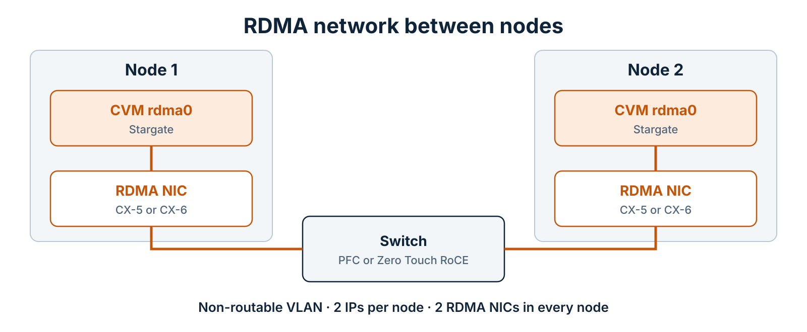
*Figure 15: Stargate on each CVM talks to the other nodes over RoCE, on a dedicated RDMA NIC and VLAN.*
{: style="text-align: center;"}

RDMA segmentation applies to clusters with RDMA-capable NICs (NVIDIA Mellanox ConnectX family). Stargate-to-Stargate traffic between CVMs then runs over RoCE on a separate RDMA LAN, through a CVM interface called **`rdma0`** that AOS creates during upgrades. It's supported on **AHV and ESXi**.

## Requirements

- **At least two RDMA-enabled NICs in every node.** If any node is missing them, the RDMA option is disabled.
- **No mixed NIC families** on the same node, such as CX-4 with CX-5, or CX-5 NICs of different speeds.
- **Uniform configuration.** Every node must have RDMA port pass-through or Zero Touch RoCE configured the same way. A mix isn't supported.
- **A non-routable subnet,** two addresses per node, sized for expansion, and a VLAN configured on the switch ports.
- **For Zero Touch RoCE (ZTR):** ConnectX-5 or ConnectX-6 NICs, the same NIC firmware on all nodes (NCC checks it, see KB 4289), and AOS 6.6 or later.
- **Without ZTR:** the switches need Priority Flow Control (PFC) configured as described in the guide's PFC specifications.

## Procedure

1. In Prism Element, open **Settings > Network Configuration > Internal Interfaces**. Prism shows the **RDMA** row only when it detects ConnectX-5 or ConnectX-6 NICs.
2. Click **Configure** in the **RDMA** row.
3. Enter a non-routable **Subnet IP** and **Netmask**, and the **VLAN** ID. The VLAN is optional with ZTR, but Nutanix recommends it.
4. Select **Use Zero Touch RoCE**, or the **PFC** value configured on the physical switch ports. Selecting ZTR disables the PFC field.
5. Click **Verify and Save**.
6. If RDMA port pass-through wasn't set up during Foundation and the cluster runs AHV, Prism asks you to choose the port. Click **Next**, select the port to reserve for RDMA on all hosts, and click **Save**. If pass-through was set up in Foundation, the port is fixed and can't be changed here.

The guide doesn't describe the impact on running VMs for this change, so plan it in a maintenance window.

## iSER

On AHV, RDMA-capable clusters can also use **iSER** (iSCSI Extensions for RDMA) between the AHV host and the CVM. AHV Turbo is the iSER initiator, and Stargate is the target. It reduces latency and CPU use for guest VM I/O, and falls back to TCP without disruption if RDMA fails. iSER uses fixed internal IP addresses that can't be changed, and has its own NIC matrix and CVM memory requirements. Treat it as a performance feature rather than a segmentation design, and follow the iSER section of the Security Guide if you need it.

* * *

# Operations

## Changing, Disabling and Deleting a Volumes or DR Network

- **Change the VLAN or pool:** there's no edit. You **disable** the interface and **create it again** with the new settings. If its name (for example `ntnx0`) is still free, AOS reuses it. If another service took it, the service gets a new one, such as `ntnx1`.
- **Disable:** in **Network Configuration > Internal Interfaces**, click **Disable** for the interface. The cluster does a rolling restart and **the service is disrupted** until you finish the follow-up. The IP pool stays available.
- **Follow-up after disabling Volumes:** move the clients back to the DSIP, as described in Part 2.
- **Follow-up after disabling DR:** reconfigure the remote sites at both locations.
- **Delete the vNIC:** disabling doesn't remove the vNIC, so AOS can reuse it later. To delete it, first check the vNIC hot-unplug limitations in the AHV Admin Guide, then run the command below from any CVM.

```bash
network_segmentation --service_network --interface="ntnx0" --delete
```

For the backplane, changing, disabling and expanding are covered in Part 1.

## A Change Plan Template

This is the structure I use. Run it once per segmentation type and once per cluster, never several at the same time.

| Phase | Task | Applies to | Impact |
|---|---|---|---|
| Before | Agree VLANs and subnets with the network team (non-routable for backplane and RDMA, routed for DR) | All | None |
| Before | Add the VLAN to switch trunks with `add`, or cable and configure new ports | All | None if done carefully |
| Before | NCC run, data resiliency OK, console access tested on every host | All | None |
| Before | Create `vs1`/`vs2` on AHV, or port groups and vSwitches on ESXi | All | Low |
| Before | Create IP pools, at least n+1 (services) or 2 per node (backplane, RDMA) | All | None |
| Before | Disable running replication schedules | DR | Replication paused |
| Window | Shut down Prism Central, service VMs, and guest VMs, then all hosts into maintenance mode | Backplane on AHV | **Downtime starts** |
| Window | Configure the network in Prism and wait for the rolling CVM reboots | All | Backplane on AHV: downtime. Others: none |
| Window | `genesis stop acropolis`, `cluster start`, exit maintenance mode, power on | Backplane on AHV | **Downtime ends** |
| Window | Move iSCSI clients to the Volumes virtual IP | Volumes | Short I/O pause per client |
| Window | Reconfigure remote sites at both locations, allow the pool in the firewall | DR (protection domains) | Replication resumes |
| After | Verification commands, full NCC, change record with outputs | All | None |
| After | Re-enable replication schedules and HA reservation | DR, backplane on AHV | None |

* * *

## Common Mistakes

| Symptom | Likely cause |
|---|---|
| Management lost on a host after the switch change | `switchport trunk allowed vlan` used without `add` |
| Validation fails in Prism | VLAN not on the switch ports, or a dedicated uplink is down |
| AHV host won't enter maintenance mode | HA reservation enabled, or a VM still running that can't be migrated |
| CVMs can't reach each other after the reboots | VLAN missing on the inter-switch link or on one switch |
| Asymmetric routing or odd reachability problems | A routable subnet with a gateway used for the backplane |
| Expansion fails at network validation | New node's switch ports missing a segmented VLAN |
| Expansion fails on IP allocation | A backplane or service pool out of addresses |
| Segmentation refuses to enable | A manually configured CVM `eth2`, or NSX NVDS port groups |
| "Failed to restart one or more services" | Services slow to start after the backplane change. Run `cluster start` |
| iSCSI still on the management network after Volumes isolation | Clients never logged out of the DSIP and reconnected to the new virtual IP |
| Routed iSCSI clients can't connect | Client subnet or gateway not set in the Volumes settings |
| Replication fails after DR isolation | Remote sites not reconfigured, or the firewall allows only the virtual IP and not the whole pool |
| DR segmentation can't be created from Prism Central | No gateway. Use the CLI |
| RDMA row missing in Prism | A node without two RDMA NICs, or mixed NIC families |
| Prism Central can't upgrade the cluster | Only a segmented DSIP in a secondary subnet, with no DSIP in the Prism Central subnet |

* * *

## Conclusion

Network segmentation isn't hard to configure. Each dialog in Prism has a handful of fields. What makes it a real project is everything around those dialogs: the right subnet for each type, the VLAN on every switch port and inter-switch link, the port groups on ESXi, the virtual switches on AHV, the follow-up for iSCSI clients and remote sites, and above all the downtime window that the backplane needs on AHV.

If I had to keep only five points from this post:

1. **Start from the requirement.** Backplane, Volumes, DR and RDMA solve different problems, and the default with no segmentation is still Nutanix's recommendation when there's no requirement.
2. **On AHV, the backplane needs a full guest VM shutdown,** to enable it and to roll it back. Everything else is rolling CVM reboots.
3. **Non-routable for backplane and RDMA, routed for DR.** Volumes can be either, with client subnets for routed clients.
4. **The work isn't done when Prism says the task succeeded.** iSCSI clients must reconnect, remote sites must be reconfigured, and firewalls must allow the whole pool.
5. **Prove it before you hand it over.** `svmips -b`, `hostips -b`, ping sweeps, iSCSI sessions on the new virtual IP, a test replication, a live migration test on AHV, and a clean NCC, all in the change record.

* * *

*Steps in this post follow the Nutanix AOS Security Guide 7.3 and the AHV Networking best practice guide as of November 2026. Check the guide for your AOS version before the change, because procedures and requirements can change between releases.*
