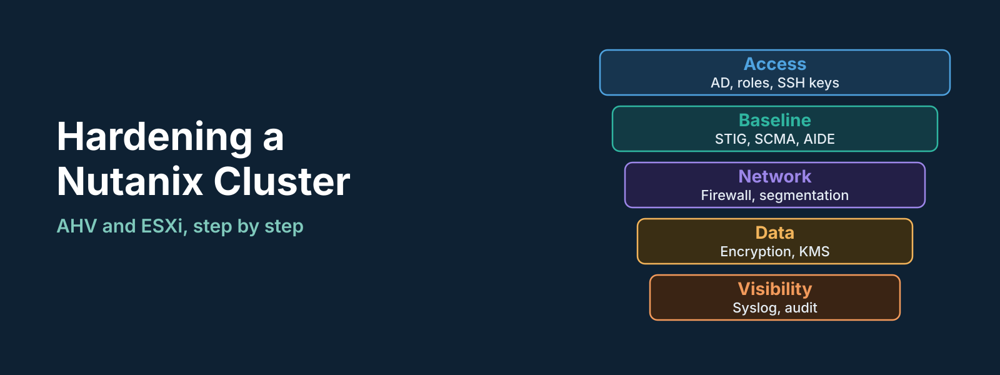
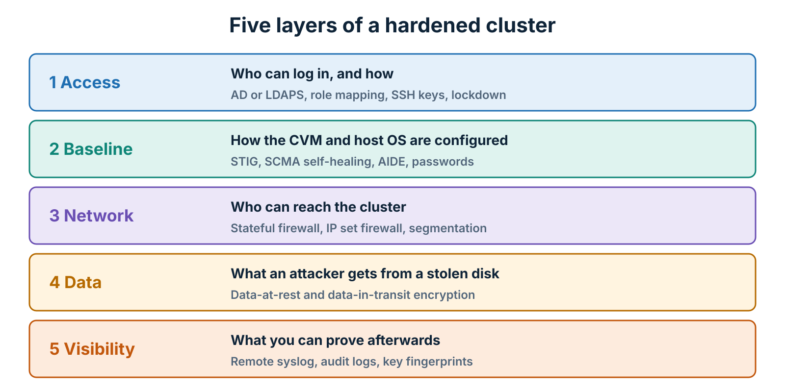
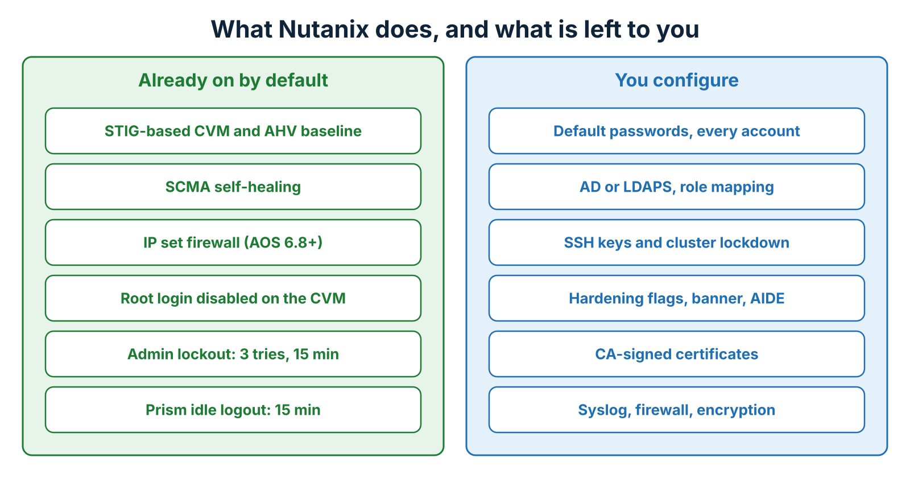
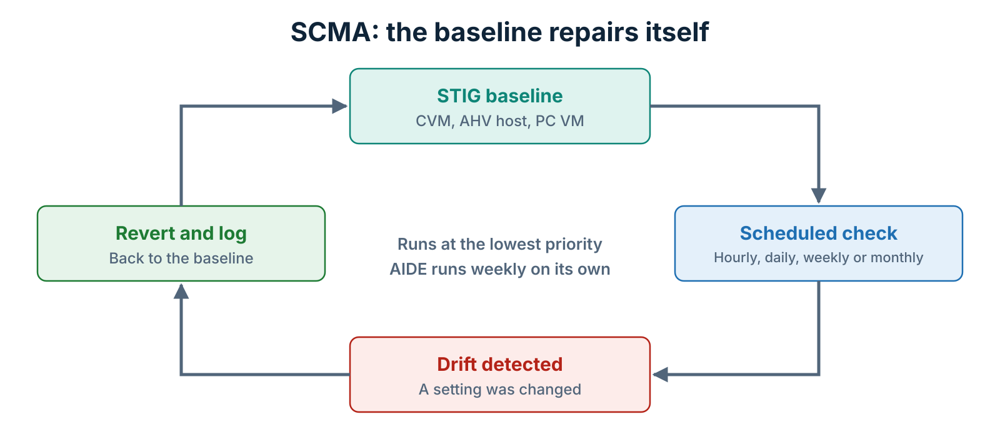
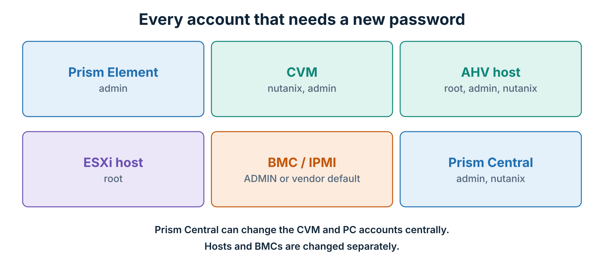
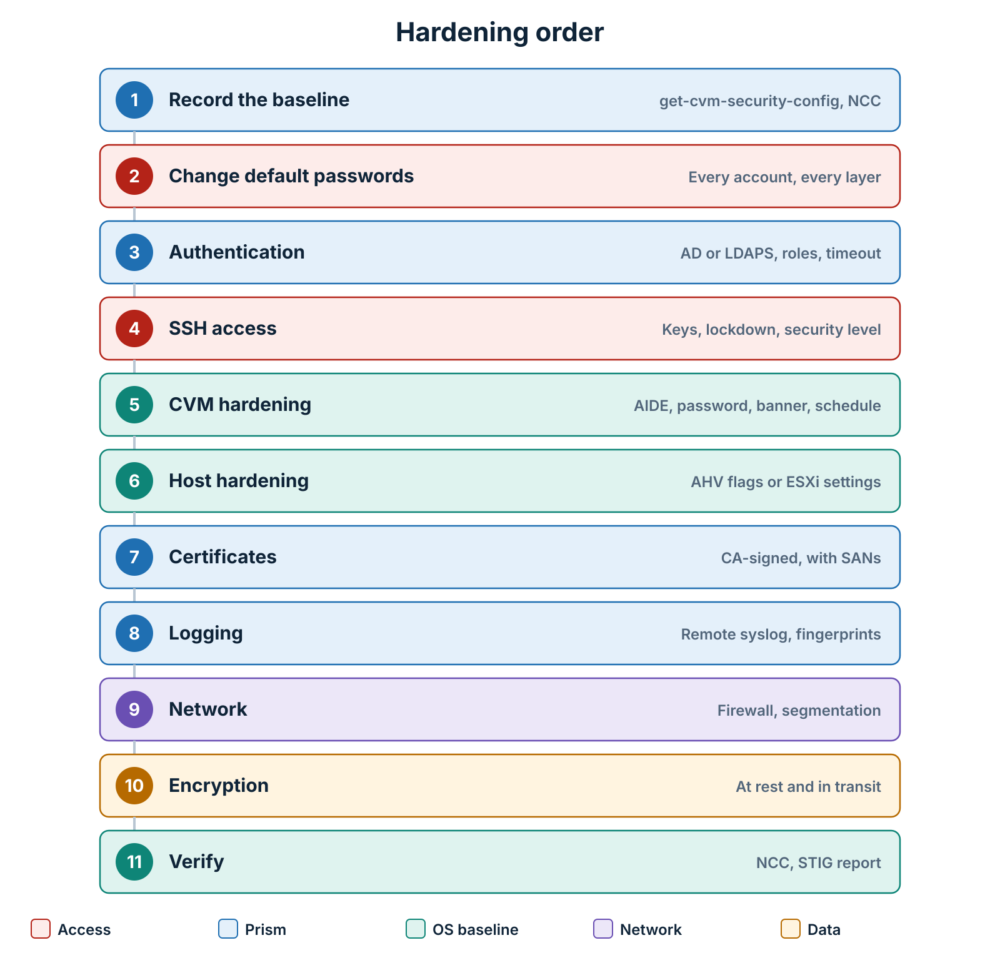
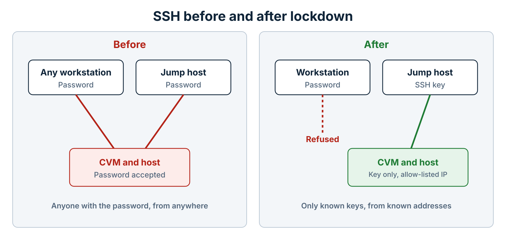
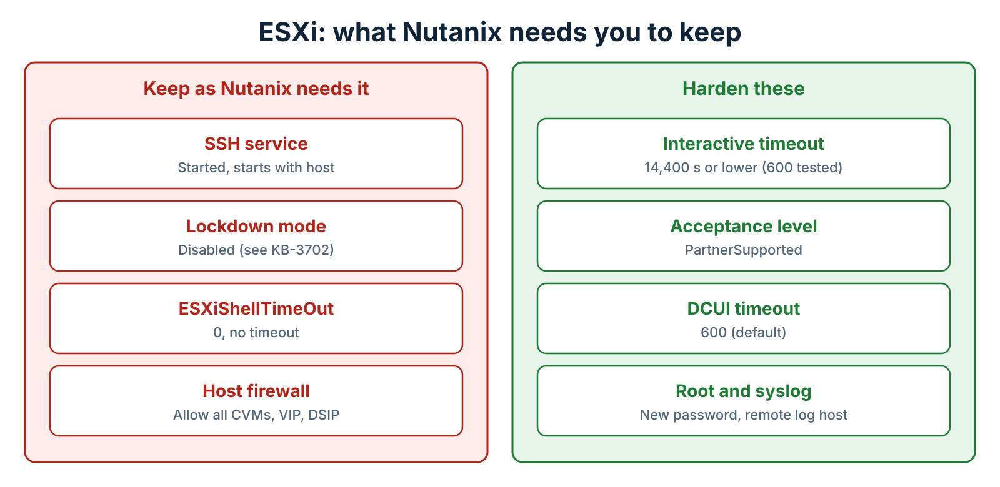
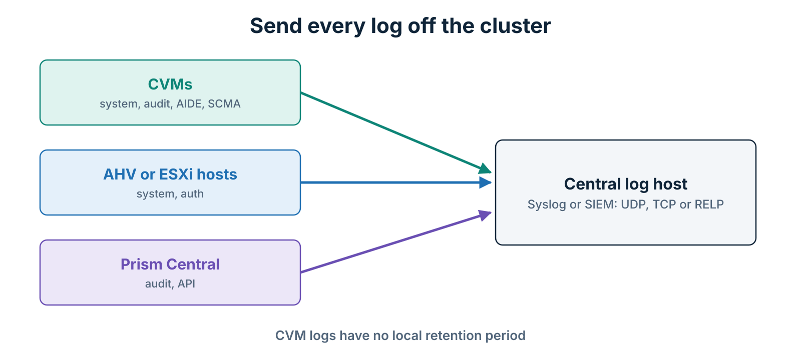
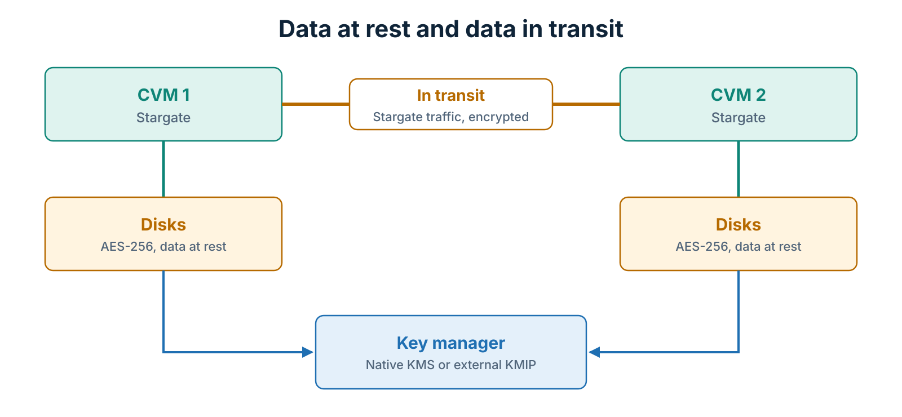

Every security review of a Nutanix environment I've been part of asks the same questions. Who can log in, and with what? Are the default passwords still there? Is SSH open with a password? Where do the logs go? Is the data encrypted? Nutanix answers many of these out of the box, but not all of them, and the parts left to you are spread across Prism Element, Prism Central, `ncli`, the hypervisor, and the BMC.

This post puts them in one place and in one order. It's the second part of a security series that started with [network segmentation](/hybrid-infrastructure/nutanix/networking/2026/11/16/nutanix-network-segmentation-ahv-esxi.html). It covers both AHV and ESXi, and for every step it shows what the setting does, the command or menu to apply it, and what to watch out for.

Steps and values follow the AOS Security Guide (7.3 at the time of writing) and Nutanix's vSphere best practice guide. Some of these settings can lock you out or can't be undone, and I've marked those clearly. Read each step before you run it.

| Section | What it covers |
|---|---|
| Understanding Nutanix hardening | The layers, what's on by default, the accounts, AHV vs ESXi |
| Before you start | Baseline, access, and the settings you can't undo |
| Steps 1 to 11 | The hardening itself, in the order I apply it |
| Operations | Day 2, a handover checklist, common mistakes |

* * *

## Understanding Nutanix Hardening

### Five layers


*Figure 1: Hardening is more than one setting. Each layer answers a different question.*
{: style="text-align: center;"}

I think of hardening as five layers, each answering one question:

1. **Access:** who can log in, and how? Directory authentication, role mapping, SSH keys, cluster lockdown.
2. **Baseline:** how are the CVM and host operating systems configured? The STIG baseline, SCMA self-healing, AIDE, password policy, banners.
3. **Network:** who can reach the cluster at all? Firewalls in front of the cluster, the built-in IP set firewall, segmentation.
4. **Data:** what does an attacker get from a stolen disk or a sniffed link? Data-at-rest and data-in-transit encryption.
5. **Visibility:** what can you prove afterwards? Remote syslog, audit logs, documented SSH key fingerprints.

A cluster with strong passwords but no remote logging isn't hardened, and neither is one with encryption but password SSH open from every workstation. The steps in this post walk through all five.

### What Nutanix already does for you


*Figure 2: A good part of the work is done by default. The rest is configuration.*
{: style="text-align: center;"}

Nutanix builds the CVM, the AHV host, and the Prism Central VM to the **RHEL 8 STIG** published by DISA. That covers the boot loader, packages, file system, services, file ownership, authentication, kernel, and logging. For example, the STIG rules prohibit direct root login, lock system accounts, enforce password rules, configure SSH carefully, and display warning banners.

On top of that, **SCMA (Security Configuration Management Automation)** checks the baseline on a schedule and fixes drift on its own.


*Figure 3: If someone changes a baseline setting, SCMA puts it back and logs it.*
{: style="text-align: center;"}

A few practical points about SCMA:

- It runs with the **lowest priority** in the CVM, so it doesn't affect performance.
- It uses SaltStack to set components back to the supported settings **without any intervention**. If you "fix" a CVM setting by hand, SCMA may simply revert it. Use the supported `ncli` parameters instead.
- You can change only the **SCMA schedule**. **AIDE runs on a fixed weekly schedule**.

Other protections that are on by default:

| Protection | Default behaviour |
|---|---|
| IP set firewall | Enabled by default since AOS 6.8. Only individual CVM and hypervisor IPs are trusted for internal RPC and API calls |
| Root login on the CVM | Console and SSH direct login are disabled for `root` |
| Admin lockout | Prism Element and Prism Central lock the `admin` account for 15 minutes after three failed logins. The period can't be changed |
| Prism idle logout | Users are logged out after 15 minutes of inactivity |
| Default certificate | Prism uses a self-signed certificate until you replace it |

Everything else, from default passwords to syslog, is configuration you have to do.

### The accounts you need to know


*Figure 4: Six components, each with its own local accounts.*
{: style="text-align: center;"}

| Component | Account | Used for | Where you change it |
|---|---|---|---|
| Prism Element | `admin` | Web console, API, emergency access | Prism Element, or Prism Central centrally |
| CVM | `nutanix` | SSH and cluster operations | `sudo passwd nutanix` on any CVM, or Prism Central |
| CVM | `admin` | SSH with lower privileges | Same password as the Prism `admin` |
| AHV host | `root`, `admin`, `nutanix` | Host access | On each host |
| ESXi host | `root` | Host access, vCenter registration | On each host or through vCenter |
| BMC | `ADMIN` or the vendor default | Out-of-band console | BMC web UI or `ipmitool` |
| Prism Central | `admin`, `nutanix` | Prism Central console and SSH | Prism Central |

### AHV and ESXi are hardened differently

This is the main hypervisor difference in this post:

- **On AHV,** the host is part of the Nutanix baseline. SCMA protects it, and you harden it with `ncli cluster edit-hypervisor-security-params` from any CVM, just like the CVM.
- **On ESXi,** the host belongs to VMware's hardening guide, not to SCMA. Nutanix publishes the values it has tested, and a few settings that **must stay** a certain way, or the CVM can't manage its host. Most importantly, the CVM needs SSH to its ESXi host.

Everything that runs on the CVM, from SCMA and `ncli` parameters to lockdown, syslog and certificates, works the same on both hypervisors.

* * *

## Before You Start

### Record the baseline

Before you change anything, capture the current state. This is your rollback reference and your "before" evidence for the security team:

```bash
ncli cluster get-cvm-security-config
ncli cluster get-hypervisor-security-config      # AHV clusters
ncc health_checks run_all
```

A fresh cluster typically shows everything disabled, with the schedule on `DAILY`:

```text
Enable Aide               : false
Enable Core               : false
Enable High Strength P... : false
Enable Banner             : false
Schedule                  : DAILY
Enable Kernel Core        : true
Enable Page Poison        : false
Enable Slub Debug         : false
SSH Security Level        : DEFAULT
Enable Lock Status        : false
IP Restriction State      : NORMAL
Enable DoDin Additiona... : false
Enable Fapolicy           : false
Enable Processor Mitig... : false
SSH whitelisted addres... :
```

### Rules I follow

- **Have console access to every host and CVM** (IPMI, iLO, iDRAC, CIMC or the vSphere console) before touching SSH settings. If you lock yourself out of SSH, the console is the way back.
- **Keep the local `admin` account working** as the emergency account. Nutanix recommends it, because it still works when Active Directory is down.
- **Test on one cluster first,** and run NCC after every step.
- **Know what can't be undone.** Two settings in this post are one-way: **Lock Status** (only Nutanix Support can unlock it) and **software data-at-rest encryption** (it can't be disabled once enabled). Both are marked when we get there.
- **Document everything** in the change record: commands, outputs, key fingerprints, and who holds which credentials.

### The order


*Figure 5: Access first, then the operating system, then network and data, and verification at the end.*
{: style="text-align: center;"}

The order matters. Passwords and authentication come first, because every later step is done with those accounts. SSH lockdown comes before the CVM flags, because the SSH security level and IP restriction build on it. Encryption comes late, because it's the one change you can't take back.

* * *

## Step 1: Change Every Default Password

Default passwords are the first thing an attacker tries and the first thing an auditor checks. Change all of them, on every layer.

### Prism Element and CVM

The **Prism `admin`** password is changed at first login, or later from the user menu (**Change Password**). If it's ever forgotten, it can be reset from any CVM:

```bash
ncli user reset-password user-name=admin password='<new-password>'
```

The **CVM `nutanix`** password is changed once and applied to every CVM in the cluster:

```bash
sudo passwd nutanix
```

The new password must:

- Be at least 8 characters long.
- Contain at least one lowercase letter, one uppercase letter, one digit, and one special character.
- Differ from the old password by at least four characters, and not be one of the last five.
- Not have more than two consecutive occurrences of the same character.
- Not contain the words "nutanix", "ntnx", "password", or simple dictionary words.

Keep the new password safe. The PAM module needs the previous `nutanix` password to start a password reset.

### Centrally from Prism Central

If the clusters are registered to Prism Central (pc.2023.4 or later, with AOS 6.7.1 or later), you can change the **CVM and Prism Central `admin` and `nutanix` passwords** from one screen: in the **Infrastructure** application, go to **Network & Security > Local Account Passwords**. You enter the current and new password per account, for up to 10 clusters at a time. It doesn't cover host or BMC accounts.

### AHV hosts

AHV has three local accounts: `root`, `admin`, and `nutanix`. Change all three on every host:

```bash
ssh root@<ahv-host>
passwd root
passwd admin
passwd nutanix
```

### ESXi hosts

Change the `root` password on every host, from vCenter or from the host:

```bash
ssh root@<esxi-host>
passwd root
```

Then update anything that stores it, such as backup software or monitoring. If the cluster is registered to vCenter in Prism, check that the registration still works.

### BMC (IPMI, iLO, iDRAC, CIMC)

The BMC gives full console access to the node, so its password matters as much as root. Change it in the BMC web interface. On Nutanix NX nodes, you can also do it from the AHV host with `ipmitool`:

```bash
ipmitool user list 1                 # find the ID of the ADMIN user
ipmitool user set password <user-id> # prompts for the new password
```

Keep the BMCs on a dedicated out-of-band network that only administrators can reach.

### Verify

NCC has a check for default passwords:

```bash
ncc health_checks system_checks default_password_check
```

It must pass before you move on.

### For new clusters

At cluster creation, you can avoid default passwords altogether. The `cluster create` command accepts options to enforce a new `nutanix` password, apply password lockdown, or apply full lockdown with no password or key-based SSH. The Security Guide's "Eliminate the Default Passwords During a Cluster Creation" section has the exact options. It's worth using on every new build.

* * *

## Step 2: Authentication, Roles and Sessions

The goal is simple: **named people log in with their own directory accounts, with the least privilege they need, and the local `admin` account is kept only for emergencies**.

### Connect Active Directory

1. In Prism Element, click the gear icon and open **Authentication**.
2. On the **Authentication Types** tab, select **Directory Service**.
3. On the **Directory List** tab, click **+ New Directory** and fill in:

| Field | Value |
|---|---|
| Directory Type | Active Directory |
| Name | A label, for example `corp-ad` |
| Domain | `corp.example.com` |
| Directory URL | `ldaps://dc01.corp.example.com:636` (single domain), or `ldaps://gc.corp.example.com:3269` (global catalog) |
| Search Type | Non Recursive, unless you nest groups. Recursive searches can be slow |
| Service Account | `svc-nutanix@corp.example.com`, with full read permission on the directory |

4. Click **Save**.

Prefer **LDAPS** (636, or 3269 for the global catalog) over plain LDAP, so credentials don't cross the network in clear text. LDAPS requires proper certificates on all domain controllers, but no certificate import on the Nutanix side.

A few traps from the Security Guide:

- If the URL points to the domain FQDN and one directory server goes down, authentication can fail. For high availability, use an LDAP HA virtual IP (KB-12568).
- Users with **"User must change password at next logon"** can't log in. They must change it on a domain workstation first.
- Members of the AD **Protected Users** group can't authenticate to Prism Element.
- Cross-forest trusts aren't supported.

### Map roles

1. Open **Role Mapping** in the settings menu and click **+ New Mapping**.
2. Select the directory, the type (**Group**, **OU** or **User**), the role, and the values.

| Role | What it allows | Map it to |
|---|---|---|
| Viewer | View only | Monitoring and audit teams |
| Cluster Admin | Administer the cluster, but not manage users | Infrastructure engineers |
| User Admin | Administer the cluster and manage user accounts | A small group of senior admins |
| Backup Admin | Backup-related tasks | Backup service accounts (check KB-14105 for AD users on AOS 6.0+) |

Enter group names without the domain (`nutanix-admins`, not `nutanix-admins@corp.example.com`), comma-separated without spaces. Names are case-sensitive. Map **groups**, not individual users, so access follows group membership in AD.

### Keep `admin` as the emergency account

Once AD works, stop using the local `admin` account for daily work. Store its password in your password vault, and use it only when the directory is unavailable. Service accounts for external tools should be directory accounts with their own role mapping. The emergency `admin` account doesn't support external application or REST API authentication by design.

### Session timeout

Prism logs users out after 15 minutes of inactivity by default. To review or tighten it for non-admin users, open **UI Settings** and set **Default Session Idle Timeout For Non-Admin Users** and **Session Idle Override For Non-Admin Users**. Align it with your organisation's policy.

### Prism Central

Prism Central has the same building blocks: directory services, role-based access control with projects and categories, local accounts, and certificates. Configure it the same way, especially if Prism Central is the main console for your administrators.

* * *

## Step 3: SSH Access

SSH to the CVMs and hosts is the most powerful access into a Nutanix cluster, so it gets the most attention.


*Figure 6: After lockdown, only known keys from known addresses can open an SSH session.*
{: style="text-align: center;"}

### 3.1 Create SSH keys for the administrators

Each administrator gets their own key pair, created on their admin workstation or jump host. Use a passphrase. Without one, anyone who copies the private key can use it.

```bash
ssh-keygen -t rsa -b 4096 -f ~/.ssh/ntnx_<username>
```

Nutanix supports **RSA** and **ECDSA** keys, with the AES128-CTR, AES192-CTR and AES256-CTR ciphers. On Windows, PuTTYgen works too (KB-1895).

### 3.2 Enable cluster lockdown

1. In Prism Element, click the gear icon and open **Cluster Lockdown**.
2. Click **+ New user SSH Key**, enter a **Name** (use the person's name), paste the **public** key, and click **Save**. Add one key per administrator.
3. **Test each key before going further**, from the jump host:

```bash
ssh -i ~/.ssh/ntnx_<username> admin@<cvm-ip>
ssh -i ~/.ssh/ntnx_<username> admin@<ahv-host-ip>     # AHV clusters
```

4. When every key works, clear **Enable Remote Login with Password** and save.

After lockdown, a password login is refused with a message like `No supported authentication methods available (server sent: publickey)`.

What lockdown does, according to the Security Guide:

- It disables **password-based SSH** to the CVMs and hosts. SSH itself keeps working with keys.
- Each key enables SSH for both the **`nutanix` and `admin`** accounts on the CVMs and hosts.
- Prism doesn't store the CVM and host passwords after lockdown.
- Disabling remote login **and** deleting all keys locks SSH access completely. Don't do that unless you mean it.

On ESXi clusters, check the result on both the CVMs and the hosts after enabling lockdown. The ESXi host's own SSH and access settings are covered in Step 5B, and some of them must stay as Nutanix needs them.

### 3.3 Document the key fingerprints

For non-repudiation, record the fingerprint of every administrator's public key:

```bash
ssh-keygen -lf ~/.ssh/ntnx_<username>.pub
```

The fingerprint appears in the SSH daemon log entries (`/home/log/secure` on the CVM), which you'll forward to the central log host in Step 7. With the fingerprints on file, every SSH session can be traced to a person.

### 3.4 Set the SSH security level

The SSH security level decides what happens when someone logs in as `nutanix`:

| Level | Password login as `nutanix` | Key login as `nutanix` |
|---|---|---|
| `default` | Full `nutanix` privileges | Full `nutanix` privileges |
| `limited` | Switched to the lower-privileged `admin` user | Full `nutanix` privileges |
| `restricted` | Switched to `admin` | Switched to `admin` |

```bash
ncli cluster edit-cvm-security-params ssh-security-level=limited
```

`limited` is a good balance once lockdown is enabled. `restricted` is the strictest, but some support procedures need the full `nutanix` user, so agree with your team how they'll get it when needed. The CVM login banner already announces that SSH as `nutanix` will be restricted in future releases and recommends `admin`.

### 3.5 Restrict SSH to known addresses

The IP restriction allows SSH to the CVMs only from addresses on an allow list, such as your jump hosts. **Add the addresses first, then enable the restriction:**

```bash
ncli cluster edit-cvm-security-params add-to-ssh-whitelist=10.10.50.11
ncli cluster edit-cvm-security-params add-to-ssh-whitelist=10.10.50.12
ncli cluster get-cvm-security-config | grep -i whitelist
ncli cluster edit-cvm-security-params ip-restriction=restricted
```

Allow only the smallest set of addresses, ideally individual jump hosts, not whole subnets. If a jump host changes IP and isn't added again, SSH to the CVMs is blocked, and the way back is the local console. Use this only when the client addresses are known and stable.

* * *

## Step 4: CVM Hardening Parameters

These are the cluster-wide CVM settings, applied from any CVM with `ncli cluster edit-cvm-security-params`. SCMA then enforces them on every CVM.

| Parameter | What it does | My recommendation |
|---|---|---|
| `enable-aide` | File and directory integrity checking | Enable |
| `enable-high-strength-password` | Minimum 15 characters, 8 different from the old one, at most 4 consecutive characters of the same class, dictionary check, lockout after 3 failures instead of 5 | Enable |
| `enable-banner` | SSH login banner | Enable, with your legal text |
| `schedule` | How often SCMA checks: hourly, daily, weekly, monthly | Hourly or daily |
| `enable-core` | Process core dumps | **Leave disabled.** Core dumps can contain sensitive data. Enable only if Nutanix Support asks |
| `enable-kernel-core` | Kernel crash dumps | Leave the default (enabled) for supportability, unless policy says otherwise |
| `enable-page-poison` | Overwrites freed memory to catch use-after-free bugs | Only if required. May reduce performance |
| `enable-slub-debug` | Detects memory corruption | Only if required. May reduce performance |
| `enable-processor-mitigations` | CPU vulnerability mitigations | Only if required. May reduce performance |
| `enable-dodin-opts` | Permanent account lock after failed passwords, AIDE emails, more frequent AIDE | DoD and similar environments only |
| `enable-fapolicy` | RHEL 8 application access control | Only with a strict policy. May reduce performance |
| `ssh-security-level` | See Step 3.4 | `limited` |
| `ip-restriction` | See Step 3.5 | `restricted`, after the allow list |
| `enable-lock-status` | Freezes the security configuration | **Last, and only if required.** See Step 10 |

### Apply the common set

```bash
ncli cluster edit-cvm-security-params enable-aide=true
ncli cluster edit-cvm-security-params enable-high-strength-password=true
ncli cluster edit-cvm-security-params schedule=hourly
```

High-strength passwords apply to future password changes. Check that the current passwords of the local accounts already meet the new length before users are forced to change them.

### Set the login banner

The banner text lives in a file on each CVM. Back it up, edit it, then enable the banner:

```bash
sudo cp -a /srv/salt/security/CVM/sshd/DODbanner /srv/salt/security/CVM/sshd/DODbannerbak
sudo vi /srv/salt/security/CVM/sshd/DODbanner
ncli cluster edit-cvm-security-params enable-banner=true
```

The guide says to edit the file on each CVM. Use the same text everywhere, approved by your legal or security team.

### Check the result

```bash
ncli cluster get-cvm-security-config
```

Compare it with the baseline you recorded before starting.

* * *

## Step 5: Host Hardening

### 5A: AHV hosts

AHV hosts are hardened from any CVM with `ncli cluster edit-hypervisor-security-params`, and SCMA enforces the settings on every host.

```bash
ncli cluster get-hypervisor-security-config
```

| Parameter | What it does | My recommendation |
|---|---|---|
| `enable-aide` | File integrity checking on the host | Enable |
| `enable-high-strength-password` | Same rules as the CVM | Enable |
| `enable-banner` | SSH login banner on the host | Enable |
| `schedule` | SCMA check frequency | Same as the CVM |
| `enable-core` | Process core dumps | **Leave disabled**, unless Nutanix Support asks |
| `enable-kernel-core` | Kernel crash dumps | Leave the default |
| `enable-itlb-multihit-mitigation` | Mitigates CVE-2018-12207, where a guest VM could crash the host | Consider for multi-tenant clusters. May reduce performance |
| `enable-retbleed-mitigation` | Mitigates Retbleed (CVE-2022-29900, CVE-2022-29901) | Consider for multi-tenant clusters. May reduce performance |
| `enable-memory-poison` | Catches use-after-free bugs | Only if required |
| `enable-fapolicy` | RHEL 8 application access control | Only with a strict policy. May reduce performance |

Apply the common set:

```bash
ncli cluster edit-hypervisor-security-params enable-aide=true
ncli cluster edit-hypervisor-security-params enable-high-strength-password=true
ncli cluster edit-hypervisor-security-params schedule=hourly
```

For the CPU mitigations, decide based on who runs VMs on the cluster. If every VM belongs to the same trusted organisation, the performance cost may not be worth it. If tenants don't trust each other, it usually is. Test with a real workload first.

**Banner on AHV.** On each host, back up and edit the banner, then enable it from a CVM:

```bash
# On each AHV host, as root
cp -a /etc/puppet/modules/kvm/files/issue.DoD /etc/puppet/modules/kvm/files/issue.DoD.bak
vi /etc/issue.DoD

# Then from any CVM
ncli cluster edit-hypervisor-security-params enable-banner=true
```

The guide warns that **changes to the AHV banner file aren't preserved across upgrades**. Add "re-apply the banner" to your AHV upgrade checklist.

### 5B: ESXi hosts

On ESXi, Nutanix recommends against changing settings outside its tested list unless you engage Nutanix Support. Here is that list, from the Nutanix vSphere best practice guide:


*Figure 7: Some hardening-guide recommendations would break the CVM. Keep these as Nutanix needs them.*
{: style="text-align: center;"}

| Setting (VMware guideline) | Hardening guide says | Nutanix recommends | Why |
|---|---|---|---|
| SSH service (`ESXi.Audit-SSH-Disable`) | Stopped | **Started**, start and stop with the host | The CVM needs SSH to its host. Without it, Genesis doesn't start the other services |
| Lockdown mode (`ESXi.enable-normal-lockdown-mode`) | Enabled | **Disabled** | Stops direct access the CVM needs. If you must enable it, follow KB-3702 with Nutanix Support |
| Shell timeout (`ESXiShellTimeOut`) | Set a limit | **0** | Any value stops CVM-to-host communication when the timer expires |
| Interactive timeout (`ESXiShellInteractiveTimeOut`) | Set a limit | **14,400** seconds, or lower. Nutanix has tested 600 | Idle sessions are a risk, and this one is safe to change |
| Acceptance level | Partner Supported | **PartnerSupported** | Foundation sets Community Supported. Raise it |
| Host firewall | Restrict access | Restrict, but **allow all CVM IPs, the cluster VIP and the Data Services IP** | Keep CVMs, hosts, VIP and DSIP on one VLAN that is excluded from restrictions |
| DCUI access (`DCUI.Access`) | Trusted users | **root** with unrestricted DCUI access | Your way back if something breaks |
| DCUI timeout (`DcuiTimeOut`) | 600 | **600** (default) | |

Apply the safe changes on all hosts at once, from any CVM:

```bash
hostssh "esxcli system settings advanced set -o /UserVars/ESXiShellInteractiveTimeOut -i 14400"
hostssh "esxcli software acceptance set --level=PartnerSupported"
hostssh "esxcli software acceptance get"
```

And a few things Nutanix asks you **not** to do on ESXi:

- **Don't remove the CVM's authorized keys** on the hosts on your own. The CVM uses them to SSH to ESXi. Engage Nutanix Support (KB-3702).
- **Don't prevent device interaction** on the CVMs. Nutanix changes CVM virtual hardware connections programmatically.
- **Exclude the CVMs from HyTrust** or similar tools. Nutanix hardens the CVM through its own STIG.
- **Don't disable DCUI** if vCenter runs on the same cluster it manages. That creates a dependency loop if the node fails.

For ESXi logging, point every host at the central log host (Step 7):

```bash
hostssh "esxcli system syslog config set --loghost='tcp://10.10.60.20:514'"
hostssh "esxcli system syslog reload"
```

* * *

## Step 6: SSL Certificates

Prism ships with a self-signed certificate. For production, Nutanix recommends a CA-signed one. It removes the browser warnings that train administrators to click through, and it lets clients verify they're really talking to the cluster.

### 6.1 Create the CSR

On any CVM, create `ssl.cnf` in your home directory. Include **every name and address** people use to reach Prism: the cluster VIP, its DNS name, and each CVM's name and IP.

```ini
[req]
distinguished_name = req_distinguished_name
req_extensions = v3_req
prompt = no

[req_distinguished_name]
countryName = SA
stateOrProvinceName = Riyadh
localityName = Riyadh
organizationName = Example Co
organizationalUnitName = Infrastructure
commonName = ntnx-cl01.corp.example.com

[v3_req]
subjectAltName = @alt_names

[alt_names]
DNS.0 = ntnx-cl01.corp.example.com
DNS.1 = ntnx-cl01-cvm1.corp.example.com
DNS.2 = ntnx-cl01-cvm2.corp.example.com
DNS.3 = ntnx-cl01-cvm3.corp.example.com
IP.0  = 10.10.10.30
IP.1  = 10.10.10.31
IP.2  = 10.10.10.32
IP.3  = 10.10.10.33
```

Generate an unencrypted private key (Prism doesn't accept password-protected keys) and the CSR:

```bash
openssl genrsa -out ntnx-cl01.key 2048
openssl req -new -nodes -key ntnx-cl01.key -sha256 -out ntnx-cl01.csr -config ssl.cnf
```

RSA 4096 and ECDSA (`prime256v1`) also work. The import validates key types and signature algorithms against NIST SP800-131a, so stick to SHA-256 or stronger. Copy the key and CSR off the CVM, then delete them from it.

### 6.2 Get the certificate signed

Send the CSR to your CA. You'll get back the signed certificate, the issuing CA certificate, and the root CA certificate if the issuer is an intermediate. Build the chain file with the issuer first and the root last, and nothing else in it:

```bash
cat intermediateCA.crt rootCA.crt > ca_chain.crt
```

### 6.3 Import it

1. In Prism Element, open **SSL Certificate** and click **Replace Certificate**.
2. Select **Import Key and Certificate** and click **Next**.
3. Choose the **Private Key Type**, then upload the **Private Key** (`.key`), the **Public Certificate** (`.cer`), and the **CA Certificate/Chain** (`.crt`).
4. Click **Import Files**.

Prism restarts its web service. Open sessions become invalid until you reload the page. If the files are wrong, Prism discards them and goes back to the default certificate, so you won't lose access.

Repeat for Prism Central. Put the certificate's expiry date in your calendar, because Prism keeps only one custom certificate, and an expired one is as bad as a self-signed one.

* * *

## Step 7: Logging and Audit


*Figure 8: CVMs, hosts and Prism Central all forward to a central log host.*
{: style="text-align: center;"}

The CVM is an appliance, and its system and audit logs have **no local retention period**. If you want to keep logs for an investigation or for compliance, they must leave the cluster. Nutanix recommends a central log host inside the management enclave, which also keeps the logs safe if a node is compromised.

### Forward CVM logs

Configure the remote server once from any CVM. It applies to all CVMs in the cluster:

```bash
ncli rsyslog-config add-server name=siem01 ip-address=10.10.60.20 port=514 \
  network-protocol=tcp relp-enabled=no
ncli rsyslog-config add-module server-name=siem01 module-name=syslog_module level=info
ncli rsyslog-config set-status enable=true
```

Use **TCP** or **RELP** rather than UDP, so log messages aren't lost silently. You can add more modules (for example Prism, Acropolis, or other services) at the level you need. The Acropolis Advanced Administration Guide lists them under "Send Logs to Remote Syslog Server".

Audit logs are forwarded too. The CVM's `audisp` plugin passes audit records to rsyslog, so on the log host you can search for `audispd` to find them.

Check that forwarding is configured on the CVMs. This is also the check the Nutanix STIG uses:

```bash
allssh "sudo grep @ /etc/rsyslog.d/rsyslog-nutanix.conf"
```

Every CVM should show a line sending to your log host (`@` for UDP, `@@` for TCP).

### Forward host and Prism Central logs

- **AHV:** the hosts are part of the Nutanix baseline. Follow the same Advanced Administration Guide section for the host modules your policy needs.
- **ESXi:** set `Syslog.global.logHost` on every host, as shown in Step 5B.
- **Prism Central:** configure its syslog in Prism Central, including the audit and API modules.

### Alert on what matters

The Nutanix STIG goes one step further: the log host should alert administrators and the security officer when the baseline changes in an unauthorized way, when accounts are created, modified, removed, disabled or enabled, and when audit storage reaches 75 percent. Build those rules in your SIEM.

* * *

## Step 8: Network Access

[Network segmentation](/hybrid-infrastructure/nutanix/networking/2026/11/16/nutanix-network-segmentation-ahv-esxi.html) moves internal traffic off the management network. This step is about who can reach the management network in the first place.

- **Put a stateful firewall in front of the cluster.** Nutanix recommends protecting the hypervisor, CVM, Prism Central and other Nutanix networks behind a stateful firewall that allows traffic only from known management endpoints. The **Ports and Protocols** reference on the Nutanix portal lists every port by product.
- **Keep the IP set firewall on.** It's enabled by default since AOS 6.8 and trusts only individual CVM and hypervisor IPs for internal RPC and API calls. Don't look for ways to disable it.
- **Put the BMCs on their own network.** Only administrators should reach IPMI, iLO, iDRAC or CIMC.
- **On ESXi, keep the CVMs, hosts, VIP and DSIP on one VLAN** excluded from host firewall restrictions (Step 5B).
- **Restrict SSH at the CVM** with the allow list from Step 3.5, in addition to the network firewall.
- **Segment where the requirement exists:** backplane, Volumes, DR or RDMA, as covered in the segmentation article.

* * *

## Step 9: Encryption


*Figure 9: At-rest encryption protects the disks. In-transit encryption protects Stargate traffic between CVMs.*
{: style="text-align: center;"}

### Data at rest (software)

Software encryption encrypts data on the drives with AES-256, so a stolen drive or node is useless without the key. Since **AOS 7.3**, software data-at-rest encryption and the native KMS are included in the **NCI Pro and Ultimate** editions. Earlier versions need Ultimate or a Pro add-on.

**Read this first: software data-at-rest encryption can't be disabled once it's enabled.** Back up your data and your keys before you start, and make sure the key manager is reliable.

**Choose the scope:**

| Hypervisor | Options |
|---|---|
| AHV | The whole cluster, and through Prism Central storage policies, individual containers or VMs |
| ESXi | The whole cluster, or individual containers. With container-level encryption, you must enable it on every new container, and you can't switch to cluster-level later |

**Choose the key manager:**

| Option | When to use it |
|---|---|
| Native KMS (local) | Clusters of 3 nodes or more, when you have no external KMS |
| Native KMS (remote) | 1-node and 2-node ROBO clusters registered to Prism Central |
| External KMS (KMIP) | When your organisation already runs a KMS. Use at least two KMS devices in clustered mode, so the KMS isn't a single point of failure |

**Enable it:**

1. In Prism Element, open **Data at Rest Encryption** in the settings menu and click **Create Configuration**.
2. Select **Encrypt the entire cluster** or **Encrypt storage containers**, and click **Save Encryption Type**.
3. Select the key manager and click **Save KMS type**.
4. For an external KMS: enter the CSR details and click **Save CSR Info**, then **Download CSRs** for all nodes and have them signed. Add the KMS servers (KMIP port 5696 by default, using **Add Address** for clustered KMS nodes), upload the CA certificate and the signed node certificates, and click **Test all nodes** until every node shows **Verified**.
5. Click **Enable Encryption**, type `ENCRYPT`, and click **Encrypt**.

Existing data is encrypted by a low-priority background task, which can take **24 to 36 hours** depending on the data. It can't be cancelled, and it resumes after a cluster restart. After any later configuration change, such as adding a KMS server, run a **rekey**.

### Data in transit

Data-in-transit encryption encrypts service-level traffic between the CVMs. Enable it from Prism Central: in the **Infrastructure** application, go to **Hardware > Clusters**, select the cluster, and choose **Actions > Enable Data-in-Transit Encryption**.

Know its limits before promising it to anyone:

- Only **Stargate** traffic between nodes is encrypted.
- **RDMA traffic** isn't encrypted.
- When a CVM is down, traffic from a guest VM to a remote CVM isn't encrypted.
- Volume group traffic isn't encrypted when the target disk is on a remote CVM.
- It can affect I/O latency and CPU usage.

* * *

## Step 10: Freeze the Configuration (Optional, Last)

When the security configuration is final and your policy requires that nobody can change it, enable **Lock Status**:

```bash
ncli cluster edit-cvm-security-params enable-lock-status=true
```

After this, the security configuration can't be changed through `ncli` or the API. **Only Nutanix Support can unlock it.** Don't enable it until every other step is complete and verified, because any later change, even a new SSH allow-list entry, will need a support case.

* * *

## Step 11: Verify

Prove the result, and keep the evidence in the change record.

**1. Configuration:**

```bash
ncli cluster get-cvm-security-config
ncli cluster get-hypervisor-security-config      # AHV
```

**2. NCC:**

```bash
ncc health_checks system_checks default_password_check
ncc health_checks run_all
```

NCC also reports on SSH security (for example `check_cvm_ssh_security`) once lockdown is enabled.

**3. SSH tests:**

- A password login to a CVM or AHV host is refused.
- A key login from an allowed jump host works.
- A key login from an address not on the allow list is refused.

**4. Logging:** the central log host receives CVM, host, audit and SSH events, and you can match an SSH login to a key fingerprint.

**5. Certificates:** browsing to the cluster VIP and to each CVM name shows the CA-signed certificate without warnings.

**6. STIG compliance report.** The CVM includes an OpenSCAP scan you can hand to auditors:

```bash
mkdir /tmp/stig_report
sudo python3 -B /home/nutanix/config/security/stig_scripts/stig_scan_driver.py \
  /home/nutanix/config/security/stig_scripts/U_RHEL_8_V1R11_STIG_SCAP_1-2_Benchmark.xml \
  /tmp/stig_report/
```

It takes about **60 to 90 minutes**, so run it in a quiet period. The benchmark file name changes with releases, so check the file name in that directory on your version first.

* * *

# Operations

## Day 2

- **Upgrades:** re-apply the AHV banner after AHV upgrades. Check `get-cvm-security-config` after every AOS upgrade, and compare it with your record.
- **Passwords:** rotate the emergency `admin`, `nutanix`, host and BMC passwords on your policy's schedule, using Prism Central's central password management where possible.
- **SSH keys:** remove the key of anyone who leaves the team on the same day, in **Cluster Lockdown**. Review the key list quarterly.
- **Certificates:** renew before expiry and import the new one the same way.
- **AD service account:** when its password changes, update it in Prism immediately, or directory logins fail.
- **Logs:** review SCMA and AIDE events in the SIEM. An SCMA revert means someone changed a setting by hand, so find out who and why.
- **Expansion:** new nodes inherit the cluster security configuration, but change the BMC password on every new node, and on ESXi apply the host settings from Step 5B.

## Handover Checklist

| # | Item | AHV | ESXi | Evidence |
|---|---|---|---|---|
| 1 | Prism `admin` password changed and vaulted | ✓ | ✓ | Vault entry |
| 2 | CVM `nutanix` password changed | ✓ | ✓ | `default_password_check` PASS |
| 3 | Host passwords changed (`root`, `admin`, `nutanix` on AHV; `root` on ESXi) | ✓ | ✓ | Change record |
| 4 | BMC passwords changed, BMC on OOB network | ✓ | ✓ | Change record |
| 5 | AD over LDAPS with service account | ✓ | ✓ | Directory list screenshot |
| 6 | Role mapping by AD groups | ✓ | ✓ | Role mapping screenshot |
| 7 | SSH keys per admin, fingerprints documented | ✓ | ✓ | Fingerprint list |
| 8 | Cluster lockdown: password SSH disabled | ✓ | ✓ | Refused password login |
| 9 | SSH security level `limited` or `restricted` | ✓ | ✓ | `get-cvm-security-config` |
| 10 | SSH allow list and IP restriction | ✓ | ✓ | `get-cvm-security-config` |
| 11 | AIDE, high-strength passwords, banner on CVMs | ✓ | ✓ | `get-cvm-security-config` |
| 12 | AIDE, high-strength passwords, banner on hosts | ✓ | n/a | `get-hypervisor-security-config` |
| 13 | ESXi interactive timeout, acceptance level, syslog | n/a | ✓ | `esxcli` output |
| 14 | ESXi SSH started, lockdown disabled, shell timeout 0 | n/a | ✓ | vCenter screenshot |
| 15 | CA-signed certificate on Prism Element and Central | ✓ | ✓ | Browser check |
| 16 | Remote syslog over TCP or RELP | ✓ | ✓ | `grep @` output, events on log host |
| 17 | Stateful firewall in front of management | ✓ | ✓ | Firewall rule export |
| 18 | Data-at-rest encryption with key backup | ✓ | ✓ | Encryption status |
| 19 | Data-in-transit encryption, if required | ✓ | ✓ | Prism Central cluster view |
| 20 | Full NCC clean, STIG report attached | ✓ | ✓ | Reports |

## Common Mistakes

| Symptom | Likely cause |
|---|---|
| Locked out of SSH on all CVMs | Password login disabled before the keys were tested, or IP restriction enabled before the allow list |
| SSH from the jump host suddenly refused | The jump host changed IP and isn't on the allow list |
| A hand-made CVM change keeps reverting | SCMA restoring the baseline. Use the `ncli` parameters |
| AD users can't log in | Plain LDAP blocked, "must change password" set, Protected Users group, or service account password expired |
| AD logins fail when one DC is down | Directory URL points to the domain FQDN instead of an LDAP HA address |
| ESXi CVM won't start its services | SSH service stopped on the host, or lockdown mode enabled |
| CVM loses contact with ESXi after a while | `ESXiShellTimeOut` changed from 0 |
| Certificate import silently reverts | Encrypted private key, wrong file types, or extra certificates in the chain file |
| No logs on the SIEM | Forwarding not enabled, UDP blocked, or only one module configured |
| AHV banner gone after an upgrade | Banner file changes aren't preserved across upgrades |
| Can't change any security setting | Lock Status enabled. Only Nutanix Support can unlock it |
| Can't turn encryption off | Software data-at-rest encryption can't be disabled once enabled, by design |

* * *

## Conclusion

Nutanix gives you a strong starting point: a STIG baseline that repairs itself, an internal firewall, and sensible lockout and session defaults. What turns that into a hardened cluster is the configuration around it: no default passwords anywhere, directory logins with the right roles, SSH by key only from known machines, a CA-signed certificate, logs that leave the cluster, and encryption where the data needs it.

If I had to keep only five points from this post:

1. **Passwords and access first.** Every default password, on every layer, including the BMC.
2. **Test SSH keys before you disable passwords,** and add the allow list before you enable IP restriction. Keep console access ready.
3. **On ESXi, follow Nutanix's tested values.** SSH stays on, lockdown mode stays off, and the shell timeout stays at 0.
4. **Logs must leave the cluster.** The CVM has no local retention, so without a log host you have no history.
5. **Two settings are one-way:** Lock Status and software data-at-rest encryption. Do them last, on purpose.

* * *

*Steps in this post follow the Nutanix AOS Security Guide 7.3 and the Nutanix vSphere best practice guide as of November 2026. Check the guides for your versions before the change, because parameters, defaults and supported values change between releases.*
