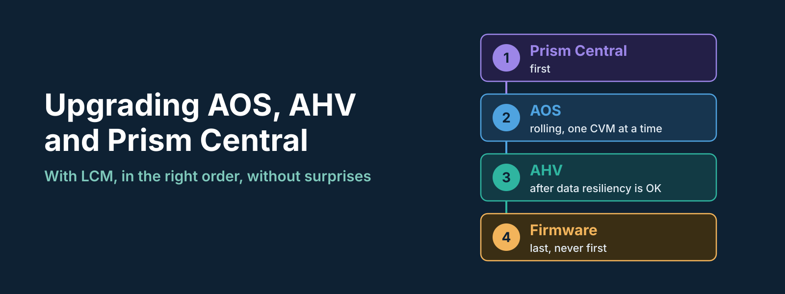
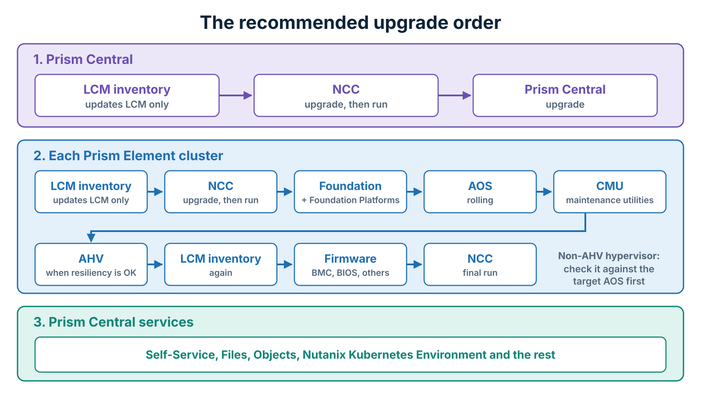
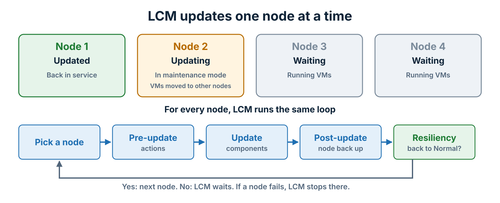
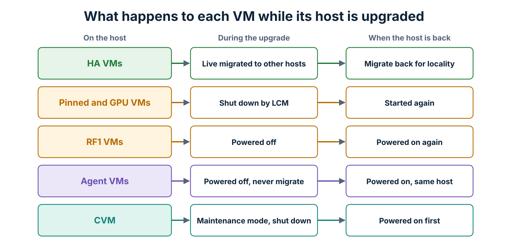
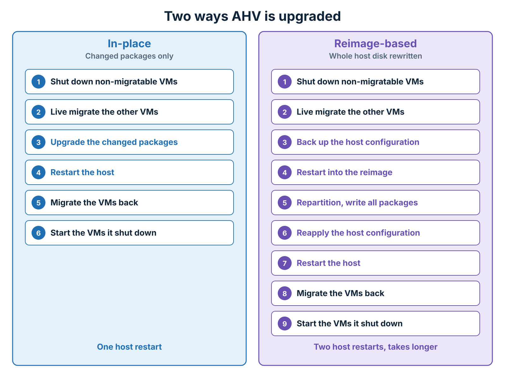
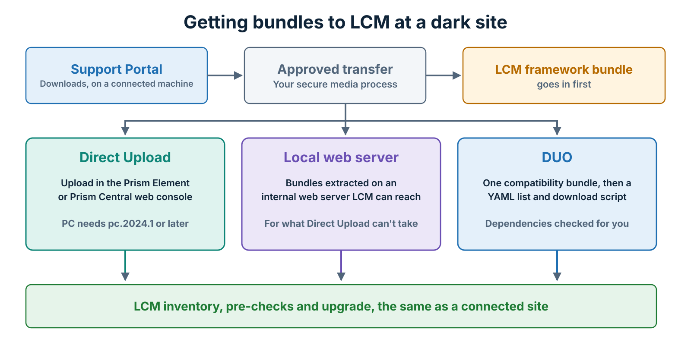
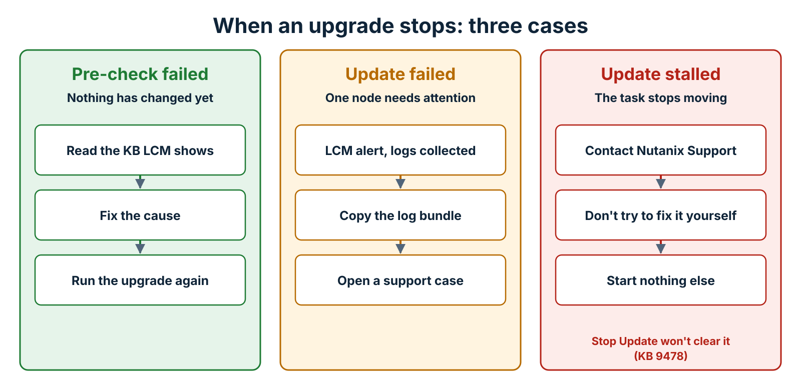

A Nutanix upgrade is mostly automatic. You run an inventory, tick the components and click **Apply Updates**, and Life Cycle Manager (LCM) handles one node at a time. Most of the surprises happen before or around that click: a host still in maintenance mode from an earlier job, a VM pinned to one host, a Prism Central that is older than the clusters it manages, a dark-site bundle that's missing a dependency.

This post is the routine I follow to avoid those surprises. It covers the order to upgrade things in, what to check before the maintenance window, what LCM actually does to your hosts and VMs, how dark sites differ, and what to do when an upgrade stops halfway. The procedures, rules and commands follow the current Nutanix documentation, and I've noted where a rule applies only to some versions.

| Written against | Version |
|---|---|
| Life Cycle Manager | LCM 3.4 |
| AOS | 7.6 |
| AHV | 11.2 |
| Prism Central | pc.7.6 |
| Hypervisors covered | AHV in detail, with ESXi notes where the steps differ |

## How Nutanix Upgrades Work Now

If you last upgraded a cluster a few years ago, the first thing to unlearn is the old **Upgrade Software** page in Prism Element. On AOS 7.6, the one-click upgrade page handles only ESXi, Hyper-V, Files and File Server. Everything else goes through LCM:

- **AOS:** to upgrade to AOS 6.8 or later you must use LCM, and LCM itself has to be at the latest version first. One-click AOS upgrade is deprecated since LCM 3.0.
- **Prism Central:** in a Nutanix environment, you can upgrade Prism Central only through LCM.
- **Foundation:** since LCM 2.7, Foundation is upgraded only through LCM. The Foundation tab under **Settings > Upgrade Software** is gone.
- **AHV, NCC, firmware and the rest:** LCM.

There's a second thing to keep in mind: some components are managed from Prism Central and some from Prism Element, and the hypervisor is one you can't upgrade from Prism Central. The Nutanix guidance is explicit: to upgrade the hypervisor, log on to the Prism Element web console of the cluster and use LCM there.

| Managed from Prism Central | Managed from Prism Element |
|---|---|
| Prism Central itself | AOS |
| NCC (for Prism Central) | AHV |
| Cluster Maintenance Utilities (CMU) | NCC (for the cluster) |
| Self-Service, NKE, Objects, Files Manager | CMU |
| Foundation Central, Licensing | Foundation and Foundation Platforms |
| Flow Network Security PC | Flow Network Security PE |
| Microservices Platform (MSP) | File Server, FSM, File Analytics |
| Security Dashboard CVE data | AOS Security, Licensing |

Two rules from that split are easy to miss:

- Keep the **Flow Network Security** PC and PE versions the same. A lower PE version keeps working, but the new features need both sides at the same version.
- Use the **same LCM source on both sides**: either both connected or both dark site. In a dark site, Prism Central and Prism Element use the same bundles.

## The Order That Works

This is the part that causes the most trouble when it's done from memory. Nutanix puts it in one sentence in the Prism Central guide: when upgrading Prism Central and AOS, **upgrade Prism Central first**, then upgrade AOS on the clusters it manages. LCM's own procedure expands that into a full sequence.



*Figure 1: The recommended order. Prism Central first, the cluster software next, firmware after the software, and the Prism Central services last.*
{: style="text-align: center;"}

**On Prism Central:**

1. Run an LCM inventory. Don't update anything except LCM in this step. The inventory also updates the LCM framework.
2. Upgrade NCC if a compatible version is offered, then run NCC.
3. Upgrade Prism Central. If Self-Service runs on Prism Central, upgrade Prism Central before Self-Service.

**On each Prism Element cluster:**

1. Run an LCM inventory. Again, nothing except LCM in this step.
2. Upgrade NCC if offered, then run NCC.
3. If the last inventory is more than 24 hours old, run it again.
4. Update **Foundation**. Foundation Platforms is bundled with it, but Nutanix also ships Foundation Platforms on its own. If a newer one exists, it shows up as a separate update after the next inventory.
5. Update **AOS**.
6. Update **Cluster Maintenance Utilities (CMU)**.
7. Update **AHV**.
8. Run an inventory again and update the **firmware**.
9. Run NCC.

**Back on Prism Central:** update the services that run on it, such as Self-Service, Files, Objects and Nutanix Kubernetes Environment. Prism Central core services and the Security Dashboard CVE data are the exception. You can update those at any stage, and Nutanix suggests doing it early.

A few rules sit around this sequence:

- **Firmware is never the first step.** Nutanix says this in two places in the LCM guide. Upgrade AOS and the hypervisor first, then run an inventory and apply the firmware LCM recommends.
- **On ESXi, Hyper-V or another non-AHV hypervisor**, check that your current hypervisor version is supported with the target AOS before you start. If it isn't, upgrade the hypervisor before AOS. Otherwise the hypervisor comes after AOS, as with AHV.
- **On AHV, don't leave a gap between AOS and AHV.** After the AOS upgrade, the cluster can run an older or unsupported AHV version for a while, and Nutanix recommends moving to the latest supported AHV as soon as possible. The inventory after the AOS upgrade shows that AHV version.
- **The Witness VM** for Metro or two-node clusters has its own version. Nutanix recommends the latest AOS build for it, and it can be upgraded at any point. It's independent of the cluster and Prism Central versions.
- **Two exceptions** may change what LCM shows you. If a SATA DOM 3IE3 firmware update is available, LCM may show only that update until it's done. On AHV clusters with NVIDIA GRID vGPU drivers, LCM doesn't always show the AHV updates.

When you select everything at once, LCM works out the dependencies itself and batches them. The order above matters most when you upgrade components one by one. That's common in change windows, where each step is approved and tracked on its own.

## Planning Before the Window

The checks in this section take an hour or two the week before. Each one is much cheaper to find then than in the middle of the window.

### Check the path and the compatibility

Nutanix points to these sources before any upgrade:

- **Upgrade Paths** on the Support Portal (you need to log in). It tells you if you can go straight from your current version to the target, or need a hop in between.
- **Compatibility and Interoperability Matrix**: hardware model against AOS and hypervisor, AHV guest OS support, and the **Software Interoperability** tab for what works with what (Prism Central against AOS, Files, Objects and so on).
- **Release notes** for AOS, AHV, Prism Central and LCM.
- **Field and security advisories.** Nutanix recommends reading the last three months.
- **LTS or STS.** AOS releases come as Long Term Support or Short Term Support releases. KB 5505 explains the support periods. Know which one you are moving to, because it decides how soon you'll be doing this again.

### Know the blockers for your version

Some blockers depend on where you start from. These are the ones from the current guides:

| If you are... | What happens | What to do |
|---|---|---|
| On AOS older than 6.8, or Prism Central older than pc.2024.1 | Starting with LCM 3.4, LCM sees an end-of-life version and enters **restricted mode**. It won't update itself to a version that wouldn't work on your cluster. | Upgrade to a supported version. KB-17286 covers leaving restricted mode. |
| Running Nutanix Kubernetes Engine (NKE) | NKE is not compatible with pc.7.5 or later. | Move the workloads to Nutanix Kubernetes Platform (NKP) before upgrading Prism Central to pc.7.5 or later. |
| Upgrading Prism Central to pc.7.6 for the first time | An alert about Objects Lite may appear. | Nothing. It clears when the upgrade completes (KB-21796). |
| Running Flow Network Security | FNS only works with compatible AOS and Prism Central versions. | Check the FNS release notes before you pick the target versions. |

### Make room for Prism Central

On a Nutanix cluster, the Prism Central upgrade doesn't use the VM's `/home` partition. It creates a dedicated **30 GB vDisk** on the Prism Element cluster that hosts Prism Central and uses it for the bundle, the extraction and the installer. That only works if:

- the cluster hosting Prism Central is registered to that Prism Central,
- Prism Central is registered to a host in the cluster, or has the microservices infrastructure enabled (mandatory and on by default from pc.7.3),
- and there's enough free capacity for the 30 GB vDisk.

While you're there, keep the Prism Central VM as Nutanix deployed it. The guide says not to add vDisks or NICs to it beyond what the installation or upgrade instructions specify.

### Keep NCC at the same version everywhere

The Prism Central guide asks for the **same NCC version on every node** of a cluster, and on Prism Central and every cluster it manages. The order above does this naturally, because NCC is the first thing you upgrade on each side.

### Plan the window, not only the upgrade

From the Nutanix recommendations:

- Upgrade **non-production first**, then production.
- Run upgrades in a **maintenance window** or outside business hours. Users may notice latency during an upgrade, especially on clusters with only 1GbE uplinks.
- **Run one upgrade at a time.** Wait for an upgrade to finish before you start any other operation, including another upgrade.
- You can **pause the alert emails** during the window (**Alert Email Configuration** in Prism, or nCLI) and turn them back on afterwards.

Two more items come from how the upgrade moves VMs, which is covered further down. First, make sure the cluster can run without one host. LCM takes one node out at a time, so the remaining hosts have to absorb its VMs. Second, write down which VMs can't live migrate, because they'll be powered off.

### AHV host passwords

The LCM guide lists one configuration step for AHV clusters before an upgrade: set the AHV host account credentials as the AHV Administration Guide describes. On AHV 11.2 that means:

- Set or change the `admin` and `root` passwords from the **System Accounts** page in Prism Central, not with SSH on the host.
- Leave the `nutanix` account alone. It's used internally by AOS. Don't set or change its password.

The LCM procedure also mentions that you might need to update these credentials after the AHV upgrade, so check them again once it's done.

## The Pre-Checks That Actually Stop Upgrades

### Run NCC first

Run a full NCC before every upgrade, from Prism Element (**Health > Actions > Run NCC Checks > All checks**) or from any CVM:

```bash
nutanix@cvm$ ncc health_checks run_all
```

The rule is simple. Anything that comes back other than **INFO** or **PASS** gets resolved before you continue, or goes to Nutanix Support if you can't resolve it. LCM runs the critical NCC checks again by itself before an upgrade (`test_ncc_checks`), but don't rely on that. A full run the day before gives you time to fix things.

If you need to send the output to someone outside your team, NCC can anonymize it:

```bash
nutanix@cvm$ ncc health_checks run_all --anonymize_output=1
```

### Run the LCM pre-checks as a dry run

LCM can run the pre-checks for a module **without starting the upgrade**. In Prism Element, go to **LCM > Updates > Software**, select the module, and choose **Pre-Upgrade > Upgrade Precheck**. Do this a day or two before the window. A pre-check failure found on Tuesday is a ticket. Found at midnight in the window, it's a cancelled change.

### The LCM framework pre-checks worth knowing

LCM runs a set of framework checks before every inventory and every update. If one fails, the operation doesn't run. Each module also has its own checks on top of these. These are the ones I'd check by hand before the window, with the KB that LCM points you to when they fail:

| Pre-check | What it catches | KB |
|---|---|---|
| `test_hosts_in_maintenance_mode` | A host left in maintenance mode, often from an earlier failed upgrade or maintenance task | 9046 |
| `test_is_cvm_in_maintenance_mode` | A CVM in maintenance mode | 9782 |
| `test_ahv_entering_mm_pinned_vms` | Pinned VMs that would stop an AHV host from entering maintenance mode | — |
| `test_esx_entering_mm_pinned_vms` | The same on ESXi | 7596 |
| `test_phorest_certs` | A broken certificate chain between Prism Central and Prism Element | 12367 |
| `test_lacp_configuration` | LACP enabled but misconfigured | 14277 |
| `test_validate_remote_version` | CVMs running different LCM versions | 7784 |
| `test_check_url_connectivity` | The LCM URL is not reachable (connected sites) | 7782 |
| `test_node_removal_status` | A node marked for removal | 13903 |
| `test_expand_cluster_status` | A cluster expansion in progress | 14121 |
| `test_ncm_license_enforcement_check` | No valid license on the cluster | 13754 |
| `test_esxi_scratch_space` | No free space in `/scratch` on an ESXi host | 7966 |
| `test_esxi_bootbank_space` | Not enough space in the ESXi boot bank for Phoenix-based upgrades | 7663 |
| `test_esx_ha_enabled` | ESXi HA not enabled, or the host not managed by vCenter | 7788 |
| `test_hpe_security_check` | The iLO security mode on HPE nodes | 9239 |
| `test_cisco_validate_credentials_and_setup` | Wrong Cisco UCS Manager credentials | 15110 |

For a **connected site**, open the firewall for LCM before the window. The endpoints are `download.nutanix.com` (LCM modules, metadata and most images) and `release-api.nutanix.com` (AOS, NCC and Prism Central versions). The full port list is in Nutanix's **Ports and Protocols** reference.

For **ESXi**, there are two vCenter settings to prepare. Disable **admission control** for all LCM updates. Check the **DRS** mode: in fully automated mode, LCM migrates the VMs itself. In partially automated mode, it doesn't migrate them and shows a warning asking you to do it manually.

## What LCM Does to Your Hosts and VMs

### One node at a time

LCM always works the same way, whatever the component:

1. It updates its own framework if a newer one is available.
2. It runs the pre-checks.
3. It works out which updates depend on which and batches them, so the pre-update and post-update steps run only once per node. On NX hardware, for example, BMC is always updated before BIOS on each node.
4. It picks a node, runs the pre-update actions, applies the update, runs the post-update actions and brings the node back.
5. It moves to the next node **only when data resiliency is back to Normal**.



*Figure 2: LCM takes one node down at a time and waits for data resiliency to return to Normal before moving on.*
{: style="text-align: center;"}

Only one node is down at any moment. If something goes wrong on a node, LCM stops there and waits for you to fix it before it touches the next one. So when an upgrade fails, it's one node that needs attention while the rest of the cluster keeps running.

There's one ESXi detail worth knowing. LCM restarts the ESXi host after migrating the VMs but before it enters maintenance mode, so vCenter never shows a maintenance mode alert. That's expected.

Before you click **Apply Updates**, open **View Upgrade Plan**. LCM lists what it's about to do and what to expect, for example which services stop and which nodes go into maintenance mode.

### What happens to the VMs

When an AHV host enters maintenance mode for an upgrade, this is the sequence from the AHV Administration Guide:

1. The host starts entering maintenance mode.
2. HA VMs are **live migrated** to other hosts.
3. **Pinned VMs** (host affinity to that node) and **replication factor 1 VMs** are **powered off**.
4. The host finishes entering maintenance mode.
5. The CVM enters maintenance mode and shuts down.

When the node comes back, it runs in reverse. The CVM powers on and leaves maintenance mode, then the host leaves maintenance mode. The replication factor 1 VMs power on again and VMs migrate back to restore locality.



*Figure 3: Which VMs move and which are powered off while a host is upgraded.*
{: style="text-align: center;"}

On AHV, LCM shuts down the running **non-migratable VMs** before it updates their host and starts them again afterwards. Nutanix counts three kinds of VM as non-migratable:

- VMs with **affinity to a single host**. Nutanix recommends shutting these down gracefully yourself before the upgrade, because they can't move and will be powered off.
- VMs with **GPUs**.
- **Agent VMs.**

Agent VMs deserve a word. If you have VMs set to `ha_priority=-1` so they don't restart in an HA event, Nutanix recommends making them agent VMs instead. An agent VM stays powered off during AHV and LCM upgrades, never migrates to another host, and powers on again on the same host once the host is back to normal.

On ESXi, LCM shows a **Review VM Migration** step before it applies updates. You can let LCM shut down the non-migratable VMs automatically, or handle them yourself. LCM can't put an ESXi host with active pinned VMs into maintenance mode.

### The VMs that make maintenance mode time out

These cases don't fail a pre-check. They show up during the upgrade as a host that won't enter maintenance mode:

- **Affinity and anti-affinity rules from third-party products.** An antivirus appliance that runs one scanning VM per host is the classic example. Disable the rules or power off those VMs before the upgrade.
- **Nutanix Files.** When LCM upgrades the hypervisor on a cluster with Files, disable the anti-affinity rules on all FSVMs first and turn them back on after the upgrade.
- **Auto-provisioning.** Omnissa Horizon (formerly VMware Horizon) with Instant Clones, or any script that creates VMs, can place a new VM on the host LCM is evacuating. Disable provisioning during the upgrade.
- **Memory overcommit.** VMs with memory overcommit live migrate more slowly, because swapped memory has to come back into RAM before it can be copied. Under heavy load, the migration adds load of its own.

## AOS, Then AHV

### AOS

AOS is upgraded from LCM in Prism Element, or from Prism Central for the clusters it manages. Like every LCM update, it rolls through the cluster one node at a time and waits for data resiliency before moving on. The AOS upgrade restarts the CVMs, not the hosts, so guest VMs keep running while each CVM restarts.

The time depends on the cluster. In a Nutanix lab test published in October 2026, four NX-3060-G8 nodes went from AOS 7.5 to 7.6 in **43 minutes** with no load and **51 minutes** under a simulated VDI load of 252 VMs. That measures the AOS part only, including pre-checks and post-checks, not AHV or firmware. Nutanix states it's not a guarantee. The same post notes that there was no AOS 7.4 release: the path was 7.3 to 7.5 to 7.6.

**Before you start AHV**, open the Prism dashboard and wait until **Data Resiliency Status** is green and OK. Nutanix recommends this after every AOS upgrade, before the hypervisor upgrade.

### AHV: in-place or reimage

For each AHV upgrade path, Nutanix chooses one of two mechanisms. There's only one per path, so you don't pick it, but it changes how long each host takes.



*Figure 4: The two AHV upgrade mechanisms. The reimage-based upgrade rewrites the whole host disk and takes longer.*
{: style="text-align: center;"}

- **In-place upgrade.** LCM shuts down the non-migratable VMs and live migrates the rest. It upgrades the changed packages, restarts the host, migrates the VMs back and restarts the VMs it shut down.
- **Reimage-based upgrade.** Nutanix uses this when most or all packages change in a major release, or when the AHV disk partition layout changes. LCM evacuates the host, backs up the host configuration and restarts into the reimage. It repartitions the disk, writes all packages, reapplies the configuration and restarts again. Then the VMs come back. It takes longer than an in-place upgrade because everything is written to disk.

A few AHV points from the guides:

- **NIC drivers** are part of the AHV image, so they're upgraded with AHV. Drivers for cards passed through to the CVM are updated by upgrading AOS.
- **NVIDIA GPUs:** LCM needs a compatible NVIDIA GRID host driver bundle present, or it blocks the AHV upgrade. If you delete that bundle, you can't upgrade AHV until you upload it again and run an inventory. Upload only one host driver version for your AHV version.
- **All hosts on the same version.** NCC's `same_hypervisor_version_check` fails when hosts in a cluster run different hypervisor versions, and Nutanix doesn't recommend mixed versions in production.

## Prism Central

The Prism Central upgrade itself is short to describe:

1. Log in to Prism Central and open **Admin Center**.
2. Go to **LCM** and select the **Prism Central Cluster** tab.
3. Run the inventory, then upgrade with the method that fits your site: connected, dark site with a web server, or dark site with **Direct Upload**. Direct Upload on Prism Central needs pc.2024.1 or later.

Two warnings from the Prism Central guide are worth repeating, because the file names on the Downloads page look similar:

- **Don't upgrade Prism Central with the AOS binary and metadata `.json` files.** Prism Central has its own. Nutanix says using the AOS files can leave Prism Central unavailable.
- **Don't use the Prism Central AHV or ESXi components** on the Support Portal to upgrade an existing Prism Central.

After the upgrade, if you register a new cluster to Prism Central later, run an LCM inventory on Prism Central again. Nutanix also recommends enabling auto-inventory on Prism Central so the LCM page stays current for all clusters.

## Dark Sites

Without internet access, LCM can't fetch anything itself. You download the bundles on a connected machine, move them across the way your security policy allows, and give them to LCM in one of three ways:



*Figure 5: The three ways to give LCM its bundles at a dark site.*
{: style="text-align: center;"}

| Method | How it works | Good to know |
|---|---|---|
| **Direct Upload** | Upload the bundles in the Prism Element or Prism Central web console | Supports the main firmware (NX, Dell, Fujitsu, HPE, Intel, Lenovo, Cisco) and most software, including AOS, AHV, NCC, Foundation, Files and Prism Central. Needs pc.2024.1 or later on Prism Central. |
| **Local web server** | Extract the bundles on an internal web server that LCM can reach | Works for components that Direct Upload doesn't support. |
| **Dark Site Upgrade Orchestrator (DUO)** | Upload one compatibility bundle. LCM shows valid target versions, generates a YAML file with the bundle names you need, and provides a script to download them from the portal with an API key | Removes the guessing about which bundles go together |

For a Prism Central upgrade at a dark site you need the **LCM Framework bundle** and the **Prism Central LCM bundle**, plus the **Security Dashboard CVE Data bundle** if you want current CVE data. From pc.7.5, the separate MSP Apps bundle is no longer needed.

Three dark-site lessons:

- **Upload the LCM framework bundle first.** The framework update comes before everything else, the same as on a connected site.
- **Self-Service at a dark site goes first.** If you deployed a Self-Service VM, Nutanix asks you to update Self-Service before Prism Central, AOS and AHV, then the firmware.
- **Dependencies are enforced.** With DUO, if a dependent bundle is missing, the upgrade button is disabled and the UI names the bundle and version you need. For example, the MSP platform bundle that an Objects upgrade depends on.
- **New nodes don't see old uploads.** If you expand the cluster after uploading bundles, upload them again so the new node recognizes them.

I went through this on an HPE cluster at a dark site, when an SPP firmware upgrade turned out to be the permanent fix for a full ESXi ramdisk. That story is in [my iLORest article](/hybrid-infrastructure/nutanix/hpe/2026/11/09/esxi-root-ramdisk-full-ilorest-log-nutanix-hpe.html). The main lesson was the same as here: check what LCM supports for your hardware before you accept the version the hardware vendor recommends.

## When an Upgrade Stops Halfway

Three different things can go wrong, and they need three different responses.



*Figure 6: A failed pre-check, a failed update and a stalled update need different responses.*
{: style="text-align: center;"}

### A pre-check fails

This is the easy case. Nothing has changed on the cluster yet. Read the KB that LCM shows next to the failure, fix the cause, go back to the LCM page and run the upgrade again. Most of the table above lives here.

### An update fails

Since LCM 3.0, LCM raises an alert in the UI when an update fails. Since LCM 2.3.1, it also collects its logs automatically when any operation fails, and the failure message tells you which CVM holds the bundle and where:

```text
/home/nutanix/data/log_collector/lcm_logs__<cvm_ip>__<timestamp>.tar.gz
```

Copy that bundle off the CVM and attach it to your support case. KB-1294 lists the ways to upload it. To collect the LCM logs again by hand, run the log collector from a CVM:

```bash
nutanix@cvm$ /home/nutanix/cluster/bin/lcm/lcm_log_collector
```

For a wider picture, use Logbay. It collects across the cluster, and `--anonymize=1` hides IPs, names and other identifiers if the bundle has to leave your organization:

```bash
nutanix@cvm$ logbay collect --anonymize=1
```

Remember that LCM stops on the node that failed and doesn't touch the next one. The cluster is still running on the other nodes, so there's no need to rush a fix.

### An update stalls

A stalled upgrade is one where the task stops moving and stays there. Nutanix's guidance is clear: **contact Nutanix Support, and don't try to solve it yourself**, because a wrong move on a cluster that's mid-upgrade can make the cluster unavailable.

Two things people try that the documentation rules out:

- **Stop Update doesn't clear a stalled task.** It's for an update you started by mistake or one that will run past your window. For stalled tasks, the guide points to KB 9478.
- **Don't start another operation on top.** Nutanix asks you to wait for an upgrade to finish before you start any other operation.

### What Stop Update actually does

**Stop Update** is still useful when it's used for its real purpose. It sets a cancel intent, and LCM stops at the next **safe point** instead of immediately:

| Phase when you click Stop | What LCM does |
|---|---|
| Pre-checks | Cancels before the update begins |
| Download | Finishes the current file, then discards the module it was downloading. Modules downloaded fully before you clicked stay saved |
| Update, several components selected | Finishes the component in progress, then stops. If AOS is running and AHV is next, AOS completes and AHV doesn't start |
| Update, BIOS and BMC on all nodes | Finishes the node in progress, then stops |
| Update of AOS, AHV or Prism Central already running on some nodes | Doesn't stop. LCM completes the upgrade on all nodes, then stops |

That last row is the important one for planning. Once AOS, AHV or Prism Central has started rolling, the only way out is through, so make sure the window is long enough before you click.

On clusters running AOS 7.5 or later with pc.7.5 or later, the **Operations** tab in Prism Central shows every LCM operation across your clusters. That includes inventories, uploads, pre-checks and upgrades, with their status, duration and the user who started them. It's the first place to look when someone asks what happened during the night.

## After the Upgrade

1. Run an **LCM inventory** again, apply the **firmware** LCM recommends, and run **NCC**.
2. Upgrade the **Prism Central services**: Files, Objects, Self-Service and the others.
3. Turn back on what you turned off: **alert emails**, the **FSVM anti-affinity rules**, and any third-party affinity rules or **auto-provisioning**.
4. Power on any VMs you shut down yourself, and check the ones LCM restarted.
5. Check the **AHV host credentials**, as the LCM procedure suggests after an AHV upgrade.
6. Upgrade the **Witness VM** if you have one and haven't yet.
7. Confirm **Data Resiliency Status** is OK and all hosts show the same AHV version.

## A Checklist You Can Copy

| When | Check |
|---|---|
| A week before | Upgrade path confirmed on the Upgrade Paths tool |
| | Compatibility matrix and Software Interoperability checked for hardware, AOS, AHV, Prism Central and FNS |
| | Release notes and the last three months of advisories read |
| | Not on AOS < 6.8 or PC < pc.2024.1 (LCM restricted mode); no NKE if targeting pc.7.5+ |
| | 30 GB free for the Prism Central upgrade vDisk |
| | Non-production cluster upgraded first |
| A day before | Full NCC run, everything INFO or PASS |
| | LCM upgrade pre-check (dry run) passed |
| | No host or CVM in maintenance mode |
| | Pinned, GPU, agent and RF1 VMs listed, with owners told they'll be powered off |
| | Cluster can run without one host |
| | Third-party affinity rules, FSVM anti-affinity and auto-provisioning ready to disable |
| | Dark site: all bundles downloaded, LCM framework bundle included |
| In the window | Alert emails paused |
| | Prism Central: inventory, NCC, Prism Central |
| | Each cluster: inventory, NCC, Foundation, AOS, CMU, then AHV once data resiliency is OK, then inventory and firmware |
| | View Upgrade Plan read before Apply Updates |
| | One operation at a time |
| After | Inventory, firmware, NCC |
| | Prism Central services upgraded |
| | Alerts, rules and provisioning turned back on |
| | AHV credentials and Witness VM checked |

## Closing Thoughts

LCM has made the upgrade itself the least risky part of the night. What's left is preparation: the right order, a clean NCC, pre-checks run while there's still time to fix things, and a plan for the VMs that won't move. Do that and the window becomes a long wait while LCM works through the nodes.

When something does go wrong, the difference between a failed pre-check, a failed update and a stall decides what you do next. A failed pre-check is yours to fix. A failed update needs logs and a support case. A stall is for Nutanix Support alone.

*Versions and procedures in this post follow the Nutanix LCM 3.4, AOS 7.6, AHV 11.2 and Prism Central pc.7.6 documentation as of November 2026. Always check the release notes and the upgrade paths for your own versions before planning an upgrade.*
